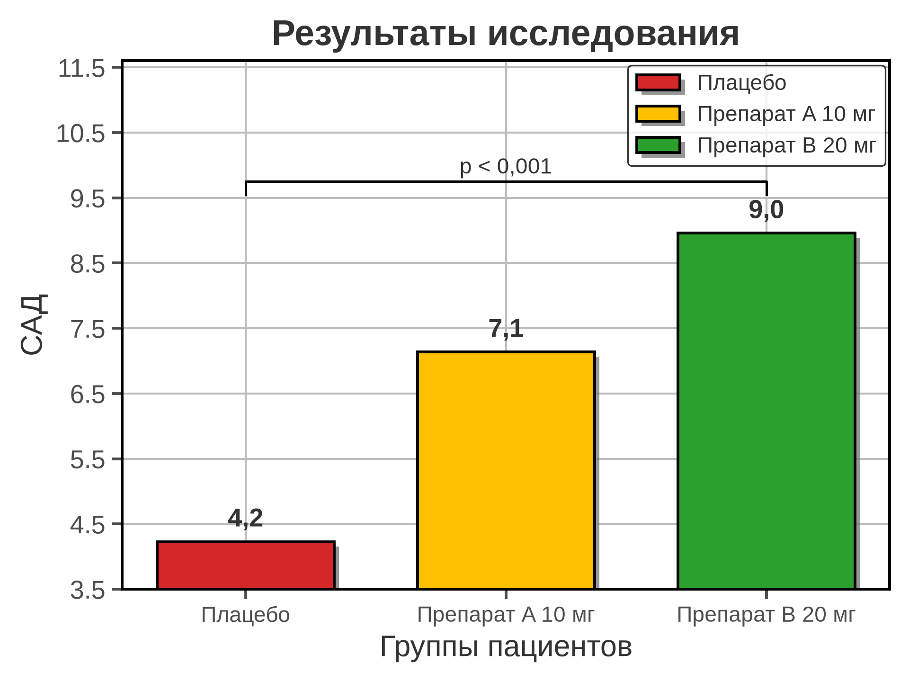
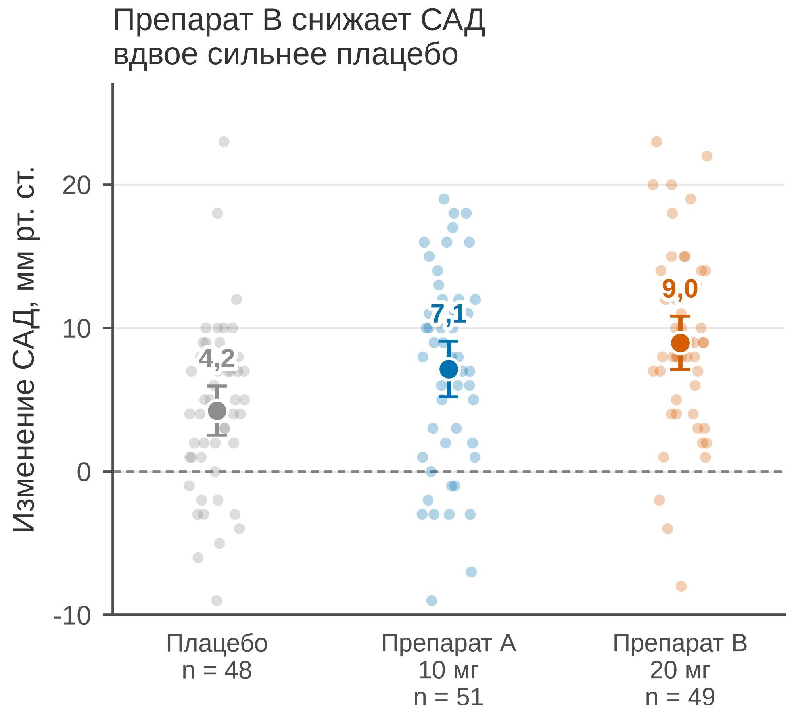

# Раздел 1. Принципы качественной научной графики

График в научной работе — не украшение и не «картинка к тексту». Это способ
рассуждения о данных: читатель должен за несколько секунд увидеть закономерность,
оценить её величину и понять, насколько ей можно доверять. Поэтому разговор
о графике начинается не с библиотек и не с цветов, а с вопроса: **что именно
читатель должен понять и какое решение принять?**

Этот раздел задаёт систему координат для всей методички. Сначала — смысловые
принципы: честность, контекст, неопределённость, иерархия. Затем — нормативы
и оформление: размеры, шрифты, цвет, единицы, подписи. В конце — разбор одного
и того же результата в двух версиях: «плохой» и «правильной».

> Все данные в примерах синтетические. Они правдоподобны по единицам и величинам,
> но не описывают реальных пациентов.

## 1.1 «Правильный» и «качественный»: два разных требования

Полезно развести два прилагательных, которые часто используют как синонимы.

**Правильный график** (valid, truthful) — тот, который не искажает данные
и не нарушает нормы:

- масштаб осей соответствует типу кодирования;
- статистика показана корректно (есть *n*, разброс, определение ошибок);
- единицы измерения указаны;
- подпись самодостаточна;
- рисунок соответствует требованиям журнала или ГОСТ.

**Качественный график** (effective, craft) — тот, который решает задачу читателя:

- сообщение считывается за несколько секунд;
- визуальная иерархия ведёт взгляд от главного к второстепенному;
- палитра доступна при дальтонизме и в чёрно-белой печати;
- шрифты и размеры комфортны в конечном физическом размере;
- график согласован с остальными рисунками работы;
- результат воспроизводим по данным и коду.

Эти требования независимы. График может быть правильным, но бесполезным:
аккуратные столбики с *n*, SD и единицами, по которым невозможно ничего
сравнить. И наоборот: эффектный график с градиентами и тенями может быть
красивым, но лживым. Методичка — о том, как удержать оба требования
одновременно.

**Главный тезис.** График проектируется от вопроса читателя и структуры данных,
а не от возможностей библиотеки. Matplotlib умеет рисовать 3D-пончики; это
не аргумент в пользу 3D-пончиков.

## 1.2 Смысловые принципы

### 1.2.1 Сначала сообщение, потом график

Перед первой строкой кода сформулируйте одно предложение:

> «После этого графика читатель должен понять, что препарат B снижает САД
> примерно вдвое сильнее плацебо, и что разброс между пациентами велик».

Если предложение не формулируется, график, скорее всего, не нужен: данные
лучше показать таблицей. Если предложений два, это два графика или две панели
A и B.

Из этого следуют практические правила:

- **Заголовок — вывод, а не тема.** «Результаты исследования» сообщает ноль
  информации. «Препарат B снижает САД вдвое сильнее плацебо» — сообщает вывод
  и заодно объясняет, что читать на графике.
- **Один график — одна мысль.** Если хочется показать и динамику, и сравнение
  групп, и корреляцию, — это три панели, а не один «комбайн».
- **Главное — крупнее и контрастнее.** Основная серия или эффект должны
  визуально доминировать; вспомогательные — уходить на второй план.
- **Читатель не обязан знать контекст.** График должен работать вместе
  с подписью, но не вместо неё.

Заголовок внутри рисунка — спорная территория. Для слайдов, отчётов и внутренних
документов он полезен. Для журнальной публикации многие редакции предпочитают
не дублировать заголовок в изображении и в подписи: содержательный вывод
переносят в caption. Проверяйте гайд журнала; в этой методичке заголовок
оставлен как дидактический приём.

### 1.2.2 Форму определяют данные

Тип графика — не вкусовое решение. Он определяется:

- типом переменных (категориальные, непрерывные, временные, парные);
- числом наблюдений и групп;
- наличием распределения, выбросов, цензурирования;
- задачей: сравнить, показать связь, распределение, динамику, состав.

Минимальная таблица соответствия:

| Задача | Рекомендуемая форма | Почему |
|---|---|---|
| Сравнить несколько категорий | точка с доверительным интервалом, полоса, столбцы | положение читается точнее длины |
| Показать распределение | гистограмма, ECDF, box, violin, strip | виден разброс и форма, а не только среднее |
| Связь двух непрерывных | диаграмма рассеяния, hexbin, contour | видна форма зависимости и выбросы |
| Динамика во времени | линия; small multiples для многих серий | время должно идти по оси X |
| Доля целого | stacked bar, 100 % bar; круговая — только для 3–5 долей | углы и площади читаются хуже длины |
| Матрица значений | heatmap с ограниченной палитрой | цвет кодирует величину, но требует шкалы |
| Парные измерения | slope chart, paired dot plot | видно направление изменения у каждого объекта |
| Оценки и неопределённость | forest plot | компактно показывает эффект и ДИ |
| Выживаемость | Kaplan–Meier с числом рисков | цензурирование нельзя игнорировать |
| Диагностическая точность | ROC-кривая, precision–recall | зависит от prevalence |
| Многомерные наблюдения | small multiples, PCA/biplot (осторожно) | уменьшение размерности меняет интерпретацию |

Подробный разбор видов графиков — в разделе 4, примеры с кодом — в разделе 5.

Полезно помнить «грамматику графики» (Wilkinson, 1999; ggplot2): данные →
эстетические отображения → геометрия → шкалы → грани. Matplotlib мыслит
императивно («нарисуй линию здесь»), ggplot2 и plotnine — декларативно
(«свяжи x и y, сгруппируй по цвету»). Оба подхода допустимы; декларативный
лучше защищает от несогласованности, императивный — даёт полный контроль.

### 1.2.3 Честность масштаба

Это самый частый источник визуальной лжи — и самый простой для исправления.

**Столбцы кодируют длину.** Длина обязана начинаться с нуля. Если ось Y
обрезана, читатель сравнивает не значения, а обрезки. Пример из раздела 1.4:
средние 4,2 и 9,0 мм рт. ст., ось начинается с 3,5. Визуально препарат B
«в 7,5 раза больше» плацебо, хотя в данных разница в 2,1 раза. Коэффициент
искажения (lie factor, Tufte):

*LF* = (5,46 / 0,73) / (8,96 / 4,23) ≈ 3,5.

Значения LF заметно выше 1 или заметно ниже 1 означают искажение; Tufte
предлагал считать допустимым диапазон примерно 0,95–1,05.

**Точки и линии кодируют положение.** Для них нулевая отметка не обязательна:
если весь смысл в изменении на 2–3 единицы, растянутая ось помогает увидеть
тренд. Но у этого есть условия:

- ось явно подписана, диапазон не скрывает важный контекст;
- читатель не принят за дурака: обрезка не маскирует выбросы и не создаёт
  ложный «обвал» или «взлёт»;
- для сравнения нескольких серий шкалы одинаковы, если это возможно.

**Логарифмическая шкала** допустима для величин, которые меняются
мультипликативно (титры антител, вирусная нагрузка, концентрации), и только
для положительных значений. Она обязана быть подписана: «лог. шкала, основание
10». Логарифм не «улучшает» график — он меняет вопрос, на который тот отвечает.

**Разрыв оси** допустим как крайняя мера для выбросов, с явными метками разрыва.
Для столбцов — недопустим: он ломает длину. **Две оси Y** на одном графике
почти всегда создают ложную корреляцию: две произвольно масштабированные
величины всегда можно «подогнать» так, чтобы линии пересеклись в нужном месте.
Если без этого нельзя обойтись, кодируйте оси цветом, подписывайте единицы
и объясняйте, почему две панели хуже.

**Пропорции.** Для временных рядов удачный приём — «banking to 45°»: выбирать
соотношение сторон так, чтобы типичный наклон тренда был около 45°. Слишком
широкий график сглаживает изменения, слишком узкий — драматизирует. Для
сравнения наклонов в scatter-plot полезна квадратная область.

### 1.2.4 Неопределённость, распределение и *n*

Столбик со средним и «усиками» — не универсальный график. У него есть
презрительное, но точное название — *dynamite plot*: он скрывает форму
распределения, число наблюдений и выбросы. Weissgerber и соавторы (2015)
показали, как часто такие графики искажают картину в биомедицинских статьях.

Что показывать:

- ***n* для каждой группы** — в подписи или на оси.
- **Разброс**: отдельные точки при небольшом *n*, box/violin или strip при
  большем, SD/CI — как дополнение, а не замена.
- **Определение ошибок**: SD, SEM и 95 % ДИ — разные вещи.

| Обозначение | Что характеризует | Как читать |
|---|---|---|
| SD | разброс наблюдений вокруг среднего | «насколько разные пациенты» |
| SEM | точность выборочного среднего, SD/√*n* | «насколько точно измерено среднее», не разброс |
| 95 % ДИ | неопределённость среднего | при повторных выборках накрывал бы истинное среднее в 95 % случаев |

Частая ошибка — подписать «mean ± SEM», а в тексте интерпретировать как
«разброс». Ещё чаще — использовать 95 % ДИ как «диапазон, в котором лежат
95 % данных»: это неверно, для этого нужен интервал предсказания или
перцентили.

Для парных измерений (до/после у одного пациента) столбики независимых групп
теряют связь между наблюдениями. Показывайте пары: slope chart или paired
dot plot. Для скошенных данных — медиана и межквартильный интервал, а не
среднее и SD.

И наконец: **эффект и его неопределённость важнее p-значения**. «*p* < 0,05»
не говорит, насколько велик эффект и насколько он клинически значим.
Показывайте разницу средних, отношение рисков, hazard ratio — с 95 % ДИ.

### 1.2.5 Контекст и воспроизводимость

График без контекста — головоломка. Минимальный набор:

- единицы измерения на осях и в подписи;
- *n* и способ формирования групп;
- что означают ошибки/полосы;
- статистический тест или модель, если они упомянуты;
- программное обеспечение и версия (для воспроизводимости);
- доступность данных и кода, если это допускает журнал.

Дополнительно:

- **Согласованность групп.** Один и тот же цвет и порядок групп во всех
  рисунках статьи. Читатель не должен каждый раз заново расшифровывать легенду.
- **Нормализация.** «Относительно контроля» — относительно какого контроля,
  что именно делили, что делать с нулями? Всё это — в подпись.
- **Пропуски.** Если данные исключены, покажите сколько и почему.
- **Версии.** «Построено в Python 3.12, matplotlib 3.11, seaborn 0.13» —
  дешёвая и полезная строка в подписи или supplementary.

### 1.2.6 Иерархия, минимализм и декор

Эдвард Тафти ввёл два полезных понятия: **data-ink ratio** (доля «чернил»,
которая кодирует данные) и **chartjunk** (декор, не несущий информации).
Практический вывод: убирайте всё, что не помогает читать данные.

Что обычно лишнее:

- тени, псевдо-3D, градиенты, не кодирующие величину;
- тяжёлая сетка по обеим осям и полная рамка;
- легенда, дублирующая подписи оси;
- декоративные иконки, фоны, текстуры;
- подписи «Рисунок 1» внутри изображения;
- несколько акцентных цветов без семантики.

Но минимализм — не самоцель. Убрать единицы, *n* или подпись оси — это
не минимализм, а потеря информации. Хороший график не «пустой», а
**иерархичный**:

1. данные — самый контрастный слой;
2. оси, подписи, аннотации — средний;
3. сетка, рамки, фон — самый бледный.

Полезные приёмы:

- **прямые подписи** вместо легенды, если серий немного;
- **один акцентный цвет** для главного вывода, серый — для контекста;
- **лёгкая сетка** только по той оси, где она помогает читать значения;
- **белое пространство** как способ группировки, а не «пустота».

### 1.2.7 Доступность

Около 8 % мужчин европейского происхождения имеют нарушения цветового зрения
(протанопия или дейтеранопия); среди женщин доля ниже, но не нулевая. В зале
на 250 человек, по оценке Color Universal Design, может быть больше десяти
человек с дальтонизмом. Рецензент тоже может быть одним из них.

Правила:

- **Не кодировать смысл только цветом.** Дублируйте формой маркера, типом
  линии, прямой подписью, штриховкой.
- **Использовать палитры, проверенные на дальтонизм**: Okabe–Ito, Paul Tol,
  viridis/cividis для последовательных шкал.
- **Проверять в оттенках серого.** Если после обесцвечивания серии
  неразличимы — добавить форму или подпись.
- **Контраст.** Для текста — не ниже 4,5:1, для графических объектов —
  не ниже 3:1 (WCAG 2.1).
- **Кегль в конечном размере.** Шрифт 6 pt, который «нормально смотрится»
  на экране в 200 %, в журнале превратится в нечитаемую полосу.
- **Alt-текст** для веб-версий и доступных PDF.

### 1.2.8 Согласованность

Серия рисунков в статье должна выглядеть как один документ, а не как
коллаж из разных статей. Единый визуальный язык:

- одна гарнитура и 2–3 кегля;
- одна палитра и одно соответствие «цвет → группа»;
- одинаковые толщины линий, размеры маркеров, стиль сетки;
- одинаковое расположение меток панелей (A, B, C) — слева сверху;
- одинаковый десятичный разделитель и формат дат;
- одинаковые единицы и сокращения.

Если на рисунке 1 плацебо серое, на рисунке 2 оно тоже серое. Если на рисунке
3 появился новый препарат — он получает новый цвет, а не переиспользует
цвет старого.

### 1.2.9 Проверка «пять секунд — тридцать секунд — пять минут»

Быстрый тест перед отправкой:

1. **Пять секунд.** Что читатель понял? Если ответ «какие-то столбики» —
   график не работает.
2. **Тридцать секунд.** Можно ли прочитать значения, единицы, *n* и понять,
   что означают усы? Если нет — не хватает подписей.
3. **Пять минут.** Можно ли восстановить, как получены данные, что такое
   ошибки, есть ли выбросы и не противоречит ли график тексту? Если нет —
   подпись не самодостаточна.

## 1.3 Нормативы и оформление

### 1.3.1 Какие документы задают правила

Иерархия проста: **требования журнала важнее ГОСТ**, если вы отправляете
статью. ГОСТ и локальные шаблоны — для диссертаций, отчётов о НИР и внутренних
документов.

| Документ | Что регулирует | Комментарий |
|---|---|---|
| Гайд журнала (Instructions for Authors) | размеры, шрифты, форматы, число рисунков, captions | всегда проверяйте перед отправкой |
| ICMJE Recommendations | общие нормы медицинских журналов, подготовка рукописи | [icmje.org](https://www.icmje.org/recommendations/) |
| EQUATOR Network | отчётные стандарты (CONSORT, STROBE, PRISMA, ARRIVE) | [equator-network.org](https://www.equator-network.org/) |
| COPE | публикационная этика, целостность изображений | [publicationethics.org](https://publicationethics.org/) |
| ГОСТ 7.32-2017 | отчёт о НИР: структура, рисунки, подписи | [docs.cntd.ru](https://docs.cntd.ru/document/1200160119) |
| ГОСТ 2.105-95 | ЕСКД: общие требования к текстовым документам | [docs.cntd.ru](https://docs.cntd.ru/document/1200007600) |
| ГОСТ 8.417-2002 | единицы величин | [docs.cntd.ru](https://docs.cntd.ru/document/1200031406) |

Отчётные стандарты важны не только для текста. CONSORT требует схему потока
участников, STROBE — аккуратного описания выборки, PRISMA — блок-схему
отбора исследований, ARRIVE — деталей экспериментов на животных. Это тоже
«научная графика», и к ней предъявляются те же требования.

**Целостность изображений.** Нельзя selectively enhance, замазывать,
склеивать фрагменты без явных границ, менять яркость так, чтобы исчезали
детали. Любая обработка — в подписи или supplementary. Это прямая норма
COPE и ICMJE, а не «стилистика».

### 1.3.2 Размер, разрешение, формат

**Проектируйте в конечном размере.** Если рисунок будет шириной 85 мм,
не рисуйте его в 16 дюймов и не уменьшайте в Word: шрифты и толщины
превратятся в лотерею.

| Параметр | Типичное требование | Комментарий |
|---|---|---|
| Ширина | 85–90 мм (1 колонка), 170–183 мм (2 колонки) | Nature: 89 и 183 мм |
| Шрифт | sans-serif, 7–10 pt в конечном размере | нижняя граница 5–7 pt у отдельных журналов |
| Линии | 0,25–1 pt | тоньше 0,25 pt может исчезнуть при печати |
| Растр | 300 dpi для фото, 600–1200 dpi для штриховых | TIFF/PNG, без JPEG для линий |
| Вектор | PDF, EPS, SVG, AI | предпочтительно для графиков и схем |
| Цвет | RGB/sRGB для онлайн, CMYK для печати | конвертировать в конце, проверять gamut |
| Поля | 3–5 мм | чтобы подписи не обрезались |

Практические следствия:

- **Не скриншот.** Экспорт из Python, R, GraphPad, Origin — но не снимок
  экрана: скриншот теряет вектор и разрешение.
- **Шрифты — в кривые или встраивать.** Для SVG удобно `svg.fonttype = "path"`;
  для PDF — `pdf.fonttype = 42`, чтобы текст оставался редактируемым, но
  не подменялся при просмотре.
- **Не масштабировать непропорционально.** Растянутый по ширине график
  меняет восприятие наклонов и пропорций.
- **Проверять в 100 %.** Откройте итоговый PDF при реальном размере и
  посмотрите, читаются ли деления и легенда.

### 1.3.3 Шрифты

Для рисунков почти всегда лучше **sans-serif**: Arial, Helvetica, Liberation
Sans, DejaVu Sans. Они плотнее и лучше читаются в мелком кегле, чем засечные
гарнитуры.

| Элемент | Ориентир |
|---|---|
| Заголовок внутри рисунка | 9–10 pt |
| Подписи осей | 8–9 pt |
| Деления и подписи делений | 7–8 pt |
| Легенда | 7–8 pt |
| Подпись к рисунку (caption) | 8–9 pt, обычно в тексте, не в изображении |

Правила:

- одна гарнитура на весь рисунок и, желательно, на всю статью;
- не писать подписи КАПСОМ — это замедляет чтение;
- не делать всё жирным: жирный — только для акцента;
- не использовать тонкие начертания (Light, Thin) в мелком кегле;
- проверить кириллицу и специальные символы: µ, ±, ≥, ≤, →, °C;
- математические переменные — курсивом (*p*, *n*, *M*), единицы — прямым;
- не смешивать в одном рисунке разные семейства шрифтов без причины.

### 1.3.4 Цвет

Цвет должен **кодировать смысл**, а не оживлять картинку.

Три типа палитр:

- **качественная** — для категорий (группы, препараты, регионы);
- **последовательная** — для упорядоченных значений (концентрация, время);
- **дивергентная** — для отклонений от нуля/нормы (изменение, разница).

Базовый набор, который стоит запомнить, — палитра Okabe–Ito:

| Цвет | HEX | Разумная роль |
|---|---|---|
| оранжевый | `#E69F00` | категория 1 |
| небесно-голубой | `#56B4E9` | категория 2 |
| сине-зелёный | `#009E73` | категория 3 |
| жёлтый | `#F0E442` | категория 4 (только с тёмным контуром) |
| синий | `#0072B2` | основной результат |
| вермилион | `#D55E00` | акцент/второй результат |
| красновато-фиолетовый | `#CC79A7` | категория 5 |
| чёрный | `#000000` | текст, оси, а не серии |

Правила:

- не больше 6–8 категориальных цветов; больше — объединяйте или делайте
  small multiples;
- не используйте «радугу» и `jet`: она создаёт ложные границы и не
  воспринимается равномерно;
- не кодируйте противоположные категории только красным и зелёным;
- серый — для контроля, фона и «прочего»; он не должен конкурировать
  с данными;
- проверяйте рисунок в градациях серого и через симулятор дальтонизма;
- фон — белый (для печати), без тёмных тем;
- контраст графических объектов — не ниже 3:1.

Для последовательных шкал используйте `viridis`, `cividis`, `Blues`, `Greens`;
для дивергентных — `RdBu_r`, `PuOr`, `BrBG` с симметричным диапазоном
относительно нуля. Центр дивергентной шкалы должен совпадать с содержательным
нулём, а не с серединой диапазона данных.

### 1.3.5 Единицы, числа, статистика

- **СИ и общепринятые медицинские единицы.** «мм рт. ст.» — внесистемная,
  но допустимая в медицине единица; «мг/кг», «ммоль/л», «уд/мин».
- **Пробел между числом и единицей:** 8,9 мм рт. ст., 10 мг, 5 %, 37 °C.
  Исключения — знаки градусов угла и некоторые типографские случаи.
- **Десятичный разделитель.** В русском тексте — запятая, в англоязычных
  журналах — точка. Главное — единообразие в пределах работы. В коде и CSV
  обычно точка; в подписях рисунка — по языку публикации.
- **Ведущий ноль:** 0,05, а не ,05.
- **Тысячи:** 12 000, а не 12000, в тексте; в осях можно 12 000
  или 12 тыс.
- **Средние:** *M* ± SD; медиана и IQR: Me [Q1; Q3]; доли: *n* (%).
- **p-значение:** *p* = 0,032, а не «p<0.05» без точного значения, если
  журнал не требует иначе. Курсив для *p*, *n*, *M*.
- **Сокращения** расшифровывайте при первом упоминании в подписи.

### 1.3.6 Подписи к рисункам

Подпись — не «название файла», а самостоятельный текст. Хорошая структура:

1. **Что показано** — одно предложение с выводом или темой.
2. **Как показано** — группы, *n*, что означают точки/столбцы/усы.
3. **Определения** — ошибки, сокращения, статистический тест.
4. **Источник/ПО** — данные, код, версия, при необходимости.

Плохо:

> Рисунок 1. Результаты.

Хорошо:

> **Рисунок 1.** Снижение систолического АД через 12 недель терапии.
> Точки — индивидуальные значения пациентов, маркеры — среднее, усы —
> 95 % доверительный интервал (t-распределение). Плацебо — *n* = 48,
> препарат A 10 мг — *n* = 51, препарат B 20 мг — *n* = 49. Штриховая
> линия — отсутствие изменения. Данные синтетические; код —
> `01_principles/scripts/good_plot.py`.

Формальные детали:

- в ГОСТ 7.32 подпись обычно начинается с «Рисунок 1 — Название» (с тире);
- в англоязычных журналах — «Figure 1. ...»;
- подпись располагается под рисунком, а не внутри изображения;
- точка в конце подписи — по стилю журнала;
- ссылка в тексте — до появления рисунка: «(рисунок 1)» или «(Fig. 1)».

### 1.3.7 Чек-лист перед отправкой

- [ ] Заголовок/подпись сообщают вывод, а не «результаты».
- [ ] Тип графика соответствует задаче и структуре данных.
- [ ] Столбцы начинаются с нуля; обрезка осей объяснена.
- [ ] Логарифмическая шкала подписана.
- [ ] Нет двух осей Y без крайней необходимости.
- [ ] Показаны *n*, разброс и определение ошибок.
- [ ] Единицы указаны на осях и в подписи.
- [ ] Цвета различимы при дальтонизме и в градациях серого.
- [ ] Шрифт ≥ 7 pt в конечном размере; кириллица и символы не потеряны.
- [ ] Ширина соответствует колонке журнала (85/170 мм или гайд).
- [ ] Вектор или растр ≥ 300 dpi; нет скриншотов.
- [ ] Верхняя и правая рамки, тяжёлая сетка, тени и 3D убраны.
- [ ] Легенда не дублирует подписи и не закрывает данные.
- [ ] Подпись самодостаточна: группы, *n*, тест, сокращения.
- [ ] Рисунок согласован с другими рисунками по палитре и шрифтам.
- [ ] Нет искажений изображения и необъявленной обработки.
- [ ] Файлы названы по схеме журнала; формат и цветовой профиль проверены.
- [ ] Рисунок проверен в PDF при 100 % масштабе.

## 1.4 Один результат — два графика

Ниже — один и тот же набор данных: 148 пациентов, три группы, изменение САД
через 12 недель. Слева — «плохая» версия, справа — «правильная». Обе построены
по одному CSV; различается только код визуализации.

### 1.4.1 Плохой график



Код: [`bad_plot.py`](scripts/bad_plot.py). Данные: [`00_dataset.csv`](../data/00_dataset.csv).

### 1.4.2 Что с ним не так

1. **Обрезанная ось.** Столбцы начинаются с 3,5 мм рт. ст., а не с нуля.
   Визуальное отношение B/плацебо — около 7,5, реальное — 2,1. Lie factor ≈ 3,5.
2. **Светофорная палитра.** Красный — жёлтый — зелёный не только неразличим
   при протанопии/дейтеранопии, но и навязывает оценку «плохо — средне —
   хорошо», которой в данных нет.
3. **Тени и псевдо-3D.** Тень не кодирует ни одну переменную; она лишь
   утяжеляет нижнюю часть столбцов и мешает сравнивать высоту.
4. **Тяжёлая сетка по обеим осям.** Сетка конкурирует с данными; вертикальные
   линии вообще не помогают читать столбцы.
5. **Полная рамка и жирные линии.** Визуальный шум, который не несёт смысла.
6. **Легенда дублирует подписи.** Названия групп уже написаны под столбцами;
   легенда занимает место и закрывает часть данных.
7. **Заголовок «Результаты исследования».** Он не сообщает, что именно
   показано и какой вывод должен сделать читатель.
8. **Нет единиц, *n*, разброса и определения ошибок.** «САД» — это что:
   исходное, конечное, изменение? В каких единицах? Сколько пациентов?
9. **Только средние.** Без индивидуальных точек и ДИ нельзя понять,
   насколько велик разброс и насколько устойчива разница.
10. **p < 0,001 без теста и эффекта.** Значимость не заменяет величину
    эффекта; не указано, какой тест применялся и какие группы сравнивались.

### 1.4.3 Правильный график



Код: [`good_plot.py`](scripts/good_plot.py).

### 1.4.4 Что улучшено

1. **Точечная оценка вместо длины.** Средние показаны точками, а не
   столбцами; обрезать ось больше не нужно, ложной разницы не возникает.
2. **Нулевая линия.** Штриховая линия на нуле показывает отсутствие эффекта
   и помогает оценить клиническую значимость.
3. **Индивидуальные наблюдения.** Полупрозрачные точки показывают разброс,
   выбросы и то, что у части пациентов САД выросло.
4. **Среднее и 95 % ДИ.** Видна неопределённость оценки; в подписи указано,
   что это t-интервал.
5. **Семантическая палитра.** Серый — контроль, синий — препарат A,
   вермилион — препарат B. Цвета различимы при дальтонизме, а подписи групп дублируют цвет.
6. **Прямые подписи и *n*.** Названия групп и число пациентов — прямо под
   осью; легенда не нужна.
7. **Заголовок-вывод.** «Препарат B снижает САД вдвое сильнее плацебо»
   сразу задаёт вопрос, на который отвечает график.
8. **Единицы и десятичная запятая.** «Изменение САД, мм рт. ст.» — без
   догадок; числа в русской типографике.
9. **Иерархия.** Лёгкая сетка только по Y, нет верхней и правой рамок,
   данные контрастнее осей.
10. **Журнальный размер.** 85 мм в ширину, кегли 7–9,5 pt; рисунок
    спроектирован в конечном размере, а не уменьшен из «слайда».

### 1.4.5 Сопоставление

| Что было | Почему плохо | Что сделано |
|---|---|---|
| ось Y от 3,5 | длина столбца искажена, LF ≈ 3,5 | точки + нулевая линия |
| красный/жёлтый/зелёный | ложная семантика, CVD | Okabe–Ito: серый/синий/вермилион |
| тени, 3D | декор, искажает площадь | плоские маркеры |
| сетка по X и Y | шум, конкуренция с данными | сетка только по Y, бледная |
| полная рамка | визуальный шум | только левая и нижняя оси |
| легенда | дублирует подписи, закрывает данные | прямые подписи под осью |
| «Результаты исследования» | нет сообщения | заголовок-вывод |
| нет единиц и *n* | невозможно прочитать | единицы, *n* в подписях |
| только средние | скрыт разброс | точки + среднее + 95 % ДИ |
| p < 0,001 | нет теста и эффекта | эффект и ДИ; тест — в подписи |

Пара честных оговорок:

- График показывает изменение от исходного уровня, но не заменяет
  статистическую модель. Для сравнения групп с поправкой на исходное САД
  нужен ANCOVA или смешанная модель; рисунок этого не «исправляет».
- При *n* ≈ 50 точек на группу strip plot может выглядеть шумно. Альтернативы —
  box/violin с точками, half-violin, или среднее с ДИ на фоне распределения.
  Выбор зависит от сообщения и от того, что важнее: форма распределения
  или компактность.

### 1.4.6 Как воспроизвести

```bash
# из корня репозитория
uv sync
uv run python 01_principles/scripts/make_data.py
uv run python 01_principles/scripts/bad_plot.py
uv run python 01_principles/scripts/good_plot.py
```

Ключевой фрагмент «правильного» кода:

```python
from goodgraph import apply_style, figure_size, save_figure

apply_style()
fig, ax = plt.subplots(
    figsize=figure_size("single", ratio=0.90),
    layout="constrained",
)

# ... точки, средние, 95 % ДИ ...

ax.set_ylabel("Изменение САД, мм рт. ст.")
ax.set_title("Препарат B снижает САД\nвдвое сильнее плацебо", loc="left")
save_figure(fig, "01_good_dot_ci")  # images/01_good_dot_ci.svg + .png
```

Доверительный интервал считается через t-распределение, а не «среднее ± 2 SE»:

```python
from scipy import stats

se = sd / np.sqrt(n)
half_width = stats.t.ppf(0.975, df=n - 1) * se
ci_low, ci_high = mean - half_width, mean + half_width
```

Для больших *n* разница с нормальным приближением мала, но t-интервал
корректнее при *n* ≈ 50 и менее.

## 1.5 Итоги раздела

Десять тезисов, которые стоит запомнить:

1. График — аргумент, а не украшение; сначала сообщение, потом код.
2. Тип графика определяется задачей и структурой данных.
3. Столбцы — с нуля; точки и линии — могут без нуля, но с объяснением.
4. Логарифм, разрыв оси и две оси Y — только осознанно и с подписями.
5. Показывайте *n*, разброс и неопределённость; определяйте, что такое усы.
6. Эффект и 95 % ДИ важнее p-значения.
7. Убирайте chartjunk, но не путайте минимализм с потерей информации.
8. Цвет — смысл; палитра должна работать при дальтонизме и в сером.
9. Подпись самодостаточна; рисунок согласован с остальными.
10. Проектируйте в конечном размере и проверяйте в PDF при 100 %.

Дальше — инструменты. В разделе 2 разберём, как это реализуется в Python:
matplotlib, seaborn, plotnine, настройка среды через `uv` и типичные
архитектурные решения для воспроизводимых графиков.

## Источники к разделу

- Tufte E. R. *The Visual Display of Quantitative Information*. Graphics Press,
  1983. — [edwardtufte.com](https://www.edwardtufte.com/tufte/books_vdqi)
- Cleveland W. S., McGill R. Graphical Perception: Theory, Experimentation, and
  Application to the Development of Graphical Methods // *JASA*. 1984.
  Vol. 79, № 387. P. 531–554. —
  [doi:10.1080/01621459.1984.10478080](https://doi.org/10.1080/01621459.1984.10478080)
- Wilke C. O. *Fundamentals of Data Visualization*. O’Reilly, 2019. —
  [clauswilke.com/dataviz](https://clauswilke.com/dataviz/)
- Cairo A. *The Truthful Art: Data, Charts, and Maps for Communication*.
  New Riders, 2016. — [thefunctionalart.com](https://www.thefunctionalart.com/)
- Schwabish J. *Better Data Visualizations: A Guide for Scholars, Researchers,
  and Wonks*. Columbia University Press, 2021. —
  [policyviz.com](https://policyviz.com/books/better-data-visualizations/)
- Okabe M., Ito K. Color Universal Design (CUD): How to Make Figures and
  Presentations that are Friendly to Colorblind People. 2008. —
  [jfly.uni-koeln.de/color](https://jfly.uni-koeln.de/color/)
- ColorBrewer 2.0 — [colorbrewer2.org](https://colorbrewer2.org/)
- Weissgerber T. L. et al. Beyond Bar and Line Graphs: Time for a New Data
  Presentation Paradigm // *PLoS Biology*. 2015. Vol. 13, № 4. e1002128. —
  [doi:10.1371/journal.pbio.1002128](https://doi.org/10.1371/journal.pbio.1002128)
- ICMJE Recommendations — [icmje.org](https://www.icmje.org/recommendations/)
- EQUATOR Network — [equator-network.org](https://www.equator-network.org/)
- Nature. Formatting guide — [nature.com](https://www.nature.com/nature/for-authors/formatting-guide)
- W3C. WCAG 2.1, Understanding SC 1.4.11 Non-text Contrast —
  [w3.org](https://www.w3.org/WAI/WCAG21/Understanding/non-text-contrast.html)
- ГОСТ 7.32-2017 — [docs.cntd.ru](https://docs.cntd.ru/document/1200160119)
- ГОСТ 2.105-95 — [docs.cntd.ru](https://docs.cntd.ru/document/1200007600)
- ГОСТ 8.417-2002 — [docs.cntd.ru](https://docs.cntd.ru/document/1200031406)
