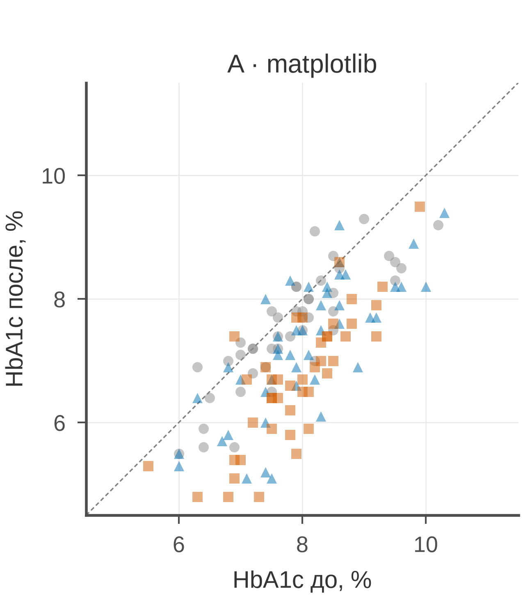
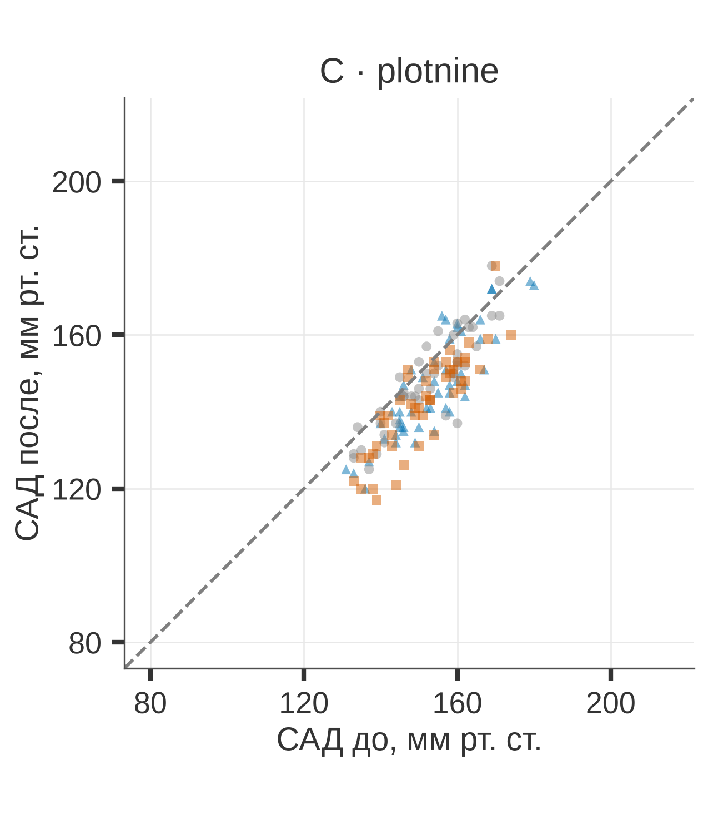

# Раздел 2. Python-инструментарий и настройка среды

В разделе 1 мы обсудили основные принципы научной графики. Каким должен быть график?
Честным, читаемым, доступным и воспроизводимым. Настало время для выьора инструментария,
средств для рисования графиков.

Теперь — чем его рисовать. Безусловно, существует множество как бесплатных, так и платных
программ для построения графиков. Например, всегда можно использовать возможности
электронных таблиц с “живой” графикой, реагирующей на изменения данных. Имеются такие
монстры, как OriginLab, MatLab, GNUPlot, ParaView и многие другие, Каждый с собственными
возможностями и даже характером. Стоило бы отметить, что графики могут быть либо
сгенерированы как статичные картинки, либо отражать представленные данные “в реальном
времени, вживую” по принципу WYSIWYG, Сам сгенерированный график может представлять собой
как статичную картинку, так и иерархию редактируемых объектов.

По мнению авторов, хотя живая графика является более наглядной, ее качество уступает
сгенерированной статичной картинке. Зачастую, особнно при сложной визуализации данных,
живая графика может оказаться даже более медленной, а усилия по ее настройке могут быть не
меньшими, чем написание небольшого программного кода. С другой стороны, живая графика
может быть очень полезна при визуализации данных, которые изменяются со временем.

Работа с данными часто предполагает работу в команде и необходимость встраиваться в
команду и ее рабочие процессы, а также выдавать стабильный результат в повторяющихся
проектах. В таких условиях программируемая генерация графики оказывается очень полезной.
Стандартом де-факто в аналитике данных является использование языка программирования
Python. В свою очередь, Python, несмотря на огромное разнообразие модулей и библиотек,
предлагает несколько наиболее распространенных основных модулей для построения графиков, В
частности, это matplotlib и seaborn.

Matplotlib — это библиотека для построения графиков, которая позволяет создавать графики в
Python, а seaborn - ее дполнение для построения прежде всего статистическихграфиков.

Задача этого раздела — не выучить все функции matplotlib, а понять, **как устроен стек** и
**как получить воспроизводимый результат** из любого места: с ноутбука, из CI, с другого
компьютера.

Хорошая новость: инструменты не определяют качество графика. Плохой график можно сделать и
в matplotlib, и в ggplot2. Но разные библиотеки по-разному заставляют думать о данных.
Matplotlib даёт полный контроль и требует дисциплины. Seaborn берёт на себя статистику и
группы. Plotnine заставляет описать график как композицию слоёв. Выбор — не религия, а
вопрос задачи.

> Все примеры раздела используют собственный набор `data/02_python_dataset.csv` (HbA1c,
> 132 пациента). Данные синтетические и предназначены только для иллюстративных целей.

## 2.1 Карта экосистемы

| **Инструмент** | **Роль** | **Документация** | **Когда нужен** |
|----|----|----|----|
| Python 3.12 | язык и рантайм | [docs.python.org](https://docs.python.org/3/) | всегда |
| uv | окружения, зависимости, версии Python | [docs.astral.sh/uv](https://docs.astral.sh/uv/) | всегда |
| NumPy | массивы, векторизованная математика | [numpy.org/doc](https://numpy.org/doc/stable/) | расчёты, генерация данных |
| pandas | таблицы, groupby, CSV | [pandas.pydata.org](https://pandas.pydata.org/docs/) | загрузка и агрегация |
| SciPy | статистика, распределения, тесты | [docs.scipy.org](https://docs.scipy.org/doc/scipy/) | доверительные интервалы, тесты |
| matplotlib | рендеринг, Figure/Axes, artists | [matplotlib.org](https://matplotlib.org/stable/) | полный контроль, финальная правка |
| seaborn | статистические графики, long-format | [seaborn.pydata.org](https://seaborn.pydata.org/) | EDA, группы, распределения |
| plotnine | грамматика ggplot2, фасеты, слои | [plotnine.org](https://plotnine.org/) | многопанельные и декларативные графики |
| adjustText | подписи без наложений | [adjusttext.readthedocs.io](https://adjusttext.readthedocs.io/) | точечные подписи |
| Pillow | растр, композит, конвертация | [pillow.readthedocs.io](https://pillow.readthedocs.io/) | сборка панелей, проверка PNG |

Стек удобно представлять так:

```
numpy / pandas / scipy
        ↓  данные и статистика
matplotlib (Figure, Axes, artists)
        ↓  рендеринг
seaborn / plotnine
        ↓  грамматика, статистика, фасеты
goodgraph (rcParams, палитры, размеры, save)
        ↓
SVG / PNG / PDF
```

Дело в том, что **seaborn и plotnine в итоге рисуют через matplotlib**. Поэтому понимание
`Figure`/`Axes`, `rcParams` и `savefig` полезно даже тем, кто пишет только на plotnine. И
наоборот: matplotlib не мешает использовать seaborn для статистики, а потом дорабатывать
оси вручную.

## 2.2 Три подхода к одному графику

### 2.2.1 matplotlib: императивный контроль

Matplotlib — низкоуровневый движок. Вы создаёте `Figure` (холст), `Axes` (область с осями)
и добавляете artists: линии, точки, текст, стрелки, патчи. Каждый элемент — объект с
координатами и свойствами.

```python
import matplotlib.pyplot as plt

fig, ax = plt.subplots(figsize=(3.35, 2.8), layout="constrained")

for group, part in df.groupby("group"):
    ax.scatter(
        part["baseline_hba1c_pct"],
        part["followup_hba1c_pct"],
        s=12,
        alpha=0.5,
        label=group,
    )

ax.set_xlabel("HbA1c до, %")
ax.set_ylabel("HbA1c после, %")
ax.legend(frameon=False)
fig.savefig("scatter.svg")
```

Сильные стороны:

- полный контроль над каждым элементом;
- аннотации, врезки, стрелки, произвольные artists;
- предсказуемое поведение при экспорте;
- огромная экосистема примеров.

Слабые стороны:

- многословно;
- статистика и группировка — вручную;
- легко получить несогласованные рисунки, если каждый скрипт настраивает оси по-своему;
- глобальное состояние `pyplot` (`plt.plot`, `plt.xlim`) может «протечь» из одного рисунка в другой.

Практическое правило: в скриптах используйте **объектный API** (`fig, ax =
plt.subplots()`), а не `plt.plot`. Глобальный `pyplot` удобен в интерактивной консоли, но
плохо предсказуем в воспроизводимом пайплайне.

### 2.2.2 seaborn: данные и статистика

Seaborn — надстройка над matplotlib, ориентированная на таблицы данных. Вы передаёте
`data=` и имена колонок, а не массивы; `hue`, `style`, `size`, `col`, `row` автоматически
кодируют группы и создают фасеты.

```python
import seaborn as sns

sns.scatterplot(
    data=df,
    x="baseline_hba1c_pct",
    y="followup_hba1c_pct",
    hue="group",
    style="group",
    ax=ax,
)
```

Сильные стороны:

- статистические преобразования «из коробки»: средние, доверительные интервалы, регрессии, KDE;
- аккуратные умолчания для категориальных групп;
- быстрый EDA и разведочные графики;
- интеграция с matplotlib через `ax=`.

Слабые стороны:

- меньше контроля над отдельными artists;
- темы seaborn (`sns.set_theme`) **перезаписывают** rcParams matplotlib;
- API статистики менялся между версиями (`ci` → `errorbar`), поэтому примеры из старых статей могут не работать;
- легко получить «красиво, но не по журнальному»: крупные шрифты, лишние линии, тени.

Практическое правило: seaborn — для исследования и быстрых статистических сводок;
финальную правку удобнее делать в matplotlib.

### 2.2.3 plotnine: грамматика графики

Plotnine — реализация грамматики графики (Wilkinson; ggplot2) для Python. График
описывается декларативно: данные → эстетические отображения → геометрия → шкалы →
координаты → фасеты → тема.

```python
from plotnine import *

(
    ggplot(df, aes("baseline_hba1c_pct", "followup_hba1c_pct", color="group"))
    + geom_point(alpha=0.5)
    + labs(x="HbA1c до, %", y="HbA1c после, %")
    + theme_bw()
)
```

Сильные стороны:

- декларативность: вы описываете **что**, а не **как**;
- фасеты (`facet_wrap`, `facet_grid`) и согласованные шкалы;
- легко менять геометрию, не переписывая код;
- хорошо ложится на многопанельные статьи и воспроизводимые отчёты.

Слабые стороны:

- требует tidy/long-формата данных;
- меньше контроля над отдельными artists, чем в matplotlib;
- своя система тем, не полностью совпадающая с rcParams;
- часть возможностей ggplot2 отличается или называется иначе;
- ошибки в слоях иногда появляются только на этапе отрисовки.

Практическое правило: plotnine — для структурированных многопанельных графиков и случаев,
где важна декларативная воспроизводимость.

### 2.2.4 Сравнение

| **Критерий** | **matplotlib** | **seaborn** | **plotnine** |
|----|----|----|----|
| Уровень | низкий | средний | высокий |
| Стиль | императивный | дата-ориентированный | декларативный |
| Контроль над artists | максимальный | средний | средний/низкий |
| Статистика «из коробки» | нет | да | частично |
| Фасеты | вручную | `col`/`row` | `facet_wrap`/`facet_grid` |
| Кривая обучения | средняя | низкая | средняя |
| Лучше всего для | финальной правки, аннотаций | EDA, групп, распределений | структуры, multi-panel |

Эти средства не исключают друг друга. Типичный пайплайн: seaborn или plotnine для
черновика, matplotlib для финальной правки, `goodgraph` — для единого стиля.

## 2.3 Один набор данных — три библиотеки

Чтобы сравнение не осталось теоретическим, один и тот же набор (HbA1c до и после 12
недель, 132 пациента) построен трижды. Код — `02_python/scripts/compare_libraries.py`. Вы
едва ли заметите разницу между всеми тремя графиками, хотя они сипользуют различные
библиотеки






*Рисунок 2.1. Один и тот же набор данных в трёх библиотеках: A — matplotlib, B — seaborn,
C — plotnine. Серые круги — плацебо, синие треугольники — препарат A 10 мг, вермилионовые
квадраты — препарат B 20 мг; штриховая линия — равенство HbA1c до и после. Данные —
`data/02_python_dataset.csv`.*

Что здесь важно:

- **Общие пределы и деления.** Все панели используют `xlim/ylim = 4,5–11,5` и деления 6/8/10. Иначе сравнение было бы нечестным.
- **Общая палитра и формы.** Цвет и форма маркера заданы один раз и повторены во всех библиотеках. Это принцип согласованности из раздела 1.
- **Разный объём кода.** Matplotlib требует явного цикла по группам; seaborn — одного вызова с `hue`/`style`; plotnine — описания слоёв и темы. Но результат один и тот же, потому что стиль вынесен наружу.
- **Размер панели 54 × 62 мм.** Три панели по 54 мм с промежутками дают ширину около 170 мм. Это пример проектирования в конечном размере, а не «нарисуем большое и уменьшим».

Ключевые фрагменты:

```python
# matplotlib: цикл по группам
for group in GROUP_ORDER:
    part = df.loc[df["group"] == group]
    ax.scatter(part["baseline_hba1c_pct"], part["followup_hba1c_pct"],
               marker=GROUP_MARKERS[group], color=GROUP_COLORS[group])

# seaborn: одна функция, группы через hue/style
sns.scatterplot(data=df, x="baseline_hba1c_pct", y="followup_hba1c_pct",
                hue="group", style="group", ax=ax)

# plotnine: слои через «+»
(
    ggplot(df, aes("baseline_hba1c_pct", "followup_hba1c_pct",
                   color="group", shape="group"))
    + geom_point(alpha=0.5)
    + geom_abline(slope=1, intercept=0, linetype="dashed")
    + coord_fixed(ratio=1, xlim=(80, 215), ylim=(80, 215))
    + theme_bw()
)
```

Нетрудно видеть, что seaborn строит график минимальным количеством кода. В plotnine это
делается с помощью слоев. Наиболее многословной конструкцией отличается matplotlib.

## 2.4 uv: окружение и воспроизводимость

### 2.4.1 Что такое uv

Использование Python-проектов предполагает, что вы используете интерпретатор языка,
подгружаете нужные вам библиотеки через Интернет, и пишете свой код, в расчете на
определенную версию интерпретатора и пакетов. Часто для обслуживания проектов используются
менеджеры пакетов, например `pip` — менеджер пакетов от Python.

В последнее время получил распространение `uv` — менеджер пакетов и окружений от Astral,
написанный на Rust. Он заменяет связку `pip` + `venv` + `pip-tools` + `pyenv` и умеет:

- создавать виртуальные окружения;
- разрешать и фиксировать зависимости (`uv.lock`);
- скачивать и переключать версии Python;
- запускать скрипты и инструменты (`uv run`, `uvx`);
- работать в CI и на чужих машинах.

Документация: [docs.astral.sh/uv](https://docs.astral.sh/uv/). В этом репозитории
используется uv 0.12 и Python 3.12; точные версии пакетов зафиксированы в `uv.lock`.

### 2.4.2 Установка менеджера пакетов UV

```bash
# Linux / macOS
curl -LsSf https://astral.sh/uv/install.sh | sh

# Windows PowerShell
powershell -c "irm https://astral.sh/uv/install.ps1 | iex"

# Если уже есть pipx или Homebrew
pipx install uv
brew install uv

uv --version
```

Если нужной версии Python нет:

```bash
uv python install 3.12
uv python list
```

`uv` скачает интерпретатор в свой каталог и не тронет системный Python.

### 2.4.3 Новый проект

```bash
mkdir my-figure && cd my-figure
uv init --python 3.12
uv add matplotlib seaborn plotnine pandas numpy scipy
uv add --dev ruff pytest
uv run python -c "import matplotlib; print(matplotlib.__version__)"
```

Что появилось:

- `pyproject.toml` — метаданные проекта и зависимости;
- `.python-version` — закреплённая версия Python;
- `uv.lock` — точное дерево зависимостей с хешами;
- `.venv/` — виртуальное окружение (не коммитится).

`uv add` одновременно обновляет `pyproject.toml`, `uv.lock` и окружение. `uv sync`
приводит окружение в соответствие с lock-файлом.

### 2.4.4 `pyproject.toml` этого репозитория

Сокращённый вид:

```toml
[project]
name = "goodgraph"
version = "0.1.0"
requires-python = ">=3.12,<3.13"
dependencies = [
    "numpy>=2.0",
    "pandas>=2.2",
    "matplotlib>=3.9",
    "seaborn>=0.13",
    "plotnine>=0.13",
    "scipy>=1.13",
]

[dependency-groups]
dev = ["ruff>=0.6", "pytest>=8.0"]

[tool.uv]
package = true
```

Полная версия с `[build-system]` и `[tool.hatch.build.targets.wheel]` — в
`pyproject.toml`.

Что здесь важно:

- `requires-python` задаёт **диапазон**, а `.python-version` — конкретную версию для разработки;
- `uv.lock` фиксирует точные версии; его нужно коммитить;
- `[tool.uv] package = true` и `src/`-layout означают, что пакет `goodgraph` устанавливается в окружение редактируемым (`pip install -e`);
- `[dependency-groups] dev` — инструменты разработки, которые не нужны читателю в рантайме.

### 2.4.5 Повседневные команды

| **Команда** | **Что делает** |
|----|----|
| `uv sync` | создаёт/обновляет `.venv` по `uv.lock` |
| `uv sync --frozen` | не меняет lock, падает при расхождении — для CI |
| `uv add pandas` | добавляет зависимость и обновляет lock |
| `uv add --dev ruff` | добавляет в dev-группу |
| `uv remove pandas` | удаляет зависимость |
| `uv lock` | пересчитывает lock |
| `uv lock --upgrade` | обновляет версии в пределах ограничений |
| `uv run python script.py` | запускает в окружении проекта |
| `uv run --with rich script.py` | добавляет пакет только на запуск |
| `uv python pin 3.12` | фиксирует версию Python |
| `uv tree` | показывает дерево зависимостей |
| `uv pip list` | список установленного |
| `uvx ruff check .` | запускает инструмент без установки в проект |

`uv run` не требует активации окружения. Если привычнее `source .venv/bin/activate`, это
тоже работает; но в скриптах и CI `uv run` надёжнее — он гарантирует нужное окружение.

### 2.4.6 Одноразовые скрипты и PEP 723

Если скрипт не входит в проект, зависимости можно объявить прямо в нём:

```python
# /// script
# requires-python = ">=3.12"
# dependencies = ["matplotlib", "pandas"]
# ///

import matplotlib.pyplot as plt
import pandas as pd
```

Запуск:

```bash
uv run plot.py
```

`uv` создаст временное окружение с указанными пакетами и выполнит скрипт. Это удобно для
примеров в статье или для утилиты, которую не хочется тащить в основной `pyproject.toml`.
Спецификация — [PEP 723](https://peps.python.org/pep-0723/).

### 2.4.7 Воспроизводимость и кеш

Правила:

- коммитить `pyproject.toml`, `uv.lock`, `.python-version`;
- не коммитить `.venv/`;
- в CI использовать `uv sync --frozen` и `uv run ...`;
- обновлять зависимости осознанно: `uv lock --upgrade`, затем прогнать тесты и пересобрать рисунки;
- фиксировать системные зависимости отдельно: шрифты, Cairo, LaTeX, Graphviz — uv их не устанавливает.

В песочнице или CI с read-only домашним каталогом задайте локальные пути:

```bash
export UV_CACHE_DIR="$PWD/.uv-cache"
export UV_PYTHON_INSTALL_DIR="$PWD/.uv-python"
export MPLCONFIGDIR="$PWD/.mplconfig"
```

В этом репозитории такие каталоги уже добавлены в `.gitignore`.

## 2.5 Анатомия воспроизводимого графика

### 2.5.1 Четыре слоя

```
data/02_python_dataset.csv
      ↓  make_data.py: seed, генерация, CSV
      ↓  plot.py: pandas/scipy, агрегация
      ↓  goodgraph.style: rcParams, палитра, размер
      ↓  matplotlib / seaborn / plotnine
      ↓  save_figure: SVG + PNG
images/01_good_dot_ci.svg, .png
```

Принципы:

1.  **Данные не знают о графике.** `make_data.py` пишет CSV и не импортирует matplotlib.
2.  **График не генерирует данные.** `plot.py` читает CSV; если данных нет — падает с понятной ошибкой.
3.  **Стиль — отдельный слой.** Один `apply_style()` и одна палитра на всю методичку.
4.  **Экспорт — отдельная функция.** `save_figure()` сохраняет SVG и PNG, закрывает фигуру и печатает пути.

### 2.5.2 Каркас скрипта

```python
from __future__ import annotations

import matplotlib

matplotlib.use("Agg")  # без дисплея

import matplotlib.pyplot as plt

from goodgraph import apply_style, figure_size, save_figure
from goodgraph.paths import DATA_DIR

apply_style()
fig, ax = plt.subplots(
    figsize=figure_size("single", ratio=0.8),
    layout="constrained",
)
# ... данные и слои ...
save_figure(fig, "02_example")
```

`figure_size("single")` возвращает размер в дюймах для 85 мм; `save_figure` сохраняет
`images/02_example.svg` и `images/02_example.png` с dpi 600 и закрывает фигуру. Если нужен
точный физический размер, не включайте `tight=True`: обрезка полей меняет ширину.

### 2.5.3 Что задаёт `apply_style`

| **Параметр** | **Значение** | **Зачем** |
|----|----|----|
| `font.family` | Liberation Sans, Arial, DejaVu Sans | кириллица, метрики Arial |
| `font.size` | 9 pt (paper) | журнальный кегль |
| `axes.spines.top/right` | False | меньше визуального шума |
| `axes.grid` | True, только Y | помогает читать значения |
| `grid.color` | `#E6E6E6` | сетка не конкурирует с данными |
| `axes.prop_cycle` | Okabe–Ito | доступная палитра по умолчанию |
| `svg.fonttype` | `path` | текст не «поплывёт» в SVG |
| `pdf.fonttype` | 42 | TrueType в PDF, текст редактируем |
| `savefig.dpi` | 600 | достаточный растр |
| `axes.unicode_minus` | False | совместимость со шрифтами |

### 2.5.4 Порядок применения стилей

Порядок важен, потому что настройки перекрывают друг друга:

1.  значения по умолчанию matplotlib;
2.  `plt.style.use("...")`, если он используется;
3.  `sns.set_theme(...)` — **сбрасывает** многие rcParams;
4.  `apply_style(...)` — должен идти последним;
5.  точечные переопределения в конкретном графике.

Если вызвать `sns.set_theme()` после `apply_style()`, шрифты, рамки и сетка могут
вернуться к умолчаниям seaborn. Если нужна тема seaborn — передайте её параметры в
`apply_style` или настройте rcParams после `set_theme`.

Plotnine живёт в своей системе тем. `theme(text=element_text(...))` не читает все rcParams
matplotlib; задавайте шрифт и размеры явно.

## 2.6 Разбор `compare_libraries.py`

Скрипт `02_python/scripts/compare_libraries.py` устроен так:

1.  **Общие константы.** `WIDTH_MM = 54`, `HEIGHT_MM = 62`, `LIM_MIN = 80`, `LIM_MAX = 215`, `TICKS = [80, 120, 160, 200]`. Одинаковые пределы — обязательное условие честного сравнения.
2.  **Палитра и формы.** `GROUP_COLORS` и `GROUP_MARKERS` заданы один раз; цвет дублируется формой, чтобы панели читались в сером.
3.  **`load_data()`.** Читает `data/02_python_dataset.csv` и проверяет, что все группы на месте.
4.  **`style_axes()`.** Общая функция для matplotlib и seaborn: пределы, деления, линия равенства, подписи, сетка, аспект.
5.  **Три функции построения.** `plot_matplotlib`, `plot_seaborn`, `plot_plotnine` — каждая самодостаточна и сохраняет свою пару SVG/PNG.
6.  **`main()`.** Последовательно вызывает три функции.

Почему это важно: если каждая панель настраивает пределы сама, сравнение превращается в
сравнение разных графиков. Общая функция `style_axes` фиксирует контракт.

## 2.7 Типичные ошибки и как их исправить

### 2.7.1 `plt.show()` в скрипте

```python
# плохо: скрипт зависит от дисплея
plt.show()

# хорошо: Agg + сохранение
matplotlib.use("Agg")
fig.savefig("figure.png", dpi=600)
```

`show()` полезен в интерактивной консоли; в скрипте, CI и на сервере он либо блокирует
выполнение, либо падает без дисплея.

### 2.7.2 Глобальное состояние `pyplot`

```python
# плохо: неясно, какая фигура сохраняется
plt.plot(x, y)
plt.title("...")
plt.savefig("a.png")
plt.plot(x2, y2)
plt.savefig("b.png")  # на самом деле обе линии на одной фигуре

# хорошо: явные объекты
fig, ax = plt.subplots()
ax.plot(x, y)
fig.savefig("a.png")
plt.close(fig)
```

### 2.7.3 `sns.set_theme()` после `apply_style()`

```python
# плохо: тема seaborn перезапишет шрифты и рамки
apply_style()
sns.set_theme(style="whitegrid")

# хорошо: сначала тема, потом свой стиль
sns.set_theme(style="whitegrid")
apply_style()
```

### 2.7.4 `tight_layout` и `constrained_layout` вместе

```python
# плохо: конфликтующие движки компоновки
fig, ax = plt.subplots(layout="constrained")
fig.tight_layout()

# хорошо: один движок
fig, ax = plt.subplots(layout="constrained")
```

### 2.7.5 `bbox_inches="tight"` и точная ширина

```python
# плохо для журнальной ширины: итоговый размер может отличаться от 85 мм
fig.savefig("figure.svg", bbox_inches="tight")

# хорошо: размер задан figsize, поля — полями
fig.savefig("figure.svg")
```

`tight` удобен для слайдов и препринтов, но не для точного соответствия колонке журнала.

### 2.7.6 Шрифт не найден

```python
from matplotlib import font_manager

print(font_manager.findfont("Liberation Sans"))
```

Если шрифт не найден, matplotlib молча подставит DejaVu Sans и предупредит. Проверяйте
`findfont` и наличие кириллицы. В Linux установите `fonts-liberation`, в Windows
используйте Arial.

### 2.7.7 SVG с текстом или с кривыми

- `svg.fonttype = "path"` — текст превращается в кривые: вид стабилен, но текст нельзя редактировать.
- `svg.fonttype = "none"` — текст остаётся текстом: удобно для правки, но зависит от шрифтов у читателя.

Для журнала обычно выбирают `path`; для внутренней правки — `none`. В этом проекте по
умолчанию `path`.

### 2.7.8 Единицы plotnine

```python
# плохо: дюймы и миллиметры перепутаны
plot.save("figure.png", width=85, height=60)

# хорошо: перевести миллиметры в дюймы
plot.save("figure.png", width=85 / 25.4, height=60 / 25.4, dpi=600)
```

`plotnine.save` принимает ширину и высоту в дюймах, как и matplotlib.

### 2.7.9 Данные не в tidy-формате

Plotnine ожидает long-формат: одна строка — одно наблюдение, колонки — переменные. Широкая
таблица `group, before, after` подойдёт для matplotlib, но для plotnine её нужно привести
к `group, time, value` через `melt`.

### 2.7.10 DPI и цветовой профиль

- DPI влияет только на растр; для SVG/PDF он не важен.
- RGB → CMYK лучше конвертировать в конце, после утверждения макета; проверьте, что цвета не «провалились» в печати.
- Прозрачный фон (`transparent=True`) почти никогда не нужен для журнала: белый фон предсказуемее.

## 2.8 Чек-лист раздела 2

- [ ] `uv sync --frozen` работает на чистой машине.
- [ ] `pyproject.toml`, `uv.lock`, `.python-version` закоммичены.
- [ ] `.venv/` не закоммичен.
- [ ] Скрипт использует `matplotlib.use("Agg")`.
- [ ] Данные и построение разделены: `make_data.py` ≠ `plot.py`.
- [ ] `apply_style()` вызывается один раз и последним.
- [ ] Нет `sns.set_theme()` после `apply_style()`.
- [ ] Пределы осей и палитра заданы явно, а не «по умолчанию».
- [ ] Сохраняются SVG и PNG; размер — в миллиметрах, не «как получилось».
- [ ] Шрифт найден, кириллица и символы (µ, ±, ≥) отображаются.
- [ ] `uv run python ...` работает из корня репозитория.
- [ ] `uv run ruff check .` проходит.
- [ ] Повторный запуск даёт те же данные и рисунки (фиксированный seed).

## 2.9 Итоги

- **matplotlib** — фундамент и полный контроль; используйте объектный API.
- **seaborn** — быстрый доступ к статистике и группам; не заменяет matplotlib, а дополняет его.
- **plotnine** — грамматика графики и фасеты; требует tidy-данных и отдельной темы.
- **uv** — воспроизводимость: версия Python, lock-файл, `uv run`, `uv sync --frozen`.
- **goodgraph** — единый стиль и экспорт; это контракт между разделами.

Дальше — раздел 3: требования к цвету, шрифтам, размерам и форматам. Там мы разберём
палитры подробнее, научимся проверять рисунок на дальтонизм и печать и соберём таблицу
«параметр → значение → источник».

## Источники к разделу

- Matplotlib documentation — [matplotlib.org](https://matplotlib.org/stable/)
- Matplotlib: Quick start guide — [matplotlib.org](https://matplotlib.org/stable/users/explain/quick_start.html)
- Matplotlib: Artists — [matplotlib.org](https://matplotlib.org/stable/users/explain/artists/index.html)
- Seaborn documentation — [seaborn.pydata.org](https://seaborn.pydata.org/)
- Seaborn tutorial — [seaborn.pydata.org/tutorial](https://seaborn.pydata.org/tutorial.html)
- Plotnine documentation — [plotnine.org](https://plotnine.org/)
- Plotnine reference — [plotnine.org/reference](https://plotnine.org/reference/)
- uv documentation — [docs.astral.sh/uv](https://docs.astral.sh/uv/)
- uv: Working on projects — [docs.astral.sh/uv/guides/projects](https://docs.astral.sh/uv/guides/projects/)
- uv: Running scripts — [docs.astral.sh/uv/guides/scripts](https://docs.astral.sh/uv/guides/scripts/)
- PEP 723: Inline script metadata — [peps.python.org/pep-0723](https://peps.python.org/pep-0723/)
- Wilkinson L. *The Grammar of Graphics*. 2nd ed. Springer, 2005. — [doi:10.1007/0-387-28695-0](https://doi.org/10.1007/0-387-28695-0)
- ggplot2 documentation — [ggplot2.tidyverse.org](https://ggplot2.tidyverse.org/)
- Rougier N. P., Droettboom M., Bourne P. E. Ten Simple Rules for Better Figures // *PLoS Computational Biology*. 2014. Vol. 10, № 9. e1003833. — [doi:10.1371/journal.pcbi.1003833](https://doi.org/10.1371/journal.pcbi.1003833)
- pandas documentation — [pandas.pydata.org](https://pandas.pydata.org/docs/)
- NumPy documentation — [numpy.org/doc](https://numpy.org/doc/stable/)
- SciPy documentation — [docs.scipy.org](https://docs.scipy.org/doc/scipy/)
- adjustText documentation — [adjusttext.readthedocs.io](https://adjusttext.readthedocs.io/)
- Pillow documentation — [pillow.readthedocs.io](https://pillow.readthedocs.io/)
