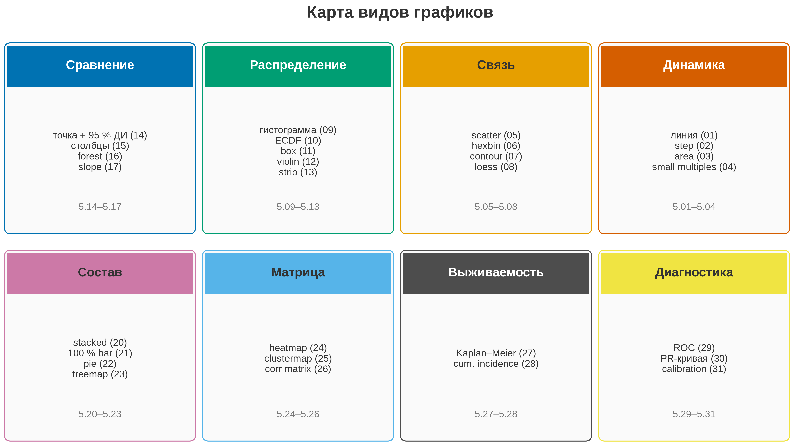

# Раздел 4. Основные виды научных графиков и области применения

Выбор вида графика — первый проектный шаг, и его почти нельзя исправить оформлением. Если
для сравнения групп выбран график распределения, читатель не увидит сравнения; если для
динамики — столбцы по категориям, он не увидит времени. Здесь — мы рассматриваем только
стратегию выбора, своего рода **карту**, а не учебник: мы разбираем семейства графиков, их
вопросы и ограничения, а подробные разборы с данными, «плохими» и «правильными» версиями
будут в разделе 5.

В разделе 5 каждый **отдельный график** формируется как минипроект - в своей папке, для
него имеется свой генератор данных `make_data.py`, который формирует отдельный набор
`data/NN_dataset.csv`. На нашей карте отдельная карточка — это семейство; внутри него
несколько графиков (например, линия, step, area и small multiples), и каждый станет
отдельным разделом. Данные одного графика не переиспользуются в другом.

## 4.1 Пять вопросов перед выбором графика

Полезно задать себе пять вопросов — желательно в этом порядке, чтобы четче выразить суть
будущего графика.

1.  **Какой вопрос я задаю данным?** Сравнить группы, описать распределение, показать связь, динамику, состав, структуру, время до события, качество теста?
2.  **Какие переменные имеются?** Категориальные, непрерывные, временные, парные, цензурированные?
3.  **Сколько наблюдений и групп?** 10 точек или 10 000? Одна группа или двадцать?
4.  **Что важнее читателю?** Точное значение, ранг, форма распределения, неопределённость, наличие выбросов?
5.  **Что читатель должен уметь прочитать и понять?** Величину эффекта, разброс, доверительный интервал, порог, число рисков?

Если ответ на первый вопрос не формулируется, график, скорее всего, не нужен: данные лучше
показать таблицей.

## 4.2 Карта семейств



*Рисунок 4.1. Карта семейств: вопрос, примеры графиков и номер раздела 5, где вид будет
разобран подробно. Карта не заменяет таблицу выбора — она показывает связи между вопросами
и формами.*

| **Семейство** | **Вопрос** | **Графики (раздел 5)** | **Ограничения** |
|----|----|----|----|
| Сравнение | «Кто больше и насколько?» | точка + 95 % ДИ (5.14), столбцы (5.15), forest (5.16), slope (5.17) | столбцы скрывают распределение; нужна нулевая база |
| Распределение | «Как устроена выборка?» | гистограмма (5.09), ECDF (5.10), box (5.11), violin (5.12), strip (5.13) | ширина бинов; box скрывает бимодальность; violin требует *n* |
| Связь | «Есть ли зависимость?» | scatter (5.05), hexbin (5.06), contour (5.07), loess (5.08) | overplotting; корреляция ≠ причинность |
| Динамика | «Как меняется во времени?» | линия (5.01), step (5.02), area (5.03), small multiples (5.04) | нерегулярные интервалы; нельзя соединять категории |
| Состав | «Из чего состоит целое?» | stacked bar (5.20), 100 % bar (5.21), pie (5.22), treemap (5.23) | части должны суммироваться; pie — максимум 5 долей |
| Матрица | «Где значения велики или малы?» | heatmap (5.24), clustermap (5.25), correlation matrix (5.26) | масштаб, кластеризация, colorbar |
| Выживаемость | «Когда происходит событие?» | Kaplan–Meier (5.27), cumulative incidence (5.28) | цензурирование, at-risk, конкурирующие риски |
| Диагностика | «Насколько хорош тест?» | ROC (5.29), precision–recall (5.30), calibration (5.31) | prevalence, порог, доверительные интервалы |
| Парные измерения | «Как меняется у каждого?» | slope chart (5.17), paired dot (5.18), Bland–Altman (5.19) | парность, пропущенные пары |
| Оценки эффекта | «Какой эффект и насколько он точен?» | forest (5.16), caterpillar (5.32), funnel (5.33) | лог-шкала для отношений, гетерогенность |

## 4.3 Семейства подробнее

### 4.3.1 Сравнение

Вопрос: «Кто больше, насколько и насколько уверенно?»

Хорошие формы:

- **точка + 95 % ДИ** — лучше столбцов, потому что положение точки читается точнее длины, а интервал показывает неопределённость (здесь и далее **ДИ** - доверительный интервал);
- **forest plot** — для нескольких оценок и эффектов;
- **slope chart** — для парных измерений;
- **столбцы** — только если нулевая база обязательна и распределение не главное.

Что следует отобразить: показывать эффект и ДИ, а не только *p*; не обрезать ось у
столбцов; не скрывать *n* и разброс. Подробно — 5.14, 5.15, 5.16, 5.17.

### 4.3.2 Распределение

Вопрос: «Как устроена выборка: центр, разброс, форма, выбросы?»

Формы:

- **гистограмма** — форма распределения, но зависит от ширины бинов;
- **ECDF** — точное чтение квантилей и сравнение выборок;
- **box** — компактно, но скрывает бимодальность и размер выборки;
- **violin** — форма, но требует достаточного *n* и может вводить в заблуждение при малых группах;
- **strip / swarm** — отдельные точки, лучше при малых *n*;
- **raincloud** — комбинация, но не для каждого журнала.

Подробно — 5.09–5.13.

### 4.3.3 Связь

Вопрос: «Меняется ли одна величина вместе с другой?»

Формы:

- **scatter** — базовая форма; при больших *n* — **hexbin** или **contour**;
- **loess/regression** — тренд, но не заменяет точки;
- **log-шкалы** — если связь мультипликативная;
- **small multiples** — если есть третья категориальная переменная.

На что обратить внимание: не путать корреляцию с причинностью, показывать *n* и выбросы,
не использовать две оси Y. Подробно — 5.05–5.08.

### 4.3.4 Динамика

Вопрос: «Как величина меняется во времени?»

Формы:

- **линия** — регулярные интервалы, одна или несколько серий;
- **step** — измерения «до/после» или дискретные события;
- **area** — накопленный итог, но не для сравнения многих серий;
- **small multiples** — много серий или групп;
- **individual trajectories** — если важна гетерогенность.

На что смотреть: время — по оси X; не соединяйте линии через категории; показывайте
пропуски и нерегулярность; не начинайте ось с произвольного значения без объяснения.
Подробно — 5.01–5.04.

### 4.3.5 Состав

Вопрос: «Из чего состоит целое и как доли меняются?»

Формы:

- **stacked bar** — состав по группам;
- **100 % bar** — сравнение долей;
- **pie** — только 3–5 долей, и только если сумма долей действительно 100 %;
- **treemap** — иерархический состав;
- **alluvial/Sankey** — потоки, но требуют осторожности.

На что смотреть: части должны суммироваться в целое; круговая диаграмма плохо читается при
многих долях и почти всегда проигрывает полосам. Подробно — 5.20–5.23.

### 4.3.6 Матрица и многомерность

Вопрос: «Где значения велики, где структура, где корреляции?»

Формы:

- **heatmap** — матрица значений; обязательна цветовая шкала с единицами;
- **clustermap** — порядок строк/столбцов подсказывает структуру, но кластеризация субъективна;
- **correlation matrix** — только как дополнение, не как доказательство;
- **PCA/biplot** — уменьшение размерности, но интерпретация меняется;
- **small multiples / parallel coordinates** — альтернатива «радуге».

Подробно — 5.24–5.26.

### 4.3.7 Выживаемость

Вопрос: «Когда происходит событие и как различаются группы?»

Формы:

- **Kaplan–Meier** — кривые выживаемости;
- **cumulative incidence** — конкурирующие риски;
- **forest plot** — hazard ratio;
- **at-risk table** — число под риском по времени.

На что смотреть: цензурирование, число рисков, доверительные интервалы, log-rank/Cox,
проверка пропорциональности. Кривые без at-risk table и без числа событий читаются плохо.
Подробно — 5.27–5.28.

### 4.3.8 Диагностика

Вопрос: «Насколько хорош тест и при каком пороге?»

Формы:

- **ROC** — чувствительность/специфичность, но зависит от prevalence;
- **precision–recall** — лучше при сильном дисбалансе классов;
- **calibration** — соответствие предсказанных и наблюдаемых вероятностей;
- **decision curve** — клиническая полезность.

На что смотреть: указывать prevalence, порог, ДИ, число наблюдений; AUROC — не
единственная метрика. Подробно — 5.29–5.31.

### 4.3.9 Парные измерения

Вопрос: «Как меняется каждый объект?»

Формы:

- **slope chart** — линии «до/после» для каждого пациента;
- **paired dot plot** — пары точек;
- **Bland–Altman** — согласие методов, а не корреляция.

На что смотреть: не анализировать парные данные как независимые группы; показывать
пропущенные пары. Подробно — 5.17–5.19.

### 4.3.10 Оценки эффекта и неопределённость

Вопрос: «Какой эффект и насколько он точен?»

Формы:

- **forest plot** — оценки и ДИ для нескольких групп/исследований;
- **caterpillar** — много оценок;
- **funnel** — публикационное смещение, но только при достаточном числе исследований.

На что смотреть: эффект + ДИ, лог-шкала для отношений (OR, RR, HR), гетерогенность, а не
только *p*. Подробно — 5.16, 5.32–5.33.

## 4.4 Когда таблица лучше графика

График не всегда выигрывает. Таблица лучше, если:

- значений мало (3–8) и нужна точная выборка;
- единицы разные и график требует нескольких осей;
- важны точные цифры, а не форма;
- категорий слишком много для читаемой палитры;
- данные неполные или несопоставимые.

Практическое правило: **если таблица отвечает на вопрос быстрее и точнее, делайте
таблицу**. График — для закономерностей, сравнений и формы, а не для переписывания чисел.

## 4.5 Антипаттерны выбора

| **Антипаттерн** | **Почему плохо** | **Альтернатива** |
|----|----|----|
| 3D-столбцы и 3D-круг | перспектива искажает длину/площадь | 2D |
| Круговая с 8–12 долями | углы и площади читаются плохо | полосы, stacked bar |
| Столбцы с SD/SEM | скрывают распределение и *n* | точки, box, violin |
| Обрезанная ось у столбцов | искажает длину | нулевая база или точки |
| Линия по категориям | навязывает порядок | столбцы/точки |
| Две оси Y | ложная корреляция | две панели или индекс |
| Scatter на 100 000 точек | overplotting | hexbin, density, contour |
| ROC без prevalence | AUROC не отражает клиническую пользу | PR, calibration |
| Kaplan–Meier без at-risk | хвост кривой не интерпретируется | at-risk table |
| Heatmap без шкалы | цвет не читается | colorbar, contour |
| Radar chart | площадь/угол искажают | small multiples, bar |
| Word cloud | площадь не пропорциональна | bar |
| 100 % stacked на 20 категорий | невозможно сравнить | small multiples |

## 4.6 Что дальше: как устроен раздел 5

Раздел 5 — практическая часть. Каждый вид графика реализуется (“живёт”) в своей папке:

```
05_charts/01_line/
├── README.md
├── line.md
├── line.typ
└── scripts/
    ├── make_data.py   # свой генератор → data/01_dataset.csv
    ├── bad_plot.py    # неудачный график → images/05_01_bad_line.*
    └── good_plot.py   # правильный график → images/05_01_good_line.*
```

В каждом разборе будет представлено следующее:

1.  сфера применения и типичные вопросы;
2.  реалистичные синтетические данные с единицами и диапазонами;
3.  неудачный график и разбор ошибок;
4.  правильный график и объяснение улучшений;
5.  чек-лист и связь с нормативами.

План:

| **Семейство** | **Разделы 5** |
|----|----|
| Динамика | 5.01 линия, 5.02 step, 5.03 area, 5.04 small multiples |
| Связь | 5.05 scatter, 5.06 hexbin, 5.07 contour, 5.08 loess |
| Распределение | 5.09 гистограмма, 5.10 ECDF, 5.11 box, 5.12 violin, 5.13 strip |
| Сравнение | 5.14 точка + ДИ, 5.15 столбцы, 5.16 forest, 5.17 slope |
| Состав | 5.20 stacked bar, 5.21 100 % bar, 5.22 pie, 5.23 treemap |
| Матрица | 5.24 heatmap, 5.25 clustermap, 5.26 correlation matrix |
| Выживаемость | 5.27 Kaplan–Meier, 5.28 cumulative incidence |
| Диагностика | 5.29 ROC, 5.30 precision–recall, 5.31 calibration |
| Парные | 5.17 slope, 5.18 paired dot, 5.19 Bland–Altman |
| Оценки эффекта | 5.16 forest, 5.32 caterpillar, 5.33 funnel |

Полный индекс с папками и данными — в `05_charts/README.md`. Порядок может меняться по
запросу. Каждый график получает **свой** генератор и **свой** датасет; переиспользование
CSV между графиками исключается.

## 4.7 Чек-лист выбора графика

- [ ] Вопрос сформулирован одним предложением.
- [ ] Тип переменных определён: категориальные, непрерывные, время, парные, цензурированные.
- [ ] Известны *n* и число групп.
- [ ] Понятно, что важнее: точное значение, форма, неопределённость.
- [ ] Выбрано семейство, а не «любимый тип графика».
- [ ] Проверены ограничения семейства.
- [ ] Рассмотрена альтернатива в виде таблицы.
- [ ] Цвет и форма не единственные носители смысла.
- [ ] График выдержит конечную ширину и печать.
- [ ] Указан раздел 5, где вид будет разобран подробно.

## 4.8 Итоги

- Тип графика определяется вопросом и структурой данных, а не привычкой.
- Сравнение, распределение, связь, динамика, состав, матрица, выживаемость, диагностика, парные измерения и оценки эффекта — разные семейства с разными ограничениями.
- Столбцы — не универсальный график; круговая — не универсальный график состава.
- Если таблица точнее и быстрее, выбирайте таблицу.
- Раздел 5 даст полный цикл для каждого из 33 графиков: данные → плохо → разбор → хорошо, с отдельным генератором и датасетом.

## Источники к разделу

- Wilke C. O. *Fundamentals of Data Visualization*. O’Reilly, 2019. — [clauswilke.com/dataviz](https://clauswilke.com/dataviz/)
- Cairo A. *The Truthful Art*. New Riders, 2016. — [thefunctionalart.com](https://www.thefunctionalart.com/)
- Tufte E. R. *The Visual Display of Quantitative Information*. Graphics Press, 1983. — [edwardtufte.com](https://www.edwardtufte.com/tufte/books_vdqi)
- Cleveland W. S., McGill R. Graphical Perception: Theory, Experimentation, and Application to the Development of Graphical Methods // *JASA*. 1984. Vol. 79, № 387. P. 531–554. — [doi:10.1080/01621459.1984.10478080](https://doi.org/10.1080/01621459.1984.10478080)
- Weissgerber T. L. et al. Beyond Bar and Line Graphs: Time for a New Data Presentation Paradigm // *PLoS Biology*. 2015. Vol. 13, № 4. e1002128. — [doi:10.1371/journal.pbio.1002128](https://doi.org/10.1371/journal.pbio.1002128)
- From Data to Viz — [data-to-viz.com](https://www.data-to-viz.com/)
- Financial Times Visual Vocabulary — [github.com/Financial-Times/chart-doctor](https://github.com/Financial-Times/chart-doctor/tree/main/visual-vocabulary)
- Data Viz Project — [datavizproject.com](https://datavizproject.com/)
- CONSORT 2010 — [consort-statement.org](https://www.consort-statement.org/)
- STROBE — [strobe-statement.org](https://www.strobe-statement.org/)
- PRISMA — [prisma-statement.org](https://www.prisma-statement.org/)
