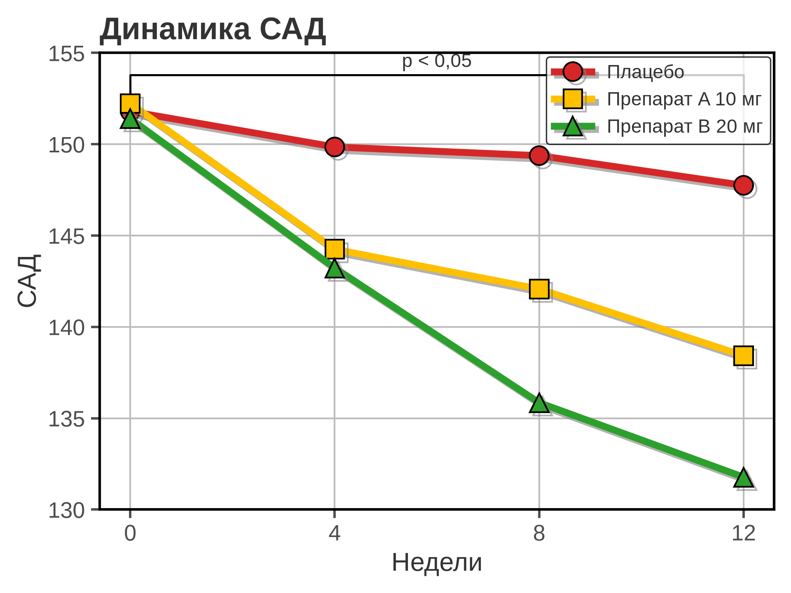
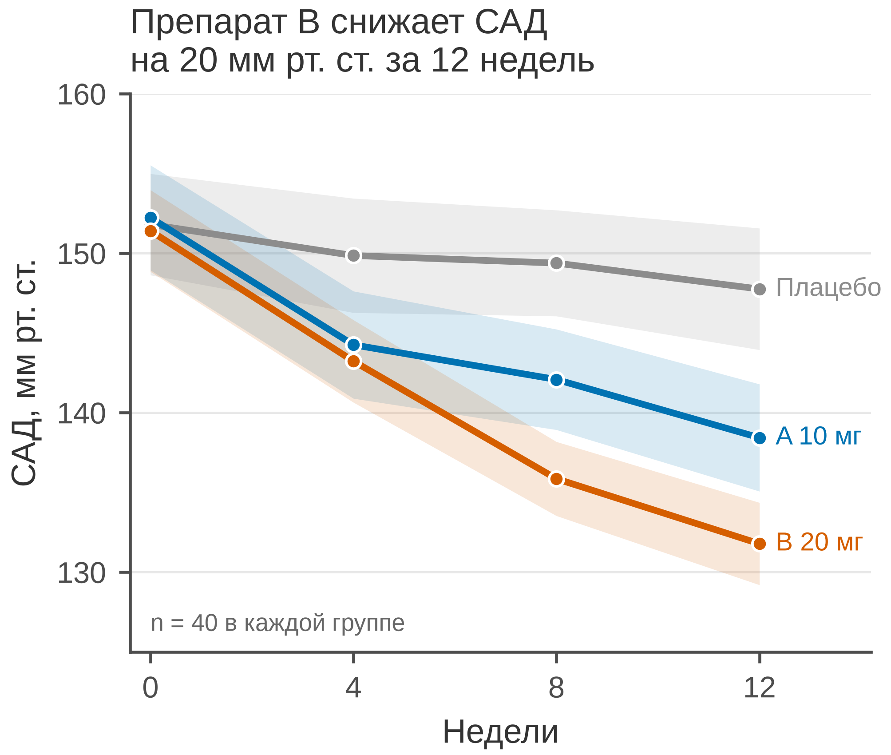

# 5.01 Линейный график: динамика во времени

Линейный график — самый частый в научных статьях и один из самых
обманчивых. Он кажется простым: время по X, значение по Y, точки соединили.
Но именно здесь легко спрятать неопределённость, раздуть эффект масштабом
и потерять внимание читателя к главному.

Этот раздел — первый практический разбор. Данные, «плохая» и «правильная»
версии используют один и тот же CSV; различается только визуализация.

## 5.01.1 Сфера применения

Линейный график отвечает на вопрос: **как величина меняется во времени
или вдоль упорядоченной оси?**

Типичные случаи:

- повторные измерения у одних и тех же пациентов (до/через 4/8/12 недель);
- динамика биомаркеров, АД, ЧСС, глюкозы, HbA1c;
- кривые роста и дозозависимые эффекты;
- временные ряды в эпидемиологии и организации здравоохранения;
- сравнение нескольких групп во времени.

Когда линия **не** подходит:

- ось X — неупорядоченные категории (пол, регион, препарат): линия
  навязывает порядок и расстояние;
- серий слишком много (больше 5–7): лучше small multiples;
- интервалы времени неравномерны, а вы строите равномерные позиции —
  это искажает скорость изменения;
- показаны только средние, а разброс и *n* важны для вывода;
- данные цензурированы (выживаемость) — нужен Kaplan–Meier, а не линия.

## 5.01.2 Данные

Сценарий: гипотетическое 12-недельное исследование, 120 пациентов
с артериальной гипертензией, три группы. САД измеряют на 0, 4, 8 и
12-й неделе.

| Колонка | Смысл | Единица |
|---|---|---|
| `patient_id` | идентификатор пациента | — |
| `group` | группа терапии | — |
| `week` | неделя измерения (0, 4, 8, 12) | недели |
| `sbp_mm_hg` | систолическое АД | мм рт. ст. |

*n* = 40 в каждой группе, 480 строк в long-формате. Данные синтетические,
но правдоподобные по единицам и величинам: плацебо снижает САД примерно
до 148, препарат A — до 139, препарат B — до 132 мм рт. ст.

Генератор: [`make_data.py`](scripts/make_data.py) → [`data/01_dataset.csv`](../../data/01_dataset.csv).

## 5.01.3 Плохой график



Код: [`bad_plot.py`](scripts/bad_plot.py).

Что с ним не так:

1. **Обрезанная ось Y (130–155).** Для линии нулевая база не обязательна,
   но диапазон не должен обрезать данные и создавать ложный драматизм.
   Здесь препарат B почти упирается в нижнюю границу, а плацебо выглядит
   почти плоским; читатель переоценивает разницу.
2. **Светофорная палитра.** Красный — жёлтый — зелёный неразличим при
   протанопии/дейтеранопии и навязывает оценку «плохо — средне — хорошо».
3. **Толстые линии, тени и крупные маркеры.** Тень не кодирует данные;
   она утяжеляет линии и мешает сравнивать наклоны.
4. **Тяжёлая сетка по обеим осям и полная рамка.** Сетка конкурирует
   с данными, вертикальные линии не помогают читать недели.
5. **Заголовок «Динамика САД».** Он не сообщает, что именно произошло
   и какой вывод должен сделать читатель.
6. **Нет единиц, *n* и неопределённости.** «САД» — это что: исходное,
   конечное, среднее? В каких единицах? Сколько пациентов?
7. **Только средние.** Без доверительных интервалов или полос разброса
   нельзя понять, насколько устойчива разница.
8. **Легенда внутри поля данных.** Она дублирует подписи и закрывает
   часть линий.
9. **Брекет «p < 0,05» без теста и эффекта.** Значимость не заменяет
   величину эффекта; не указано, какой тест и какие группы сравнивались.

Дополнительно: равномерные позиции 0/4/8/12 здесь корректны, потому что
интервалы равны. Если бы интервалы были неравными (0, 2, 12, 52 недели),
точки нужно ставить по реальному времени, а не через равные шаги.

## 5.01.4 Правильный график



Код: [`good_plot.py`](scripts/good_plot.py).

Что улучшено:

1. **Ширина 85 мм, высота 72 мм.** Рисунок спроектирован в конечном
   журнальном размере, а не уменьшен из слайда.
2. **Среднее и 95 % ДИ.** Полосы показывают неопределённость; видно,
   где различия уверенные, а где интервалы пересекаются.
3. **Палитра Okabe–Ito.** Серый — контроль, синий — препарат A,
   вермилион — препарат B; цвета различимы при дальтонизме.
4. **Прямые подписи в конце линий.** Легенда не нужна; читатель сразу
   видит, какая линия какой группе соответствует.
5. **Заголовок-вывод.** «Препарат B снижает САД на 20 мм рт. ст. за
   12 недель» — сразу понятно, что читать.
6. **Единицы и *n*.** «САД, мм рт. ст.» и «n = 40 в каждой группе»;
   в подписи можно добавить определение ДИ.
7. **Ось Y 125–160.** Достаточный контекст: видны исходный уровень,
   конечные значения и величина снижения, без обрезки «под эффект».
8. **Лёгкая сетка только по Y.** Верхняя и правая рамки убраны;
   данные контрастнее осей.
9. **Маркеры только в измеренных точках.** Линия соединяет реальные
   недели 0/4/8/12, а не произвольные позиции.

## 5.01.5 Сопоставление

| Что было | Почему плохо | Что сделано |
|---|---|---|
| ось Y 130–155 | масштаб раздувает различия | 125–160, виден контекст |
| красный/жёлтый/зелёный | ложная семантика, CVD | Okabe–Ito: серый/синий/вермилион |
| тени, толстые линии | декор, мешает сравнивать наклоны | линии 1,8 pt, маркеры 4 pt |
| сетка по X и Y | шум | сетка только по Y |
| полная рамка | визуальный шум | только левая и нижняя оси |
| легенда | дублирует подписи | прямые подписи |
| «Динамика САД» | нет сообщения | заголовок-вывод |
| нет единиц и *n* | невозможно прочитать | единицы, *n* |
| только средние | скрыта неопределённость | среднее + 95 % ДИ |
| p < 0,05 | нет теста и эффекта | эффект и ДИ; тест — в подписи |

## 5.01.6 Чек-лист линейного графика

- [ ] Время (или упорядоченная ось) — по X, значения — по Y.
- [ ] Интервалы на оси X соответствуют реальному времени.
- [ ] Ось Y не обрезает данные и не создаёт ложного драматизма.
- [ ] Показаны среднее и 95 % ДИ (или individual trajectories).
- [ ] Указаны *n* и единицы.
- [ ] Цвет не единственный носитель смысла.
- [ ] Легенда не закрывает данные; лучше прямые подписи.
- [ ] Заголовок сообщает вывод, а не «динамику».
- [ ] Нет 3D, теней и тяжёлой сетки.
- [ ] Рисунок проверен в конечном размере 85 мм.

## 5.01.7 Как воспроизвести

```bash
uv sync
uv run python 05_charts/01_line/scripts/make_data.py
uv run python 05_charts/01_line/scripts/bad_plot.py
uv run python 05_charts/01_line/scripts/good_plot.py
```

Ключевой фрагмент «правильного» кода:

```python
fig, ax = plt.subplots(
    figsize=figure_size("single", height_mm=72),
    layout="constrained",
)
ax.fill_between(x, part["ci_low"], part["ci_high"], color=color, alpha=0.15)
ax.plot(x, part["mean"], color=color, marker="o", linewidth=1.8)
ax.annotate(GROUP_SHORT[group], (x[-1] + 0.08, part["mean"].iloc[-1]))
save_figure(fig, "05_01_good_line")
```

## 5.01.8 Что дальше

Следующий график — **5.02 step**: ступенчатая функция для событий,
измерений «до/после» и дискретных изменений. У него будет свой генератор
и свой `data/02_dataset.csv`.

## Источники

- Cleveland W. S., McGill R. Graphical Perception // *JASA*. 1984. —
  [doi:10.1080/01621459.1984.10478080](https://doi.org/10.1080/01621459.1984.10478080)
- Weissgerber T. L. et al. Beyond Bar and Line Graphs // *PLoS Biology*.
  2015. — [doi:10.1371/journal.pbio.1002128](https://doi.org/10.1371/journal.pbio.1002128)
- Wilke C. O. *Fundamentals of Data Visualization*. 2019. —
  [clauswilke.com/dataviz](https://clauswilke.com/dataviz/)
