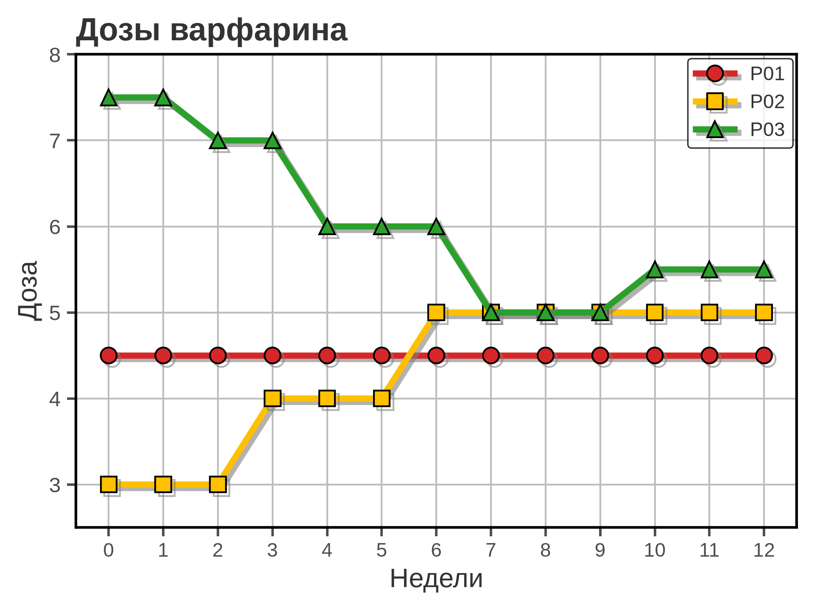
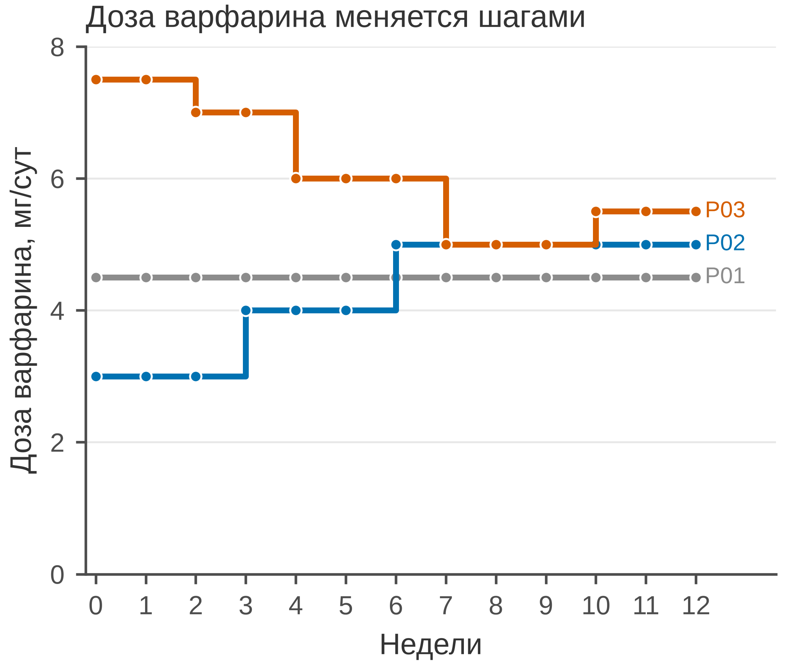

# 5.02 Ступенчатый график: события и дискретные изменения

Ступенчатый график — это линия, у которой значение **сохраняется** между
событиями и меняется скачком в момент события. Он нужен там, где процесс
по своей природе дискретен: доза препарата, скорость инфузии, статус,
тариф, число коек, порог.

Главная ошибка — соединить такие точки наклонной линией. Тогда читатель
видит плавное изменение, которого в данных не было.

## 5.02.1 Сфера применения

Ступенчатая функция отвечает на вопрос: **в какой момент значение
изменилось и каким оно оставалось до следующего события?**

Где это пригодится:

- титрование дозы препарата (варфарин, инсулин, антибиотик);
- скорость инфузии (мкг/кг/мин, мл/ч);
- изменение статуса (госпитализирован/выписан, жив/умер — но для
  выживаемости нужен Kaplan–Meier);
- тарифы, оклады, налоговые ставки;
- число занятых коек или доступных аппаратов;
- ступенчатые протоколы и пороговые правила.

Когда ступенчатый график **не** подходит:

- величина меняется непрерывно (концентрация, температура, АД);
- ось X — неупорядоченные категории;
- нужно показать распределение или неопределённость, а не момент
  изменения;
- данных слишком мало для шага — тогда лучше точки.

## 5.02.2 Данные

Сценарий: три пациента на варфарине, 12 недель. Дозу меняют на визитах
раз в неделю, шагом 0,5 мг/сут; INR измеряют на каждом визите, целевой
диапазон — 2,0–3,0.

| Колонка | Смысл | Единица |
|---|---|---|
| `patient_id` | идентификатор пациента | — |
| `week` | неделя визита (0–12) | недели |
| `dose_mg` | доза варфарина | мг/сут |
| `inr` | международное нормализованное отношение | — |

39 строк: 3 пациента × 13 визитов. Дозы — 3,0–7,5 мг/сут; у P01 доза
стабильна, у P02 и P03 — титруется. Это не исследование, а иллюстрация
индивидуального титрования; для групповых выводов нужны другие графики
и статистика.

Генератор: [`make_data.py`](scripts/make_data.py) → [`data/02_dataset.csv`](../../data/02_dataset.csv).

## 5.02.3 Плохой график



Код: [`bad_plot.py`](scripts/bad_plot.py).

Что не так:

1. **Наклонные линии вместо ступеней.** Доза не меняется плавно между
   визитами; `ax.plot` создаёт ложное впечатление непрерывного
   титрования. Это главная ошибка.
2. **Обрезанная ось Y (2,5–8).** Масштаб раздувает различия; нулевая
   база для дозы не обязательна, но диапазон должен показывать реальный
   масштаб.
3. **Светофорная палитра.** Красный — жёлтый — зелёный неразличим при
   протанопии/дейтеранопии и навязывает оценку «плохо — средне — хорошо».
4. **Толстые линии, тени и крупные маркеры.** Декор мешает видеть
   моменты изменения.
5. **Тяжёлая сетка по обеим осям и полная рамка.** Шум, который
   конкурирует с данными.
6. **Заголовок «Дозы варфарина».** Нет сообщения: что происходит
   с дозами и почему это важно.
7. **Нет единиц, числа пациентов и контекста INR.** «Доза» — в чём?
   Сколько пациентов? Почему дозу меняли?
8. **Легенда внутри поля данных.** Она дублирует подписи и закрывает
   линии.

## 5.02.4 Правильный график



Код: [`good_plot.py`](scripts/good_plot.py).

Что изменилось:

1. **`ax.step(..., where="post")`.** Доза сохраняется до следующего
   визита; вертикальные сегменты показывают скачок, горизонтальные —
   период постоянной дозы.
2. **Маркеры в моменты визитов.** Видно, где именно измеряли и меняли
   дозу, а не абстрактную кривую.
3. **Прямые подписи P01/P02/P03.** Легенда не нужна; конец линии
   сразу подписан.
4. **Ось Y 0–8 мг/сут.** Виден реальный масштаб доз, без обрезки
   «под эффект».
5. **Единицы и недели.** «Доза варфарина, мг/сут», недели 0–12.
6. **Заголовок-вывод.** «Доза варфарина меняется шагами» объясняет,
   что читать.
7. **Палитра Okabe–Ito.** Серый — P01, синий — P02, вермилион — P03.
8. **Лёгкая сетка только по Y.** Верхняя и правая рамки убраны.
9. **85 мм в ширину.** Рисунок спроектирован в конечном размере.

INR не вынесен на вторую ось: две оси Y создают ложную корреляцию.
Если INR важен, сделайте отдельную панель или таблицу; в подписи
укажите целевой диапазон 2,0–3,0.

## 5.02.5 Было и стало
| Что было | Почему плохо | Что сделано |
|---|---|---|
| `ax.plot` | плавное изменение, которого не было | `ax.step(where="post")` |
| ось Y 2,5–8 | масштаб раздувает различия | 0–8 мг/сут |
| красный/жёлтый/зелёный | ложная семантика, CVD | Okabe–Ito |
| тени, толстые линии | декор | линии 1,8 pt, маркеры 3,5 pt |
| сетка по X и Y | шум | сетка только по Y |
| полная рамка | визуальный шум | только левая и нижняя оси |
| легенда | дублирует подписи | прямые подписи |
| «Дозы варфарина» | нет сообщения | заголовок-вывод |
| нет единиц и *n* | невозможно прочитать | единицы, число пациентов в подписи |
| INR на второй оси | ложная корреляция | INR в подписи/отдельной панели |

## 5.02.6 Чек-лист ступенчатого графика

- [ ] Величина действительно постоянна между событиями.
- [ ] Использован `step`, а не `plot` с наклонными линиями.
- [ ] Выбрано `where="post"` или `where="pre"` осознанно.
- [ ] Маркеры стоят в моменты измерения/изменения.
- [ ] Ось Y показывает реальный масштаб, без обрезки «под эффект».
- [ ] Указаны единицы, число пациентов и контекст.
- [ ] Прямые подписи лучше легенды.
- [ ] Нет двух осей Y.
- [ ] Цвет не единственный носитель смысла.
- [ ] Рисунок проверен в конечном размере 85 мм.

## 5.02.7 Как воспроизвести

```bash
uv sync
uv run python 05_charts/02_step/scripts/make_data.py
uv run python 05_charts/02_step/scripts/bad_plot.py
uv run python 05_charts/02_step/scripts/good_plot.py
```

Вот как это выглядит в коде:

```python
ax.step(
    weeks,
    doses[patient].to_numpy(),
    where="post",
    color=color,
    linewidth=1.8,
    marker="o",
    markersize=3.5,
)
```

`where="post"` означает: значение `y[i]` держится от `x[i]` до `x[i+1]`,
затем происходит скачок. Если событие фиксируется в конце интервала,
проверьте, не нужен ли `where="pre"`.

## 5.02.8 Что дальше

Следующий график — **5.03 area**: область под линией для накопленных
и составных величин. У него будет свой генератор и свой
`data/03_dataset.csv`.

## Источники

- Wilke C. O. *Fundamentals of Data Visualization*. 2019. —
  [clauswilke.com/dataviz](https://clauswilke.com/dataviz/)
- Matplotlib: `step` —
  [matplotlib.org](https://matplotlib.org/stable/api/_as_gen/matplotlib.axes.Axes.step.html)
- Tufte E. R. *The Visual Display of Quantitative Information*. 1983. —
  [edwardtufte.com](https://www.edwardtufte.com/tufte/books_vdqi)