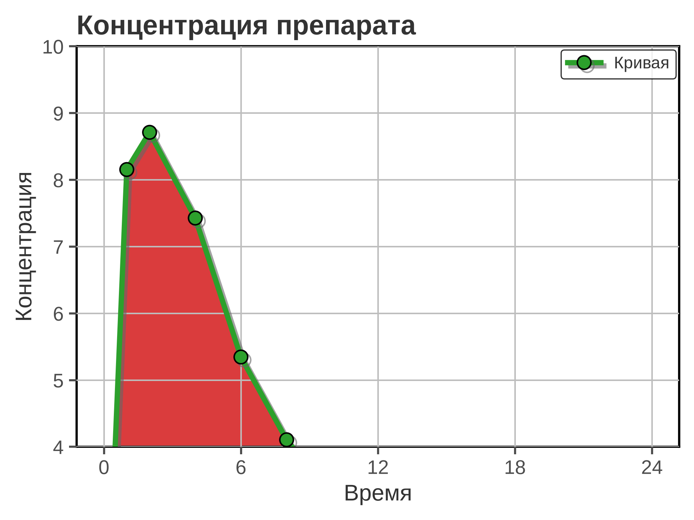
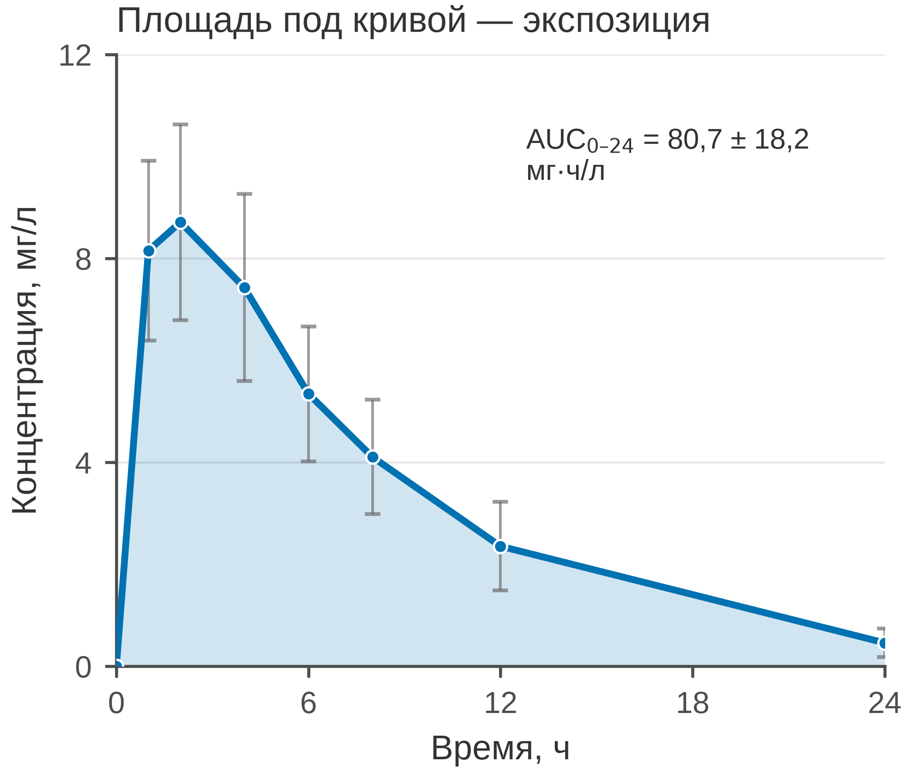

# 5.03 Area chart: площадь как величина

Area chart — это линия с заливкой под ней. Он оправдан только тогда,
когда **площадь является смыслом**: площадь под кривой концентрации
(AUC), накопленная экспозиция, суммарная нагрузка, cumulative burden.
Если заливка просто «украшает» линию, она добавляет чернила, но не
информацию.

Главное правило: **заливка area chart должна начинаться с нуля**.
Иначе площадь перестаёт быть пропорциональна величине, которую она
якобы кодирует.

## 5.03.1 Сфера применения

Area chart отвечает на вопрос: **какая суммарная величина накоплена
за период?**

Типичные случаи:

- площадь под кривой концентрация–время (AUC) в фармакокинетике;
- накопленная экспозиция лекарства или излучения;
- суммарная нагрузка (число случаев, койко-дни, затраты) за период;
- cumulative incidence, если это не кривая выживаемости (для
  выживаемости — Kaplan–Meier, 5.27);
- stacked area для состава во времени, но с осторожностью: наложение
  областей затрудняет сравнение (для состава чаще лучше stacked bar,
  5.20).

Когда area chart **не** подходит:

- площадь не несёт смысла, а заливка нужна «для красоты» — используйте
  линию;
- несколько перекрывающихся областей: одна заливка закрывает другую;
- ось Y не начинается с нуля;
- нужно точное сравнение значений — линия или точки читаются лучше;
- категории по X не упорядочены.

## 5.03.2 Данные

Сценарий: 40 пациентов получают условный препарат внутрь в дозе 500 мг.
Концентрацию в плазме измеряют через 0, 1, 2, 4, 6, 8, 12 и 24 часа.
AUC0–24 — интегральная экспозиция, мг·ч/л.

| Колонка | Смысл | Единица |
|---|---|---|
| `patient_id` | идентификатор пациента | — |
| `time_h` | время после приёма | часы |
| `conc_mg_l` | концентрация в плазме | мг/л |

320 строк: 40 пациентов × 8 моментов. Средний AUC0–24 — 80,7 ± 18,2 мг·ч/л;
пик концентрации — около 8–9 мг/л через 1–2 часа; к 24 часам — около
0,5 мг/л.

Генератор: [`make_data.py`](scripts/make_data.py) → [`data/03_dataset.csv`](../../data/03_dataset.csv).

## 5.03.3 Плохой график



Код: [`bad_plot.py`](scripts/bad_plot.py).

Что с ним не так:

1. **Заливка начинается с y = 4, а не с нуля.** Площадь больше не
   пропорциональна AUC; график показывает не интеграл, а обрезок.
   Это главная ошибка.
2. **Обрезанная ось Y (4–10).** Пик и хвост искажены; нижняя часть
   кривой и базовая линия скрыты.
3. **Красная заливка и зелёная линия.** Светофорная пара неразличима
   при протанопии/дейтеранопии; тёмная заливка конкурирует с линией.
4. **Тени и крупные маркеры.** Декор, который не кодирует данные.
5. **Тяжёлая сетка по обеим осям и полная рамка.** Сетка просвечивает
   через заливку и создаёт шум.
6. **Заголовок «Концентрация препарата».** Не сообщает, что площадь —
   это экспозиция и какова её величина.
7. **Нет единиц, *n* и AUC.** «Концентрация» — в чём? Сколько пациентов?
   Чему равна площадь?
8. **Легенда из одной строки «Кривая».** Она не несёт информации.

## 5.03.4 Правильный график



Код: [`good_plot.py`](scripts/good_plot.py).

Что улучшено:

1. **Заливка от 0.** Площадь под кривой действительно равна AUC;
   базовая линия видна.
2. **Подпись AUC0–24 = 80,7 ± 18,2 мг·ч/л.** Площадь превращается
   в число, которое можно интерпретировать.
3. **Ось Y 0–12 мг/л.** Видны пик, хвост и нулевая база; нет обрезки
   «под эффект».
4. **Среднее ± SD в точках.** Видна неопределённость; заливка
   показывает интеграл, а не заменяет разброс.
5. **Палитра Okabe–Ito.** Один синий цвет для одной серии; ничего
   лишнего.
6. **Единицы и *n*.** «Концентрация, мг/л», «Время, ч», *n* = 40
   в подписи.
7. **Заголовок-вывод.** «Площадь под кривой — экспозиция» объясняет,
   зачем здесь заливка.
8. **Лёгкая сетка только по Y, без верхней и правой рамок.**
9. **85 мм в ширину.** Рисунок спроектирован в конечном размере.

Если площадь не нужна, эти же данные лучше показать линией без
заливки: меньше чернил, та же информация. Area chart — не «линия
с красивым фоном», а график интеграла.

## 5.03.5 Сопоставление

| Что было | Почему плохо | Что сделано |
|---|---|---|
| заливка от 4 | площадь не равна AUC | заливка от 0 |
| ось Y 4–10 | обрезаны пик и хвост | 0–12 мг/л |
| красная заливка + зелёная линия | CVD, шум | один синий цвет |
| тени, крупные маркеры | декор | линия 1,8 pt, маркеры 3,5 pt |
| сетка по X и Y | шум | сетка только по Y |
| полная рамка | визуальный шум | только левая и нижняя оси |
| легенда «Кривая» | бесполезна | без легенды |
| «Концентрация препарата» | нет сообщения | заголовок-вывод |
| нет AUC и единиц | площадь не читается | AUC, мг·ч/л, *n* |
| только среднее | нет неопределённости | среднее ± SD |

## 5.03.6 Чек-лист area chart

- [ ] Площадь действительно является смыслом (AUC, накопление).
- [ ] Заливка начинается с нуля.
- [ ] Ось Y не обрезает нижнюю часть площади.
- [ ] Подписана величина площади (AUC, сумма, интеграл).
- [ ] Показана неопределённость (SD/CI или отдельные кривые).
- [ ] Указаны единицы, *n*, время.
- [ ] Нет перекрывающихся непрозрачных областей.
- [ ] Заливка не конкурирует с линией и сеткой.
- [ ] Если площадь не нужна — выбран line chart.
- [ ] Рисунок проверен в конечном размере 85 мм.

## 5.03.7 Как воспроизвести

```bash
uv sync
uv run python 05_charts/03_area/scripts/make_data.py
uv run python 05_charts/03_area/scripts/bad_plot.py
uv run python 05_charts/03_area/scripts/good_plot.py
```

Ключевые фрагменты:

```python
ax.fill_between(time, 0, mean, color=PRIMARY_BLUE, alpha=0.18, linewidth=0)
ax.plot(time, mean, color=PRIMARY_BLUE, marker="o", linewidth=1.8)

auc = np.trapezoid(part["conc_mg_l"], part["time_h"])
```

`np.trapezoid` считает площадь трапеций; единицы AUC — мг·ч/л, потому что
концентрация в мг/л умножается на время в часах.

## 5.03.8 Что дальше

Следующий график — **5.04 small multiples**: несколько панелей с общей
шкалой для многомерных данных. У него будет свой генератор и свой
`data/04_dataset.csv`.

## Источники

- Wilke C. O. *Fundamentals of Data Visualization*. 2019. —
  [clauswilke.com/dataviz](https://clauswilke.com/dataviz/)
- Matplotlib: `fill_between` —
  [matplotlib.org](https://matplotlib.org/stable/api/_as_gen/matplotlib.axes.Axes.fill_between.html)
- NumPy: `trapezoid` —
  [numpy.org](https://numpy.org/doc/stable/reference/generated/numpy.trapezoid.html)
- Tufte E. R. *The Visual Display of Quantitative Information*. 1983. —
  [edwardtufte.com](https://www.edwardtufte.com/tufte/books_vdqi)
