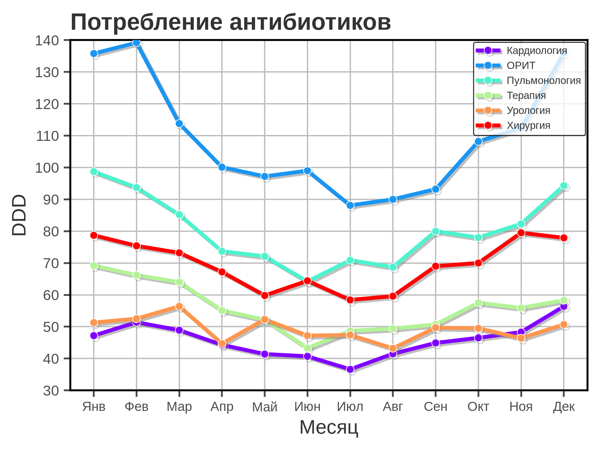
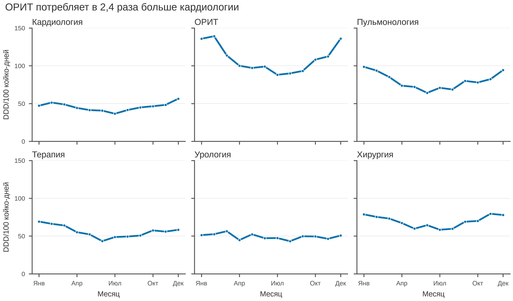

# 5.04 Small multiples: много панелей, одна логика

Small multiples (малые кратные) — это ряд небольших графиков с одинаковой
структурой и, как правило, общей шкалой. Вместо того чтобы рисовать шесть
линий на одной оси и надеяться, что читатель их различит, мы показываем
шесть панелей: сравнение идёт по форме и уровню, а не по цвету.

Принцип прост: **одна панель — одна серия; общая шкала — контракт
сравнения.** Если у панелей разные оси, сравнение становится косметикой.

## 5.04.1 Сфера применения

Small multiples отвечают на вопрос: **как различаются группы, если
смотреть на них по отдельности, но по одной шкале?**

Где это пригодится:

- динамика показателя по 5–20 отделениям, регионам, центрам;
- распределения по группам (гистограммы или box в facets);
- сезонность по месяцам для многих категорий;
- сравнение центров в многоцентровом исследовании;
- проверка согласованности трендов без наложения линий.

Когда small multiples **не** нужны:

- серий 2–3: обычная линия с прямыми подписями читается лучше;
- нужно точное сравнение двух значений — точки/таблица;
- панели не помещаются в журнальную ширину;
- шкалы всё равно придётся делать разными — тогда это уже не
  small multiples, а набор разных графиков.

## 5.04.2 Данные

Сценарий: шесть отделений больницы, 12 месяцев. Показатель — потребление
антибиотиков в DDD на 100 койко-дней. Зимой потребление выше, летом ниже.

| Колонка | Смысл | Единица |
|---|---|---|
| `department` | отделение | — |
| `month` | месяц (1–12) | — |
| `ddd_per_100_bed_days` | потребление антибиотиков | DDD/100 койко-дней |

72 строки: 6 отделений × 12 месяцев. Средние уровни: ОРИТ — 109,4,
пульмонология — 80,1, хирургия — 69,4, терапия — 55,9, урология — 49,3,
кардиология — 45,7. ОРИТ потребляет в 2,4 раза больше кардиологии.

Генератор: [`make_data.py`](scripts/make_data.py) → [`data/04_dataset.csv`](../../data/04_dataset.csv).

## 5.04.3 Плохой график



Код: [`bad_plot.py`](scripts/bad_plot.py).

Что не так:

1. **Шесть серий на одной оси.** Линии перекрываются, особенно в области
   45–80 DDD; сравнить отделения невозможно.
2. **Радужная палитра.** Шесть цветов неразличимы при дальтонизме,
   а легенда заставляет постоянно переводить взгляд.
3. **Обрезанная ось Y (30–140).** Низкие значения искажены; разница
   между кардиологией и урологией выглядит больше, чем есть.
4. **Толстые линии, тени и крупные маркеры.** Декор усиливает
   overplotting.
5. **Тяжёлая сетка по обеим осям и полная рамка.** Сетка конкурирует
   с шестью линиями.
6. **Заголовок «Потребление антибиотиков».** Не сообщает, что
   сравниваются отделения и кто лидирует.
7. **Нет единиц и n.** «DDD» — это что? Сколько отделений и месяцев?
8. **Легенда из шести строк** закрывает верхнюю часть данных.

## 5.04.4 Правильный график



Код: [`good_plot.py`](scripts/good_plot.py).

Что изменилось:

1. **2×3 панели.** Каждое отделение — своя панель; линии не
   перекрываются.
2. **Общая ось Y 0–150.** Панели честно сравнимы; видно, что ОРИТ
   выше всех, а кардиология ниже всех.
3. **Один цвет.** Сравнение идёт по форме и уровню, а не по легенде.
4. **Общие деления X.** Янв/Апр/Июл/Окт/Дек; подписи только на нижнем
   ряду, чтобы не дублировать.
5. **Подписи осей по краям.** «DDD/100 койко-дней» — только слева,
   «Месяц» — только снизу.
6. **Заголовок-вывод.** «ОРИТ потребляет в 2,4 раза больше
   кардиологии» сразу задаёт сообщение.
7. **Лёгкая сетка по Y, без верхней и правой рамок.**
8. **170 мм.** Две журнальные колонки; панели не сжаты в одну.

Порядок панелей — по алфавиту; если нужен содержательный порядок
(например, по уровню потребления), задайте его явно и сохраняйте
во всех рисунках.

## 5.04.5 Было и стало
| Что было | Почему плохо | Что сделано |
|---|---|---|
| 6 линий на одной оси | overplotting | 2×3 панели |
| радужная палитра | CVD, легенда | один синий цвет |
| ось Y 30–140 | искажает низкие значения | 0–150 |
| толстые линии, тени | декор | линии 1,6 pt, маркеры 2,6 pt |
| сетка по X и Y | шум | сетка только по Y |
| полная рамка | визуальный шум | только левая и нижняя оси |
| легенда | закрывает данные | подписи панелей |
| «Потребление антибиотиков» | нет сообщения | заголовок-вывод |
| нет единиц и n | невозможно прочитать | единицы, 6 отделений × 12 месяцев |
| разные шкалы | нельзя сравнивать | общая шкала |

## 5.04.6 Чек-лист small multiples

- [ ] Панели действительно сравнимы: общая шкала X и Y.
- [ ] Одна панель — одна серия; нет перекрытия.
- [ ] Порядок панелей осмысленный и одинаковый во всех рисунках.
- [ ] Подписи осей не дублируются на каждой панели.
- [ ] Один цвет, если нет смыслового повода для разных.
- [ ] Заголовки панелей короткие и однозначные.
- [ ] Есть общий заголовок-вывод.
- [ ] Указаны единицы и n.
- [ ] Панели не сжаты: минимум 45–50 мм на панель.
- [ ] Если серий 2–3, рассмотрена обычная линия.

## 5.04.7 Как воспроизвести

```bash
uv sync
uv run python 05_charts/04_small_multiples/scripts/make_data.py
uv run python 05_charts/04_small_multiples/scripts/bad_plot.py
uv run python 05_charts/04_small_multiples/scripts/good_plot.py
```

Вот как это выглядит в коде:

```python
fig, axes = plt.subplots(
    2, 3,
    figsize=figure_size("double", height_mm=100),
    sharex=True,
    sharey=True,
    layout="constrained",
)
for ax, department in zip(axes.ravel(), departments, strict=True):
    ax.plot(x, pivot[department], color=PRIMARY_BLUE)
    ax.set_title(department, loc="left")
```

`sharex=True` и `sharey=True` — это и есть контракт сравнения. Если
приходится делать `sharey=False`, подпишите разные шкалы явно и
объясните, почему они разные.

## 5.04.8 Что дальше

Следующий график — **5.05 scatter**: связь двух непрерывных величин,
выбросы и плотность. У него будет свой генератор и свой
`data/05_dataset.csv`.

## Источники

- Tufte E. R. *The Visual Display of Quantitative Information*. 1983. —
  [edwardtufte.com](https://www.edwardtufte.com/tufte/books_vdqi)
- Wilke C. O. *Fundamentals of Data Visualization*. 2019. —
  [clauswilke.com/dataviz](https://clauswilke.com/dataviz/)
- Cairo A. *The Truthful Art*. New Riders, 2016. —
  [thefunctionalart.com](https://www.thefunctionalart.com/)
- Matplotlib: `subplots` —
  [matplotlib.org](https://matplotlib.org/stable/api/_as_gen/matplotlib.pyplot.subplots.html)