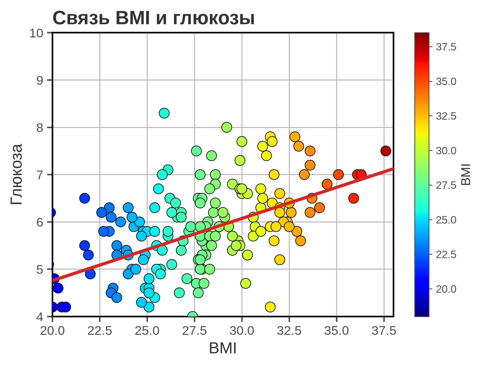
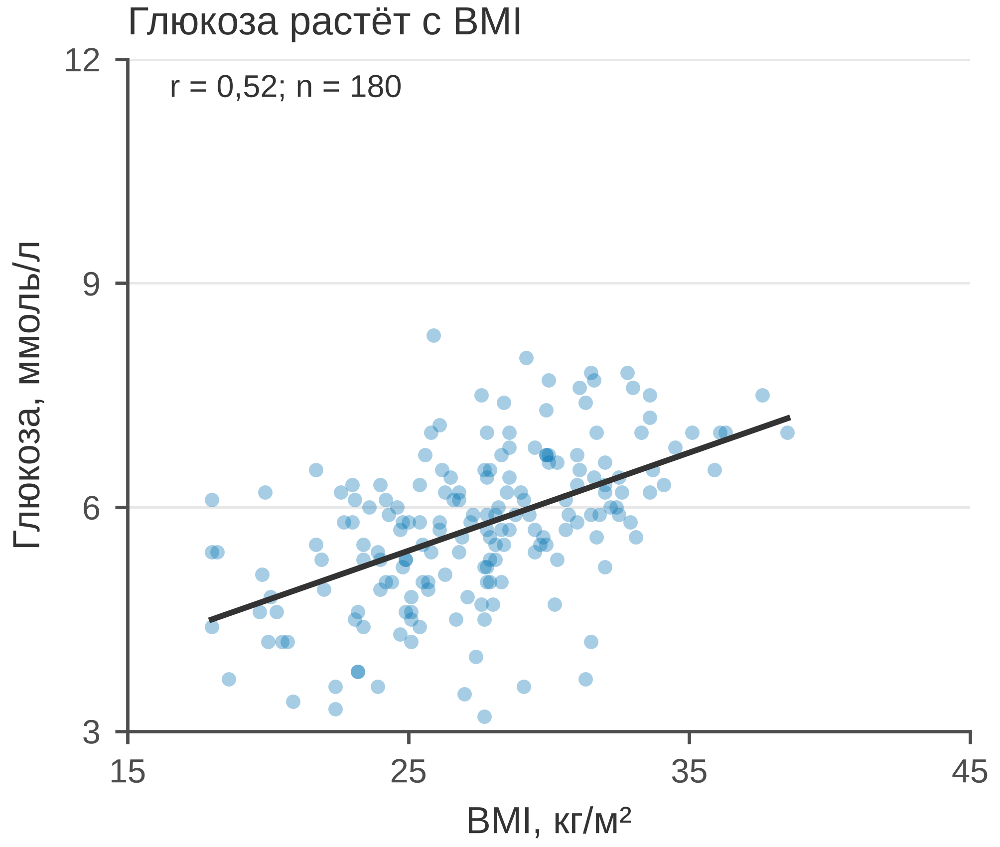

# 5.05 Scatter: связь двух непрерывных величин

Scatter plot — базовая форма для связи двух непрерывных переменных. Он
показывает не только тренд, но и разброс, выбросы, гетерогенность и
плотность наблюдений. Поэтому scatter честнее коэффициента
корреляции: коэффициент сжимает всю картину в одно число.

На практике: **точки важнее линии.** Линия регрессии — дополнение к данным,
а не замена им. Если на графике видны только линия и *r*, читатель не
увидит ни формы, ни выбросов.

## 5.05.1 Сфера применения

Scatter отвечает на вопрос: **связаны ли две непрерывные величины
и как выглядит эта связь?**

Где это пригодится:

- связь биомаркера и клинического показателя (BMI и глюкоза, CRP и тяжесть);
- корреляция двух методов измерения (но для согласия — Bland–Altman, 5.19);
- зависимость дозы и эффекта;
- поиск выбросов и гетерогенности;
- проверка линейности перед регрессией.

Когда scatter **не** подходит:

- одна из переменных категориальная — нужны точки/столбцы;
- время по X — нужна линия (5.01);
- точек слишком много — overplotting, нужны hexbin (5.06),
  contour (5.07) или плотность;
- нужно показать согласие методов, а не корреляцию — Bland–Altman (5.19);
- обе переменные — доли, сумма которых фиксирована (compositional data).

## 5.05.2 Данные

Сценарий: 180 взрослых на профилактическом осмотре. Измерены BMI
(кг/м²) и глюкоза натощак (ммоль/л).

| Колонка | Смысл | Единица |
|---|---|---|
| `patient_id` | идентификатор пациента | — |
| `bmi_kg_m2` | индекс массы тела | кг/м² |
| `glucose_mmol_l` | глюкоза натощак | ммоль/л |

Средний BMI — 27,5 ± 4,1 кг/м²; глюкоза — 5,7 ± 1,0 ммоль/л;
корреляция Пирсона *r* = 0,52 (*p* < 0,001). Связь положительная,
но не жёсткая: вокруг линии большой разброс.

Генератор: [`make_data.py`](scripts/make_data.py) → [`data/05_dataset.csv`](../../data/05_dataset.csv).

## 5.05.3 Плохой график



Код: [`bad_plot.py`](scripts/bad_plot.py).

Что не так:

1. **Обрезанные оси (20–38 и 4–10).** Часть точек и хвосты скрыты;
   форма связи и выбросы искажены.
2. **Цвет точек по BMI.** BMI уже на оси X; цвет дублирует ось
   и добавляет радужную шкалу, которая не несёт новой информации.
3. **Крупные непрозрачные маркеры с чёрной обводкой.** Overplotting:
   в плотных областях точки сливаются, нельзя оценить плотность.
4. **Красная линия регрессии без доверительной полосы и статистики.**
   Не указаны *r*, *n*, наклон; линия выглядит как «истина».
5. **Тяжёлая сетка по обеим осям и полная рамка.** Шум, который
   конкурирует с точками.
6. **Заголовок «Связь BMI и глюкозы».** Не сообщает направление
   и силу связи.
7. **Нет единиц и *n*.** «BMI» и «Глюкоза» — в чём? Сколько людей?
8. **Цветовая шкала BMI** дублирует ось X и занимает место.

## 5.05.4 Правильный график



Код: [`good_plot.py`](scripts/good_plot.py).

Что изменилось:

1. **Полный диапазон осей.** 15–45 кг/м² и 3–12 ммоль/л; все точки
   видны, включая хвосты.
2. **Полупрозрачные точки одного цвета.** `alpha=0.35`, размер 12:
   видна плотность и не теряются отдельные наблюдения.
3. **Линия регрессии только в диапазоне данных.** Без экстраполяции
   за пределы наблюдений.
4. **Подпись *r* = 0,52; *n* = 180.** Связь quantified; читатель
   видит и форму, и число.
5. **Единицы на осях.** «BMI, кг/м²», «Глюкоза, ммоль/л».
6. **Заголовок-вывод.** «Глюкоза растёт с BMI» задаёт направление.
7. **Лёгкая сетка только по Y, без верхней и правой рамок.**
8. **85 мм.** Рисунок спроектирован в конечном размере.

Корреляция не равна причинности: BMI и глюкоза могут быть связаны
через возраст, питание, физическую активность. Scatter показывает
ассоциацию, а не механизм.

## 5.05.5 Было и стало
| Что было | Почему плохо | Что сделано |
|---|---|---|
| оси 20–38 / 4–10 | точки и хвосты обрезаны | 15–45 / 3–12 |
| цвет по BMI | двойное кодирование, радуга | один синий цвет |
| крупные непрозрачные точки | overplotting | s=12, alpha=0,35 |
| линия без статистики | не quantifies связь | r, n, линия в диапазоне |
| сетка по X и Y | шум | сетка только по Y |
| полная рамка | визуальный шум | только левая и нижняя оси |
| «Связь BMI и глюкозы» | нет сообщения | заголовок-вывод |
| нет единиц и *n* | невозможно прочитать | единицы, *n* |
| colorbar BMI | дублирует ось | без colorbar |

## 5.05.6 Чек-лист scatter

- [ ] Обе переменные непрерывные.
- [ ] Оси не обрезают данные без объяснения.
- [ ] Есть *n* и единицы.
- [ ] Точки не сливаются: alpha/размер/hexbin.
- [ ] Линия регрессии не выходит за диапазон данных.
- [ ] Указаны *r* (или наклон) и неопределённость.
- [ ] Цвет не дублирует ось без смысла.
- [ ] Выбросы видны, а не скрыты.
- [ ] Корреляция не подана как причинность.
- [ ] Рисунок проверен в конечном размере 85 мм.

## 5.05.7 Как воспроизвести

```bash
uv sync
uv run python 05_charts/05_scatter/scripts/make_data.py
uv run python 05_charts/05_scatter/scripts/bad_plot.py
uv run python 05_charts/05_scatter/scripts/good_plot.py
```

Вот как это выглядит в коде:

```python
ax.scatter(x, y, s=12, color=PRIMARY_BLUE, alpha=0.35, linewidths=0)
slope, intercept, r_value, p_value, _ = stats.linregress(x, y)
line_x = np.array([x.min(), x.max()])
ax.plot(line_x, intercept + slope * line_x, color="#333333", linewidth=1.4)
```

Если точек станет больше нескольких тысяч, scatter превратится
в сплошное пятно; тогда нужны hexbin или contour.

## 5.05.8 Что дальше

Следующий график — **5.06 hexbin**: плотность тысяч точек без
overplotting. У него будет свой генератор и свой `data/06_dataset.csv`.

## Источники

- Wilke C. O. *Fundamentals of Data Visualization*. 2019. —
  [clauswilke.com/dataviz](https://clauswilke.com/dataviz/)
- Cleveland W. S., McGill R. Graphical Perception // *JASA*. 1984. —
  [doi:10.1080/01621459.1984.10478080](https://doi.org/10.1080/01621459.1984.10478080)
- Tufte E. R. *The Visual Display of Quantitative Information*. 1983. —
  [edwardtufte.com](https://www.edwardtufte.com/tufte/books_vdqi)
- Matplotlib: `scatter` —
  [matplotlib.org](https://matplotlib.org/stable/api/_as_gen/matplotlib.axes.Axes.scatter.html)