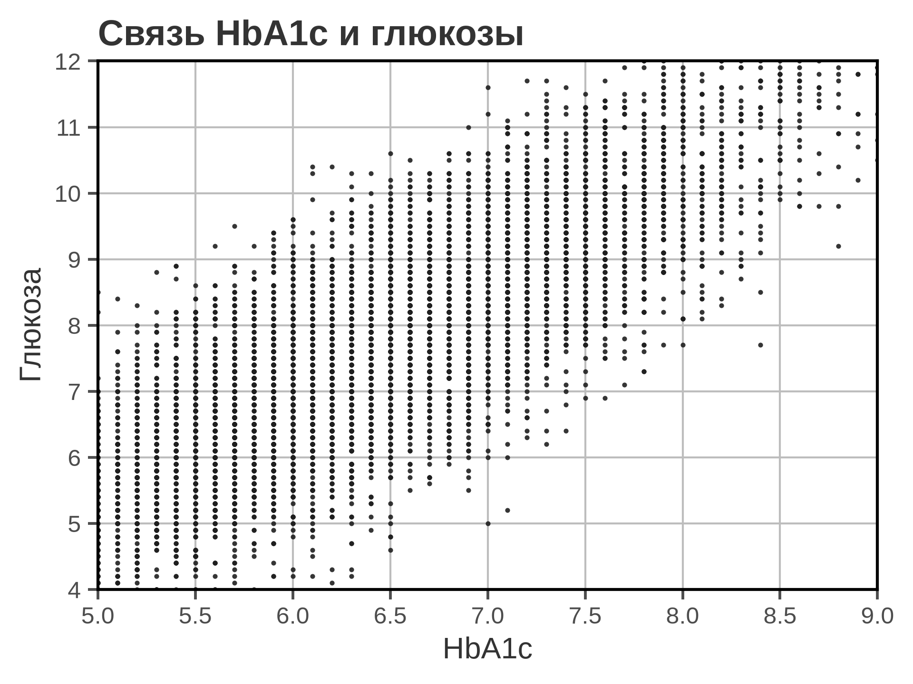
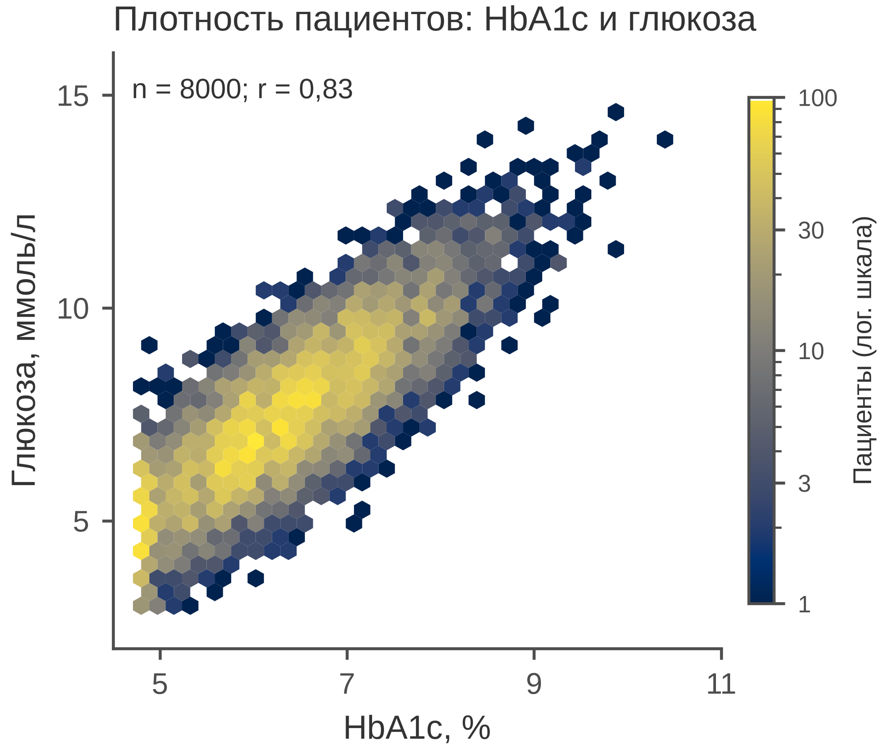

# 5.06 Hexbin: плотность тысяч точек

Hexbin — это scatter, у которого точки агрегированы в шестиугольные бины,
а цвет показывает число наблюдений в бине. Он нужен там, где обычный
scatter превращается в сплошное пятно: тысячи точек, плотное ядро,
длинные хвосты.

Важно помнить: hexbin показывает **плотность**, а не отдельного пациента.
Цвет — это число наблюдений в бине, а не значение признака.

## 5.06.1 Сфера применения

Hexbin отвечает на вопрос: **где наблюдений много, а где мало, и какова
форма облака при больших n?**

Где это пригодится:

- 5 000–1 000 000 точек в scatter;
- плотность Biomed-показателей (HbA1c и глюкоза, BMI и АД);
- кластеры и гетерогенность в больших когортах;
- проверка формы распределения перед регрессией;
- визуализация больших выгрузок без потери плотности.

Когда hexbin **не** нужен:

- точек мало (до нескольких сотен) — scatter честнее;
- нужно прочитать отдельное наблюдение;
- одна из переменных категориальная;
- важна точная форма хвоста, а бинование её огрубляет;
- нужна связь, а не плотность — scatter или contour.

## 5.06.2 Данные

Сценарий: 8 000 пациентов, HbA1c (%) и глюкоза натощак (ммоль/л).
Связь сильная, но с разбросом; при 8 000 точек обычный scatter
превращается в пятно.

| Колонка | Смысл | Единица |
|---|---|---|
| `patient_id` | идентификатор пациента | — |
| `hba1c_pct` | гликированный гемоглобин | % |
| `glucose_mmol_l` | глюкоза натощак | ммоль/л |

Средний HbA1c — 6,3 ± 0,9 %; глюкоза — 7,5 ± 1,8 ммоль/л;
корреляция Пирсона *r* = 0,83.

Генератор: [`make_data.py`](scripts/make_data.py) → [`data/06_dataset.csv`](../../data/06_dataset.csv).

## 5.06.3 Плохой график



Код: [`bad_plot.py`](scripts/bad_plot.py).

Что не так:

1. **8 000 непрозрачных точек.** Вместо плотности — чёрное пятно;
   в центре точки сливаются, хвосты теряются.
2. **Обрезанные оси (5–9 и 4–12).** Часть наблюдений и хвосты
   распределения скрыты.
3. **Тяжёлая сетка по обеим осям и полная рамка.** Сетка конкурирует
   с плотным облаком.
4. **Заголовок «Связь HbA1c и глюкозы».** Не сообщает, что важно
   именно распределение плотности.
5. **Нет единиц, n и r.** Непонятно, сколько наблюдений и какова сила
   связи.
6. **Чёрный цвет не кодирует плотность.** Читатель не видит, где
   наблюдений больше.

## 5.06.4 Правильный график



Код: [`good_plot.py`](scripts/good_plot.py).

Что изменилось:

1. **Hexbin вместо scatter.** Цвет кодирует число пациентов
   в шестиугольнике; плотность видна.
2. **Логарифмическая шкала плотности.** Видны и плотное ядро,
   и разреженные хвосты; линейная шкала «съела» бы хвосты.
3. **`mincnt=1`.** Пустые бины остаются белыми, а не окрашиваются
   в цвет «нуля».
4. **Полный диапазон осей.** 4,5–11 % и 2–16 ммоль/л; данные
   не обрезаны.
5. **Подписанный colorbar.** «Пациенты (лог. шкала)», деления
   1/3/10/30/100 — цвет читается как число.
6. **Единицы, n и r.** «HbA1c, %», «Глюкоза, ммоль/л»,
   *n* = 8000, *r* = 0,83.
7. **`cividis`.** Последовательная шкала, читаемая при дальтонизме.
8. **85 мм.** Рисунок спроектирован в конечном размере.

Hexbin не заменяет scatter для отдельных наблюдений: он показывает
плотность. Если нужен конкретный пациент или выброс, hexbin его
не подпишет.

## 5.06.5 Было и стало
| Что было | Почему плохо | Что сделано |
|---|---|---|
| 8 000 точек scatter | overplotting | hexbin |
| оси 5–9 / 4–12 | хвосты обрезаны | 4,5–11 / 2–16 |
| чёрный цвет | не кодирует плотность | цвет = число пациентов |
| линейная шкала | хвосты не видны | лог. шкала |
| пустые бины окрашены | ложные «нули» | `mincnt=1` |
| сетка по X и Y | шум | без сетки |
| полная рамка | визуальный шум | только левая и нижняя оси |
| «Связь HbA1c и глюкозы» | нет сообщения | заголовок о плотности |
| нет единиц и n | невозможно прочитать | единицы, n, r |
| нет colorbar | цвет не читается | colorbar с делениями |

## 5.06.6 Чек-лист hexbin

- [ ] Точек действительно много; scatter уже не читается.
- [ ] Понятно, что цвет кодирует число наблюдений, а не значение.
- [ ] Указаны единицы и *n*.
- [ ] Оси не обрезают данные.
- [ ] `mincnt=1`, чтобы пустые бины не выглядели «нулём».
- [ ] Шкала плотности (линейная/логарифмическая) подписана.
- [ ] Colorbar с делениями и единицами.
- [ ] `gridsize` не слишком крупный и не слишком мелкий.
- [ ] Для точных значений используется scatter/contour.
- [ ] Рисунок проверен в конечном размере 85 мм.

## 5.06.7 Как воспроизвести

```bash
uv sync
uv run python 05_charts/06_hexbin/scripts/make_data.py
uv run python 05_charts/06_hexbin/scripts/bad_plot.py
uv run python 05_charts/06_hexbin/scripts/good_plot.py
```

Вот как это выглядит в коде:

```python
hexbin = ax.hexbin(
    x, y,
    gridsize=32,
    cmap="cividis",
    mincnt=1,
    bins="log",
    linewidths=0,
)
cbar = fig.colorbar(hexbin, ax=ax, fraction=0.05, pad=0.02, shrink=0.85)
cbar.set_label("Пациенты (лог. шкала)")
```

`bins="log"` включает логарифмическую нормализацию цвета; `mincnt=1`
оставляет пустые бины белыми. Если нужно среднее значение в бине,
используйте `reduce_C_function=np.mean` и подпишите, что кодирует цвет.

## 5.06.8 Что дальше

Следующий график — **5.07 contour**: изолинии плотности или поверхности
отклика. У него будет свой генератор и свой `data/07_dataset.csv`.

## Источники

- Wilke C. O. *Fundamentals of Data Visualization*. 2019. —
  [clauswilke.com/dataviz](https://clauswilke.com/dataviz/)
- Matplotlib: `hexbin` —
  [matplotlib.org](https://matplotlib.org/stable/api/_as_gen/matplotlib.axes.Axes.hexbin.html)
- Tufte E. R. *The Visual Display of Quantitative Information*. 1983. —
  [edwardtufte.com](https://www.edwardtufte.com/tufte/books_vdqi)
- Cairo A. *The Truthful Art*. New Riders, 2016. —
  [thefunctionalart.com](https://www.thefunctionalart.com/)