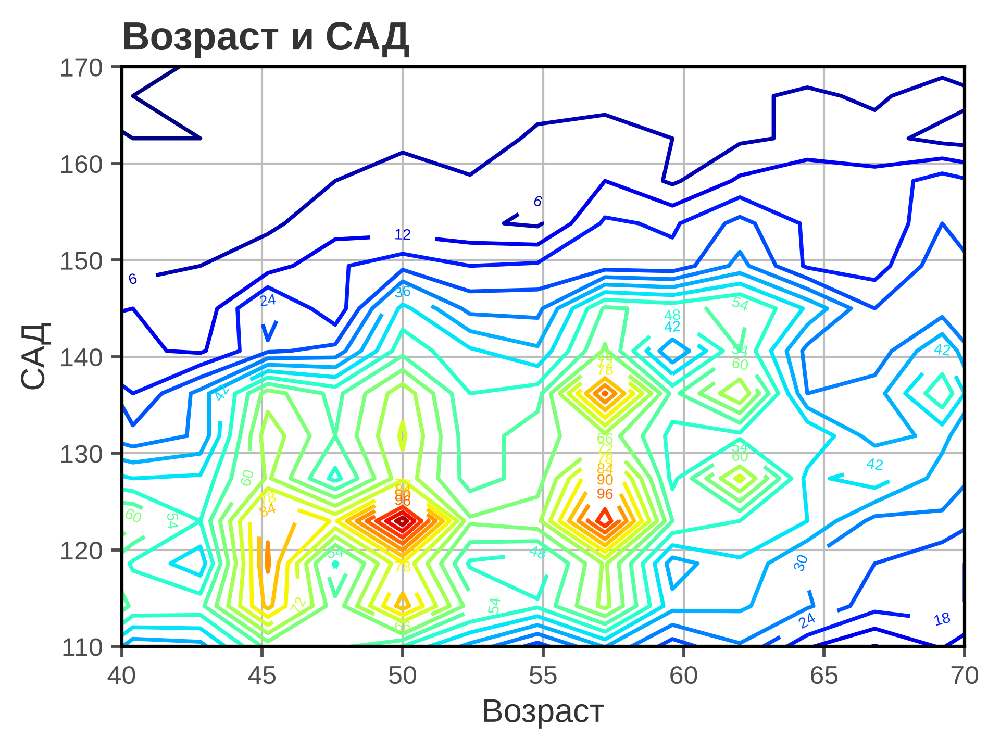
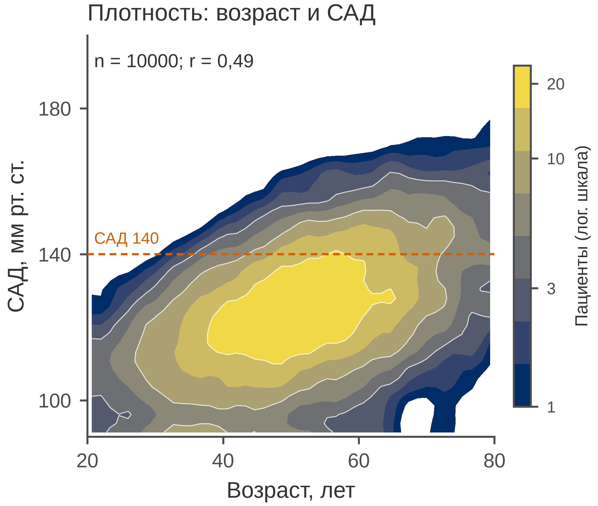

# 5.07 Contour: изолинии плотности

Contour plot рисует линии равного значения: плотности, вероятности,
поверхности отклика. В отличие от hexbin, контурная карта выглядит
гладкой и показывает форму облака, но именно поэтому она может
«придумать» структуру, которой нет в данных.

Правило: **сначала плотность, потом линии.** Контурные линии — это
изолинии оценки плотности; без colorbar и подписи уровней они ничего
не значат.

## 5.07.1 Сфера применения

Contour отвечает на вопрос: **где плотность (или значение поверхности)
одинакова и какова форма двумерного распределения?**

Типичные случаи:

- 2D-плотность больших выборок (возраст и САД, BMI и глюкоза);
- поверхность отклика (доза × время → эффект);
- доверительные области и эллипсы;
- топография/визуализация пространственных полей;
- сглаженная альтернатива hexbin.

Когда contour **не** нужен:

- точек мало — контурная оценка неустойчива;
- нужно прочитать отдельное наблюдение;
- важна локальная структура, а не гладкая форма — hexbin/scatter;
- уровни выбраны произвольно и не подписаны;
- сглаживание скрывает реальные разрывы.

## 5.07.2 Данные

Сценарий: 10 000 взрослых, возраст (лет) и систолическое АД
(мм рт. ст.). САД растёт с возрастом, разброс тоже растёт.

| Колонка | Смысл | Единица |
|---|---|---|
| `patient_id` | идентификатор пациента | — |
| `age_years` | возраст | лет |
| `sbp_mm_hg` | систолическое АД | мм рт. ст. |

Средний возраст — 51,8 ± 14,7 лет; САД — 125,0 ± 17,3 мм рт. ст.;
корреляция *r* = 0,49. Порог 140 мм рт. ст. отмечен на графике.

Генератор: [`make_data.py`](scripts/make_data.py) → [`data/07_dataset.csv`](../../data/07_dataset.csv).

## 5.07.3 Плохой график



Код: [`bad_plot.py`](scripts/bad_plot.py).

Что с ним не так:

1. **Палитра `jet` и 20 уровней.** Ложные границы, «радуга»,
   неразличимая при дальтонизме.
2. **Подписи уровней налезают друг на друга.** Читать карту
   невозможно.
3. **Обрезанные оси (40–70 и 110–170).** Хвосты распределения
   скрыты.
4. **Тяжёлая сетка по обеим осям и полная рамка.** Шум поверх
   и без того шумной карты.
5. **Заголовок «Возраст и САД».** Не сообщает, что показана
   плотность и где порог.
6. **Нет единиц, *n*, colorbar и порога 140.** Цвет и уровни
   не читаются.
7. **Слишком мелкие бины.** Карта выглядит «рябой»: шум
   гистограммы принимается за структуру.

## 5.07.4 Правильный график



Код: [`good_plot.py`](scripts/good_plot.py).

Что улучшено:

1. **Сглаженная 2D-плотность.** `gaussian_filter` убирает шум бинов,
   не стирая облако; структура читается.
2. **`cividis` и 9 уровней.** Последовательная доступная шкала,
   без ложных границ.
3. **Полный диапазон осей.** 20–80 лет и 90–200 мм рт. ст.
4. **Подписанный colorbar.** «Пациенты (лог. шкала)», деления
   1/3/10/20.
5. **Порог 140 мм рт. ст.** Выделен пунктиром и подписью.
6. **Единицы, *n* и *r*.** «Возраст, лет», «САД, мм рт. ст.»,
   *n* = 10000, *r* = 0,49.
7. **Без тяжёлой сетки.** Контурные линии — единственная
   вспомогательная графика.
8. **85 мм.** Рисунок спроектирован в конечном размере.

Контурная карта — это **оценка** плотности. Сглаживание и число
уровней — параметры модели, а не «истина». Если структура важна,
сравните contour с hexbin или scatter.

## 5.07.5 Сопоставление

| Что было | Почему плохо | Что сделано |
|---|---|---|
| `jet`, 20 уровней | ложные границы, CVD | `cividis`, 9 уровней |
| подписи всех уровней | налезают | без подписей, colorbar |
| оси 40–70 / 110–170 | хвосты обрезаны | 20–80 / 90–200 |
| мелкие бины | шум как структура | сглаживание |
| сетка по X и Y | шум | без сетки |
| полная рамка | визуальный шум | только левая и нижняя оси |
| «Возраст и САД» | нет сообщения | заголовок о плотности |
| нет единиц и n | невозможно прочитать | единицы, n, r |
| нет colorbar | цвет не читается | colorbar 1–20 |
| нет порога 140 | клинический контекст потерян | пунктир 140 |

## 5.07.6 Чек-лист contour

- [ ] Понятно, что такое «уровень» и что кодирует цвет.
- [ ] Указаны единицы и *n*.
- [ ] Оси не обрезают данные.
- [ ] Уровни подписаны или есть colorbar.
- [ ] Палитра последовательная, не `jet`.
- [ ] Сглаживание не уничтожает реальную структуру.
- [ ] Подписи уровней не налезают.
- [ ] Есть клинический/смысловой порог, если он важен.
- [ ] Для локальной структуры рассмотрен hexbin.
- [ ] Рисунок проверен в конечном размере 85 мм.

## 5.07.7 Как воспроизвести

```bash
uv sync
uv run python 05_charts/07_contour/scripts/make_data.py
uv run python 05_charts/07_contour/scripts/bad_plot.py
uv run python 05_charts/07_contour/scripts/good_plot.py
```

Ключевой фрагмент:

```python
hist, xedges, yedges = np.histogram2d(
    age, sbp, bins=(45, 45), range=[[20, 80], [90, 200]]
)
smooth = gaussian_filter(hist, sigma=1.2)
levels = np.logspace(0, np.log10(smooth.max()), 9)
ax.contourf(xx, yy, smooth.T, levels=levels, cmap="cividis")
```

`sigma` и число уровней — параметры сглаживания. Меняйте их
осознанно и проверяйте, что вывод не зависит от выбранного
сглаживания.

## 5.07.8 Что дальше

Следующий график — **5.08 loess**: нелинейный тренд на scatter
с доверительной полосой. У него будет свой генератор и свой
`data/08_dataset.csv`.

## Источники

- Wilke C. O. *Fundamentals of Data Visualization*. 2019. —
  [clauswilke.com/dataviz](https://clauswilke.com/dataviz/)
- Matplotlib: `contourf` —
  [matplotlib.org](https://matplotlib.org/stable/api/_as_gen/matplotlib.axes.Axes.contourf.html)
- SciPy: `gaussian_filter` —
  [docs.scipy.org](https://docs.scipy.org/doc/scipy/reference/generated/scipy.ndimage.gaussian_filter.html)
- Tufte E. R. *The Visual Display of Quantitative Information*. 1983. —
  [edwardtufte.com](https://www.edwardtufte.com/tufte/books_vdqi)
