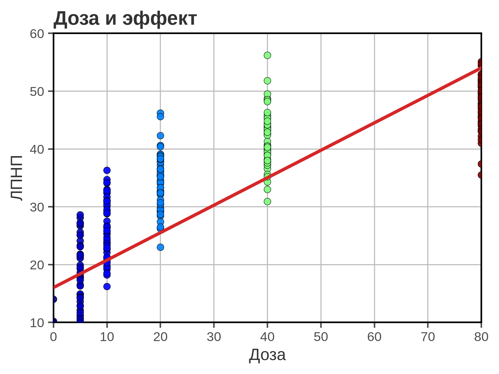
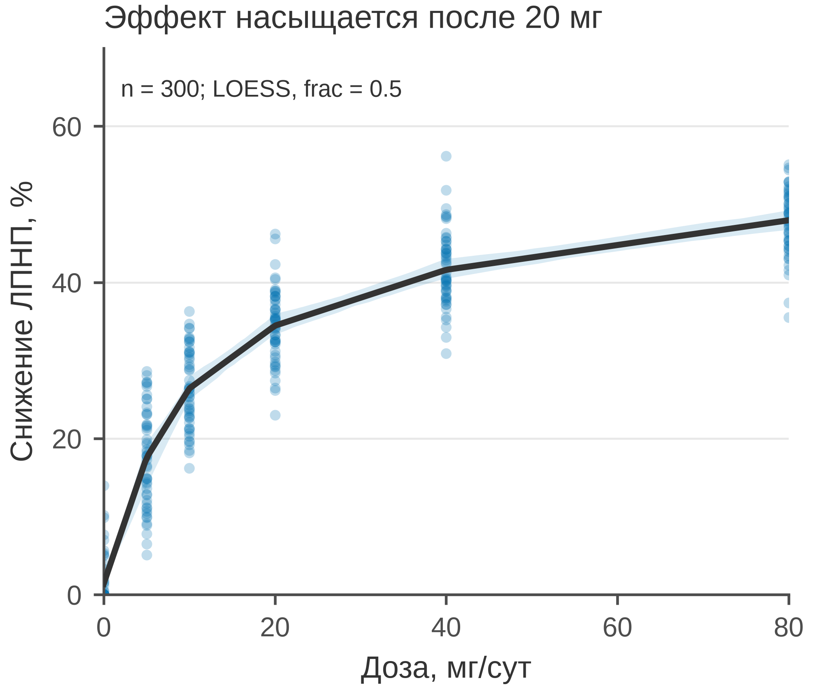

# 5.08 LOESS: нелинейный тренд

LOESS (locally estimated scatterplot smoothing) — локальная регрессия:
для каждой точки строится свой полином по соседям. Он не предполагает
глобальной формы связи и поэтому хорошо показывает насыщение, пороги
и изгибы, которые линейная прямая пропускает.

Но LOESS — это **описание тренда**, а не модель причинности. Он зависит
от ширины окна (`frac`), плохо ведёт себя на краях и не годится для
экстраполяции.

## 5.08.1 Сфера применения

LOESS отвечает на вопрос: **как выглядит нелинейный тренд, если не
навязывать ему форму?**

Где это пригодится:

- доза–эффект с насыщением (статин и ЛПНП, препарат и АД);
- проверка линейности перед регрессией;
- нелинейные биомаркерные ассоциации;
- сглаживание временных рядов (но для времени чаще line/step);
- визуальная проверка порогов и плато.

Когда LOESS **не** нужен:

- точек мало (десятки) — сглаживание неустойчиво;
- нужна предсказательная модель или экстраполяция;
- важна причинная интерпретация;
- данные имеют резкие разрывы, которые нельзя сглаживать;
- `frac` выбран так, что исчезает реальная структура.

## 5.08.2 Данные

Сценарий: 300 пациентов, фиксированные дозы статина 0, 5, 10, 20, 40
и 80 мг/сут. Эффект — снижение ЛПНП (%), насыщается с ростом дозы.

| Колонка | Смысл | Единица |
|---|---|---|
| `patient_id` | идентификатор пациента | — |
| `dose_mg` | доза статина | мг/сут |
| `ldl_reduction_pct` | снижение ЛПНП | % |

Средние по дозам: 0 мг — 1,7 %, 5 мг — 17,6 %, 10 мг — 26,4 %,
20 мг — 34,5 %, 40 мг — 41,8 %, 80 мг — 47,7 %. Рост замедляется:
это и есть насыщение.

Генератор: [`make_data.py`](scripts/make_data.py) → [`data/08_dataset.csv`](../../data/08_dataset.csv).

## 5.08.3 Плохой график



Код: [`bad_plot.py`](scripts/bad_plot.py).

Что не так:

1. **Линейная регрессия на нелинейных данных.** Прямая не описывает
   плато: на 80 мг она завышает эффект, на 10–20 мг — занижает.
2. **Цвет точек по дозе.** Доза уже на оси X; цвет дублирует ось
   и добавляет радужную шкалу.
3. **Обрезанная ось Y (10–60).** Низкие дозы и хвост скрыты.
4. **Крупные непрозрачные точки, тяжёлая сетка, полная рамка.**
5. **Заголовок «Доза и эффект».** Не сообщает, что эффект
   насыщается.
6. **Нет единиц, n, доверительной полосы и описания модели.**

## 5.08.4 Правильный график



Код: [`good_plot.py`](scripts/good_plot.py).

Что изменилось:

1. **LOESS вместо прямой.** Видно быстрое снижение ЛПНП до 20 мг
   и выполаживание после.
2. **Bootstrap-полоса 95 %.** Показана неопределённость кривой;
   на краях она шире.
3. **Полный диапазон осей.** 0–80 мг и 0–70 %.
4. **Полупрозрачные точки одного цвета.** Видна плотность,
   нет двойного кодирования.
5. **Единицы, n и `frac`.** «Доза, мг/сут», «Снижение ЛПНП, %»,
   *n* = 300, `frac = 0.5`.
6. **Заголовок-вывод.** «Эффект насыщается после 20 мг» задаёт
   сообщение.
7. **Лёгкая сетка только по Y, без верхней и правой рамок.**
8. **85 мм.** Рисунок спроектирован в конечном размере.

`frac` — доля наблюдений в локальном окне. Маленький `frac` даёт
извилистую кривую, большой — слишком гладкую. Показывайте выбранное
значение и проверяйте устойчивость.

## 5.08.5 Было и стало
| Что было | Почему плохо | Что сделано |
|---|---|---|
| линейная прямая | не описывает плато | LOESS |
| цвет по дозе | двойное кодирование | один цвет |
| ось Y 10–60 | низкие дозы обрезаны | 0–70 |
| крупные точки | шум | s=10, alpha=0,25 |
| нет CI | не видна неопределённость | bootstrap 95 % |
| сетка по X и Y | шум | сетка только по Y |
| полная рамка | визуальный шум | только левая и нижняя оси |
| «Доза и эффект» | нет сообщения | заголовок-вывод |
| нет единиц и n | невозможно прочитать | единицы, n, frac |

## 5.08.6 Чек-лист LOESS

- [ ] Понятно, что кривая — описание тренда, а не модель причинности.
- [ ] Указан `frac` (или span) и число точек.
- [ ] Показана неопределённость (bootstrap/CI).
- [ ] Оси не обрезают данные.
- [ ] Нет экстраполяции за пределы данных.
- [ ] Краевые эффекты не интерпретируются как реальные.
- [ ] Точки видны, а не закрыты линией.
- [ ] Есть единицы и *n*.
- [ ] Сравнение с линейной моделью/Spline/GAM осознано.
- [ ] Рисунок проверен в конечном размере 85 мм.

## 5.08.7 Как воспроизвести

```bash
uv sync
uv run python 05_charts/08_loess/scripts/make_data.py
uv run python 05_charts/08_loess/scripts/bad_plot.py
uv run python 05_charts/08_loess/scripts/good_plot.py
```

Вот как это выглядит в коде:

```python
from statsmodels.nonparametric.smoothers_lowess import lowess

fit = lowess(y, x, frac=0.5, return_sorted=True)
grid = np.linspace(0, 80, 200)
mean_line = np.interp(grid, fit[:, 0], fit[:, 1])

# bootstrap-полоса
boots = []
for _ in range(200):
    idx = rng.integers(0, len(x), len(x))
    boot = lowess(y[idx], x[idx], frac=0.5, return_sorted=True)
    boots.append(np.interp(grid, boot[:, 0], boot[:, 1]))
low, high = np.percentile(boots, [2.5, 97.5], axis=0)
```

Bootstrap здесь оценивает неопределённость **кривой**, а не отдельных
пациентов. Для формального вывода о дозе–эффекте нужна
параметрическая модель (Emax, spline, GAM) и клиническое обоснование.

## 5.08.8 Что дальше

Следующий график — **5.09 histogram**: распределение одной непрерывной
величины. У него будет свой генератор и свой `data/09_dataset.csv`.

## Источники

- Cleveland W. S. Robust Locally Weighted Regression and Smoothing
  Scatterplots // *JASA*. 1979. —
  [doi:10.1080/01621459.1979.10482531](https://doi.org/10.1080/01621459.1979.10482531)
- Wilke C. O. *Fundamentals of Data Visualization*. 2019. —
  [clauswilke.com/dataviz](https://clauswilke.com/dataviz/)
- Statsmodels: LOWESS —
  [statsmodels.org](https://www.statsmodels.org/stable/generated/statsmodels.nonparametric.smoothers_lowess.lowess.html)
- Tufte E. R. *The Visual Display of Quantitative Information*. 1983. —
  [edwardtufte.com](https://www.edwardtufte.com/tufte/books_vdqi)