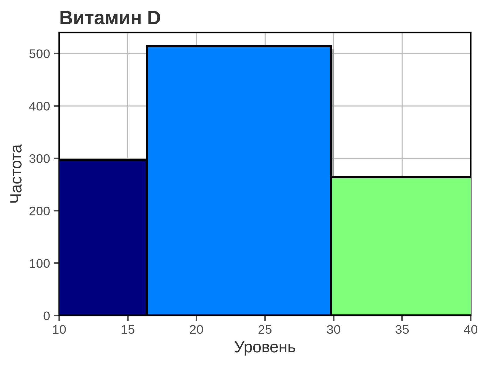
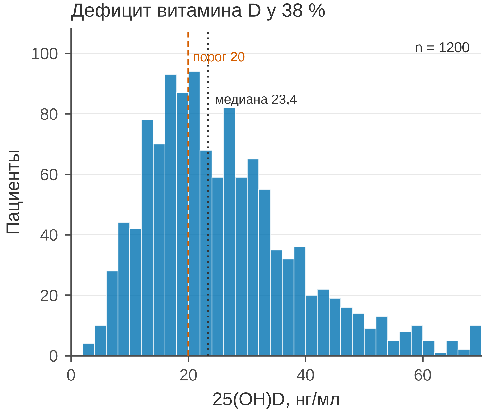

# 5.09 Гистограмма: распределение одной величины

Гистограмма показывает, как распределена одна непрерывная величина:
центр, разброс, форму, скошенность и выбросы. Она отвечает на вопрос
«как устроена выборка», а не «как связаны две переменные».

Главная ловушка — **выбор ширины бина**. Слишком широкие бины скрывают
форму, слишком узкие — превращают шум в «структуру». Гистограмма — это
семейство изображений, а не одно «истинное».

## 5.09.1 Сфера применения

Гистограмма отвечает на вопрос: **как распределена величина и где
её центр, разброс, хвосты?**

Где это пригодится:

- распределение биомаркера (витамин D, CRP, глюкоза);
- проверка нормальности/скошенности перед тестом;
- поиск выбросов и многомодальности;
- описание выборки до сравнения групп;
- контроль качества измерений.

Когда гистограмма **не** подходит:

- наблюдений мало (десятки) — лучше точки/strip;
- нужно точное значение или квантиль — ECDF (5.10);
- несколько групп — box/violin/small multiples;
- важна форма хвоста, а бины её огрубляют;
- ось X обрезана и хвост скрыт.

## 5.09.2 Данные

Сценарий: 1 200 взрослых, уровень 25(OH)D (нг/мл). Распределение
сдвинуто влево и имеет правый хвост.

| Колонка | Смысл | Единица |
|---|---|---|
| `patient_id` | идентификатор пациента | — |
| `vitamin_d_ng_ml` | 25(OH)D | нг/мл |

Медиана — 23,4 нг/мл; IQR — 16,5–32,5; дефицит (< 20 нг/мл) —
у 38 %; диапазон 3–70 нг/мл.

Генератор: [`make_data.py`](scripts/make_data.py) → [`data/09_dataset.csv`](../../data/09_dataset.csv).

## 5.09.3 Плохой график



Код: [`bad_plot.py`](scripts/bad_plot.py).

Что не так:

1. **Пять бинов.** Форма распределения и правый хвост исчезли;
   осталось три столбца.
2. **Обрезанная ось X (10–40).** Низкие и высокие значения
   не видны.
3. **Радужные столбцы, чёрные края и тени.** Декор, который
   не кодирует данные.
4. **Тяжёлая сетка по обеим осям и полная рамка.**
5. **Заголовок «Витамин D».** Не сообщает, что важно:
   дефицит, медиана, форма.
6. **Нет единиц, n, медианы и порога 20.** Гистограмма
   не читается как клинический результат.

## 5.09.4 Правильный график



Код: [`good_plot.py`](scripts/good_plot.py).

Что изменилось:

1. **Ширина бина 2 нг/мл.** Видна форма, правый хвост и мода
   около 18–24 нг/мл.
2. **Полный диапазон 0–70 нг/мл.** Ничего не обрезано.
3. **Один цвет, белые края, без теней.**
4. **Порог дефицита 20 нг/мл** выделен пунктиром.
5. **Медиана 23,4 нг/мл** отмечена и подписана.
6. **n = 1200 и доля дефицита 38 %** в заголовке.
7. **Единицы, лёгкая сетка только по Y, без верхней и правой рамок.**
8. **85 мм.** Рисунок спроектирован в конечном размере.

Проверьте устойчивость: постройте гистограмму с шириной 1, 2 и 5 нг/мл.
Если вывод меняется, он не должен держаться на одном выборе бинов.

## 5.09.5 Было и стало
| Что было | Почему плохо | Что сделано |
|---|---|---|
| 5 бинов | форма и хвост скрыты | бины по 2 нг/мл |
| ось X 10–40 | хвосты обрезаны | 0–70 |
| радуга, тени | декор | один цвет |
| сетка по X и Y | шум | сетка только по Y |
| полная рамка | визуальный шум | только левая и нижняя оси |
| «Витамин D» | нет сообщения | заголовок о дефиците |
| нет единиц и n | невозможно прочитать | единицы, n |
| нет порога и медианы | клинический контекст потерян | порог 20, медиана |
| counts без подписи | непонятно, что такое Y | «Пациенты» |

## 5.09.6 Чек-лист гистограммы

- [ ] Указана единица измерения.
- [ ] Ось X не обрезает хвосты.
- [ ] Ширина бина осмысленна; проверена устойчивость.
- [ ] Указаны *n* и, если важно, медиана/IQR.
- [ ] Есть клинический порог, если он существенен.
- [ ] Один цвет, без 3D и теней.
- [ ] Сетка не конкурирует с данными.
- [ ] Понятно, что по Y: пациенты или плотность.
- [ ] Для малых *n* рассмотрены точки/ECDF.
- [ ] Рисунок проверен в конечном размере 85 мм.

## 5.09.7 Как воспроизвести

```bash
uv sync
uv run python 05_charts/09_histogram/scripts/make_data.py
uv run python 05_charts/09_histogram/scripts/bad_plot.py
uv run python 05_charts/09_histogram/scripts/good_plot.py
```

Вот как это выглядит в коде:

```python
bins = np.arange(0, 72, 2)
counts, _, _ = ax.hist(
    values, bins=bins,
    color=PRIMARY_BLUE, alpha=0.8,
    edgecolor="white", linewidth=0.4,
)
ax.axvline(20, color=ACCENT_VERMILLION, linestyle="--", linewidth=0.9)
ax.axvline(np.median(values), color="#333333", linestyle=":", linewidth=0.9)
```

`bins` можно задать числом или массивом границ. Массив границ
предпочтительнее: он фиксирует ширину и облегчает сравнение
нескольких выборок.

## 5.09.8 Что дальше

Следующий график — **5.10 ECDF**: эмпирическая функция распределения,
точное чтение квантилей. У него будет свой генератор и свой
`data/10_dataset.csv`.

## Источники

- Wilke C. O. *Fundamentals of Data Visualization*. 2019. —
  [clauswilke.com/dataviz](https://clauswilke.com/dataviz/)
- Matplotlib: `hist` —
  [matplotlib.org](https://matplotlib.org/stable/api/_as_gen/matplotlib.axes.Axes.hist.html)
- Tufte E. R. *The Visual Display of Quantitative Information*. 1983. —
  [edwardtufte.com](https://www.edwardtufte.com/tufte/books_vdqi)
- Weissgerber T. L. et al. Beyond Bar and Line Graphs // *PLoS Biology*.
  2015. — [doi:10.1371/journal.pbio.1002128](https://doi.org/10.1371/journal.pbio.1002128)