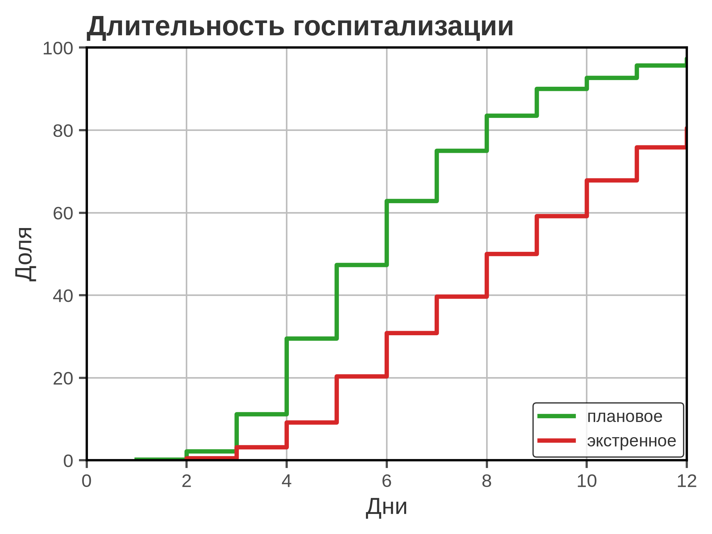
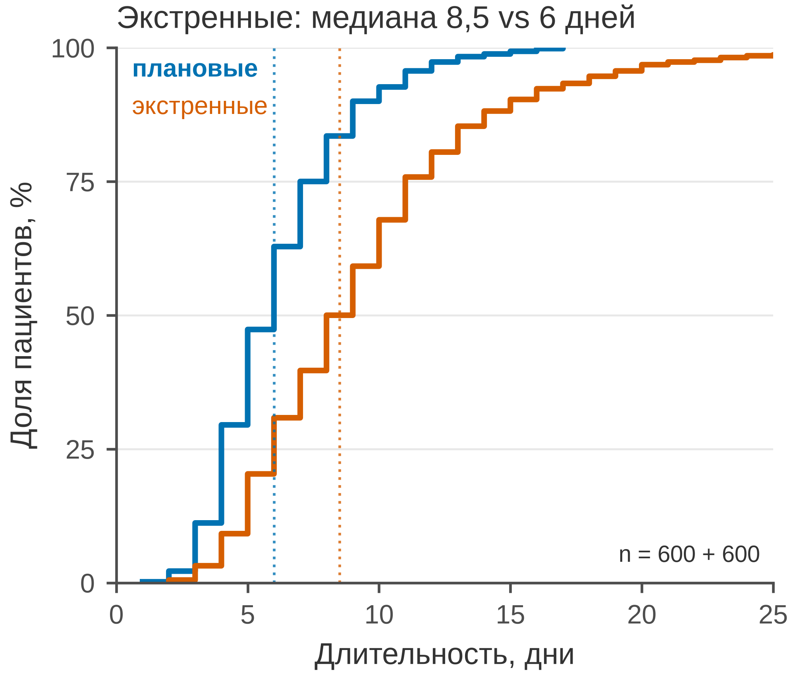

# 5.10 ECDF: функция распределения

ECDF (empirical cumulative distribution function) показывает, какая
доля наблюдений не превышает каждое значение X. В отличие от
гистограммы, здесь нет бинов: кривая строится по всем точкам и позволяет
точно прочитать медиану, квартили и любой перцентиль.

ECDF — это ступенчатая функция. Каждый скачок — одно или несколько
наблюдений; высота ступени — накопленная доля.

## 5.10.1 Сфера применения

ECDF отвечает на вопрос: **какая доля пациентов имеет значение ≤ x
и где проходят квантили?**

Где это пригодится:

- распределение длительности госпитализации, времени до выписки;
- сравнение двух групп по всей кривой, а не только по средним;
- чтение медианы, IQR и перцентилей;
- проверка сдвига распределения;
- малые и средние выборки, где гистограмма капризна.

Когда ECDF **не** подходит:

- время до события с цензурированием — Kaplan–Meier (5.27);
- нужно показать плотность/форму — histogram/KDE;
- групп слишком много — кривые перекрываются (нужны small multiples);
- нужна одна сводка, а не распределение — dot/box.

## 5.10.2 Данные

Сценарий: 1 200 госпитализаций, 600 плановых и 600 экстренных.
Длительность — дни; распределение скошено вправо.

| Колонка | Смысл | Единица |
|---|---|---|
| `patient_id` | идентификатор пациента | — |
| `admission_type` | плановое/экстренное | — |
| `los_days` | длительность госпитализации | дни |

Медиана: плановые — 6 дней, экстренные — 8,5 дня. Средние: 6,2 и 9,4.
Правый хвост — до 20–25 дней.

Генератор: [`make_data.py`](scripts/make_data.py) → [`data/10_dataset.csv`](../../data/10_dataset.csv).

## 5.10.3 Плохой график



Код: [`bad_plot.py`](scripts/bad_plot.py).

Что не так:

1. **Ось X обрезана до 12 дней.** Правый хвост и половина кривой
   скрыты; экстренные госпитализации выглядят короче, чем есть.
2. **Красно-зелёная пара.** Неразличима при протанопии/дейтеранопии.
3. **Легенда.** Заставляет переводить взгляд; для двух групп лучше
   прямые подписи.
4. **Толстые ступени, тяжёлая сетка, полная рамка.**
5. **Нет медиан, квартилей, единиц и n.**
6. **Заголовок «Длительность госпитализации».** Не сообщает,
   что экстренные длиннее.

## 5.10.4 Правильный график



Код: [`good_plot.py`](scripts/good_plot.py).

Что изменилось:

1. **Полный диапазон 0–25 дней.** Обе кривые видны целиком,
   включая хвост.
2. **Синий и вермиллион.** Различимы при CVD; без легенды,
   с прямыми подписями.
3. **Медианы отмечены пунктиром.** 6 и 8,5 дня; разница видна
   на уровне 50 %.
4. **Ось Y в процентах.** «Доля пациентов, %» читается
   без пересчёта.
5. **n = 600 + 600.** Понятно, сколько наблюдений в группах.
6. **Заголовок-вывод.** «Экстренные: медиана 8,5 vs 6 дней».
7. **Лёгкая сетка только по Y, без верхней и правой рамок.**
8. **85 мм.** Рисунок спроектирован в конечном размере.

ECDF читается так: найдите на оси X интересующий срок, поднимитесь
до кривой и посмотрите долю на оси Y. Медиана — точка, где кривая
пересекает 50 %.

## 5.10.5 Было и стало
| Что было | Почему плохо | Что сделано |
|---|---|---|
| ось X 0–12 | хвост обрезан | 0–25 |
| красный/зелёный | CVD | синий/вермиллион |
| легенда | лишний поиск | прямые подписи |
| толстые ступени | шум | 1,7 pt |
| нет медиан | не читаются квантили | пунктирные медианы |
| нет единиц и n | невозможно прочитать | «дни», n = 600 + 600 |
| «Длительность…» | нет сообщения | заголовок с медианами |
| сетка по X и Y | шум | сетка только по Y |

## 5.10.6 Чек-лист ECDF

- [ ] Ось X не обрезает хвост.
- [ ] Указаны единицы и *n*.
- [ ] Подписаны группы (прямо или легендой).
- [ ] Медиана/квартили отмечены, если они важны.
- [ ] Ось Y — доля или процент, ясно что именно.
- [ ] Нет лишних цветов и толстых ступеней.
- [ ] Для цензурированных данных выбран Kaplan–Meier.
- [ ] Сравнение групп не сводится к средним.
- [ ] Кривые не перекрываются из-за числа групп.
- [ ] Рисунок проверен в конечном размере 85 мм.

## 5.10.7 Как воспроизвести

```bash
uv sync
uv run python 05_charts/10_ecdf/scripts/make_data.py
uv run python 05_charts/10_ecdf/scripts/bad_plot.py
uv run python 05_charts/10_ecdf/scripts/good_plot.py
```

Вот как это выглядит в коде:

```python
def ecdf(values):
    xs = np.sort(values)
    ys = np.arange(1, len(xs) + 1) / len(xs) * 100
    return xs, ys

xs, ys = ecdf(values)
ax.step(xs, ys, where="post", color=PRIMARY_BLUE, linewidth=1.7)
ax.axvline(np.median(values), color=PRIMARY_BLUE, linestyle=":", linewidth=0.8)
```

`where="post"` важен: ступень держится до следующего значения.
Для сравнения групп используйте одинаковые оси и прямые подписи.

## 5.10.8 Что дальше

Следующий график — **5.11 box plot**: сравнение распределений
по группам. У него будет свой генератор и свой `data/11_dataset.csv`.

## Источники

- Wilke C. O. *Fundamentals of Data Visualization*. 2019. —
  [clauswilke.com/dataviz](https://clauswilke.com/dataviz/)
- Matplotlib: `step` —
  [matplotlib.org](https://matplotlib.org/stable/api/_as_gen/matplotlib.axes.Axes.step.html)
- Weissgerber T. L. et al. Beyond Bar and Line Graphs // *PLoS Biology*.
  2015. — [doi:10.1371/journal.pbio.1002128](https://doi.org/10.1371/journal.pbio.1002128)
- Tufte E. R. *The Visual Display of Quantitative Information*. 1983. —
  [edwardtufte.com](https://www.edwardtufte.com/tufte/books_vdqi)