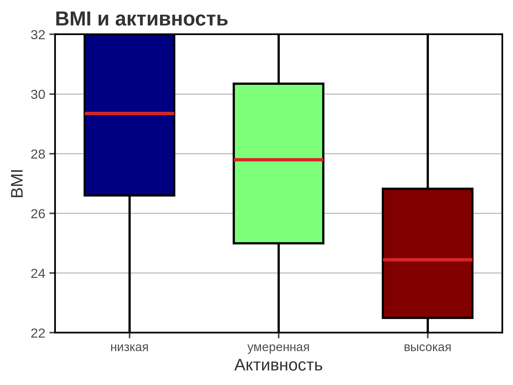
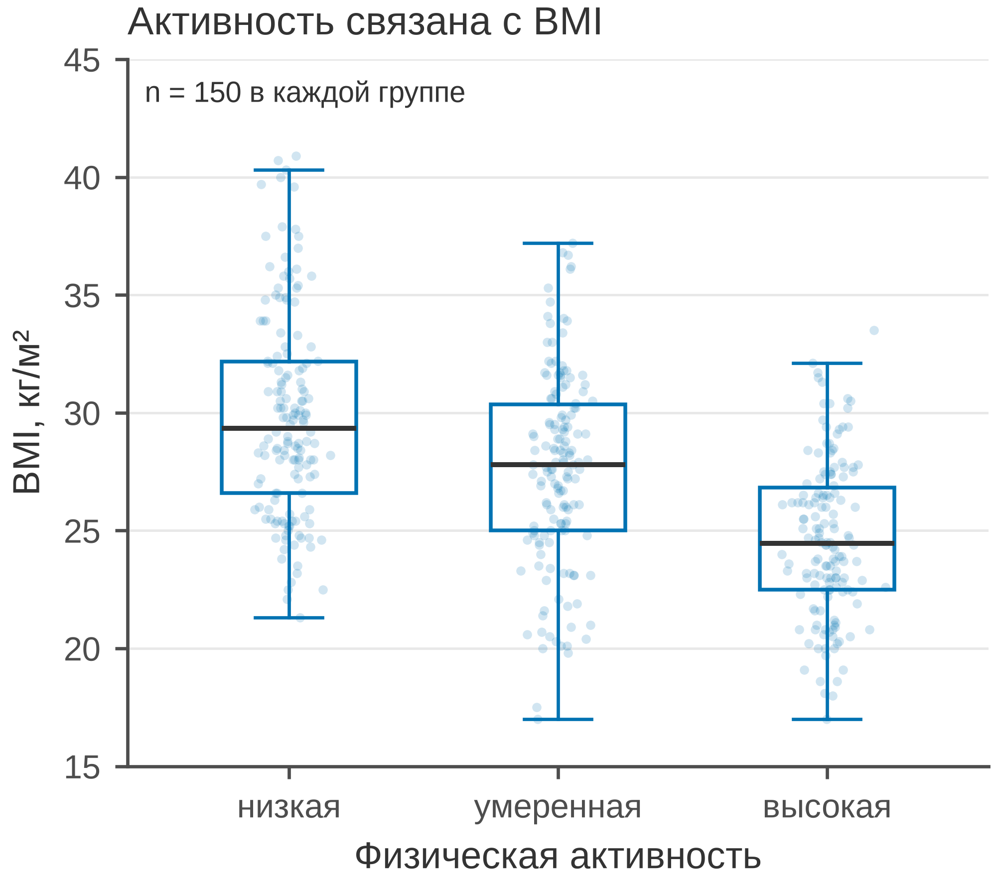
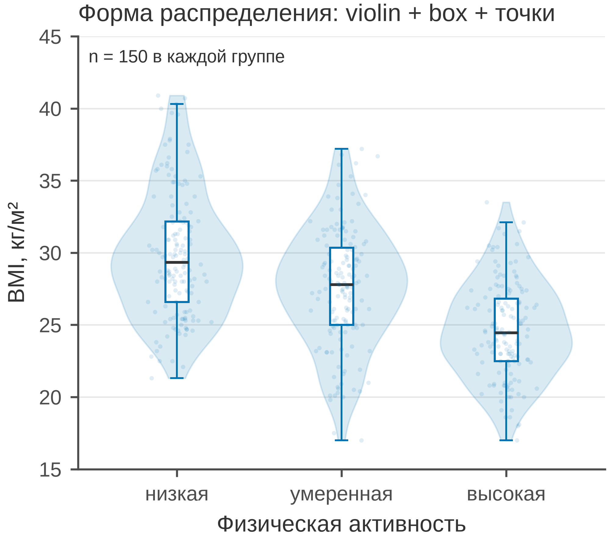
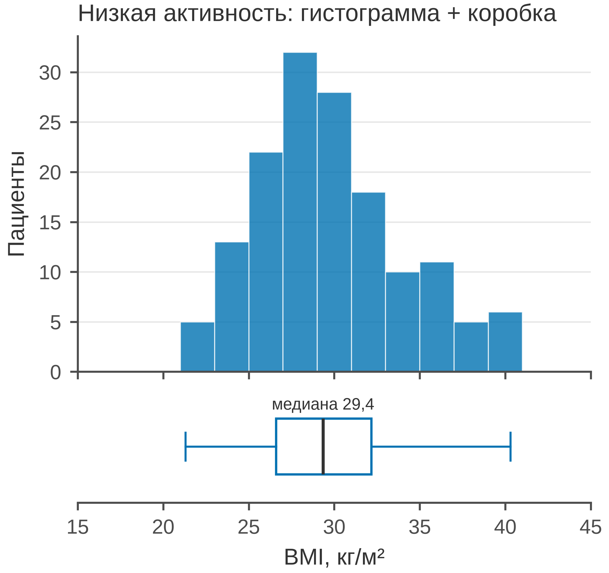

# 5.11 Boxplot: сравнение распределений по группам

Boxplot — компактная сводка распределения: медиана, межквартильный
размах (IQR), усы и выбросы. Он хорош для сравнения 2–5 групп, но
**сам по себе скрывает форму** распределения и размер выборки.

Поэтому в этом разделе показаны четыре варианта:

1. плохой boxplot;
2. boxplot + отдельные точки;
3. violin + box + точки;
4. boxplot, совмещённый с гистограммой.

## 5.11.1 Сфера применения

Boxplot отвечает на вопрос: **как различаются медианы и разброс
между группами?**

Где это пригодится:

- сравнение биомаркера по 2–5 группам (активность, тяжесть, центр);
- проверка сдвига и разброса до формального теста;
- поиск выбросов;
- компактная сводка в таблице рисунков;
- сравнение до/после (но для парных данных — 5.18).

Когда boxplot **не** достаточен:

- нужно увидеть форму/модальность — violin или histogram;
- групп много — small multiples;
- выборка маленькая — точки важнее коробки;
- нужны точные квантили — ECDF (5.10);
- данные цензурированы — Kaplan–Meier (5.27).

## 5.11.2 Данные

Сценарий: 450 взрослых, три уровня физической активности —
низкая, умеренная, высокая. Показатель — BMI (кг/м²), по 150 человек
в группе.

| Колонка | Смысл | Единица |
|---|---|---|
| `patient_id` | идентификатор пациента | — |
| `activity` | уровень активности | — |
| `bmi_kg_m2` | индекс массы тела | кг/м² |

Медианы: низкая — 29,4; умеренная — 27,8; высокая — 24,4 кг/м².
Есть правый хвост и отдельные выбросы.

Генератор: [`make_data.py`](scripts/make_data.py) → [`data/11_dataset.csv`](../../data/11_dataset.csv).

## 5.11.3 Плохой график



Код: [`bad_plot.py`](scripts/bad_plot.py).

Что не так:

1. **Ось Y обрезана до 22–32.** Выбросы и хвосты скрыты; высокая
   группа выглядит «обрезанной».
2. **Радужные ящики, красные медианы и выбросы.** Декор вместо
   данных; CVD-небезопасно.
3. **Нет отдельных точек.** Не видно формы, размера групп и того,
   что за пределами усов.
4. **Тяжёлая сетка, полная рамка, толстые линии.**
5. **Заголовок «BMI и активность».** Не сообщает направление
   и величину различий.
6. **Нет единиц и *n*.**

## 5.11.4 Boxplot + точки



Код: [`good_box_points.py`](scripts/good_box_points.py).

Что изменилось:

1. **Полный диапазон 15–45 кг/м².** Видны хвосты и выбросы.
2. **Белые ящики с синим контуром, тёмная медиана.** Один цвет,
   без радуги.
3. **Все 450 точек с jitter.** Видна плотность, форма и размер
   групп; выбросы не прячутся.
4. **Единицы, *n* = 150, заголовок-вывод.**
5. **Лёгкая сетка только по Y, 85 мм.**

Точки не заменяют boxplot: они показывают, что внутри коробки,
а коробка даёт сводку. Вместе они честнее, чем boxplot отдельно.

## 5.11.5 Violin + box + точки



Код: [`good_violin_box.py`](scripts/good_violin_box.py).

Что показывает:

1. **Violin** — оценку плотности: где значения встречаются чаще.
2. **Box** — медиану, IQR и усы.
3. **Точки** — исходные наблюдения.

Это «raincloud»-подход: форма, сводка и данные одновременно. Он хорош
для 3 групп и умеренных выборок. Но violin — это KDE: она может
«продлить» хвост за пределы реальных данных и создать ложную
плавность. При малых *n* доверяйте точкам больше, чем контуру.

## 5.11.6 Boxplot + гистограмма



Код: [`good_box_hist.py`](scripts/good_box_hist.py).

Что показывает:

1. **Гистограмма сверху** — форму распределения (бины по 2 кг/м²).
2. **Boxplot снизу** — медиану, IQR, усы и выбросы.
3. **Общая ось X** — гистограмма и коробка выровнены.

Этот вариант полезен, когда нужно показать и форму, и сводку для одной
переменной или одной группы. Медиана 29,4 кг/м² подписана прямо над
коробкой.

## 5.11.7 Было и стало
| Что было | Почему плохо | Что сделано |
|---|---|---|
| ось Y 22–32 | выбросы и хвосты скрыты | 15–45 |
| радуга, красные медианы | декор, CVD | один синий цвет |
| нет точек | не видна форма | jitter-точки |
| толстые линии | шум | 0,8–1,2 pt |
| сетка по X и Y | шум | сетка только по Y |
| полная рамка | визуальный шум | только левая и нижняя оси |
| «BMI и активность» | нет сообщения | заголовок-вывод |
| нет единиц и n | невозможно прочитать | единицы, n = 150 |
| только коробка | форма скрыта | + violin / histogram |

## 5.11.8 Чек-лист boxplot

- [ ] Ось Y не обрезает усы и выбросы.
- [ ] Указаны единицы и *n* (по группам).
- [ ] Медиана и IQR читаются; усы объяснены.
- [ ] Точки показаны, если *n* небольшое или важна форма.
- [ ] Для формы добавлен violin или histogram.
- [ ] Цвет не дублирует группы без смысла.
- [ ] Нет 3D, теней и радуги.
- [ ] Сетка не конкурирует с данными.
- [ ] Для многих групп — small multiples.
- [ ] Рисунок проверен в конечном размере.

## 5.11.9 Как воспроизвести

```bash
uv sync
uv run python 05_charts/11_box/scripts/make_data.py
uv run python 05_charts/11_box/scripts/bad_plot.py
uv run python 05_charts/11_box/scripts/good_box_points.py
uv run python 05_charts/11_box/scripts/good_violin_box.py
uv run python 05_charts/11_box/scripts/good_box_hist.py
```

Ключевые фрагменты:

```python
# boxplot + точки
ax.boxplot(data, positions=[1, 2, 3], widths=0.5, patch_artist=True,
           showfliers=False, boxprops={"facecolor": "white"})
for position, values in zip([1, 2, 3], data, strict=True):
    ax.scatter(position + rng.normal(0, 0.06, len(values)), values,
               s=5, alpha=0.18, linewidths=0)

# violin + box
ax.violinplot(data, positions=[1, 2, 3], widths=0.8, showextrema=False)

# histogram + horizontal box
fig, (ax_hist, ax_box) = plt.subplots(2, 1, sharex=True,
                                      gridspec_kw={"height_ratios": [3, 1]})
ax_box.boxplot([values], orientation="horizontal", positions=[0.5])
```

## 5.11.10 Что дальше

Следующий график — **5.12 violin**: отдельный разбор скрипичной
диаграммы, её преимуществ и ловушек. У него будет свой генератор
и свой `data/12_dataset.csv`.

## Источники

- Wilke C. O. *Fundamentals of Data Visualization*. 2019. —
  [clauswilke.com/dataviz](https://clauswilke.com/dataviz/)
- Weissgerber T. L. et al. Beyond Bar and Line Graphs // *PLoS Biology*.
  2015. — [doi:10.1371/journal.pbio.1002128](https://doi.org/10.1371/journal.pbio.1002128)
- Matplotlib: `boxplot` —
  [matplotlib.org](https://matplotlib.org/stable/api/_as_gen/matplotlib.axes.Axes.boxplot.html)
- Matplotlib: `violinplot` —
  [matplotlib.org](https://matplotlib.org/stable/api/_as_gen/matplotlib.axes.Axes.violinplot.html)