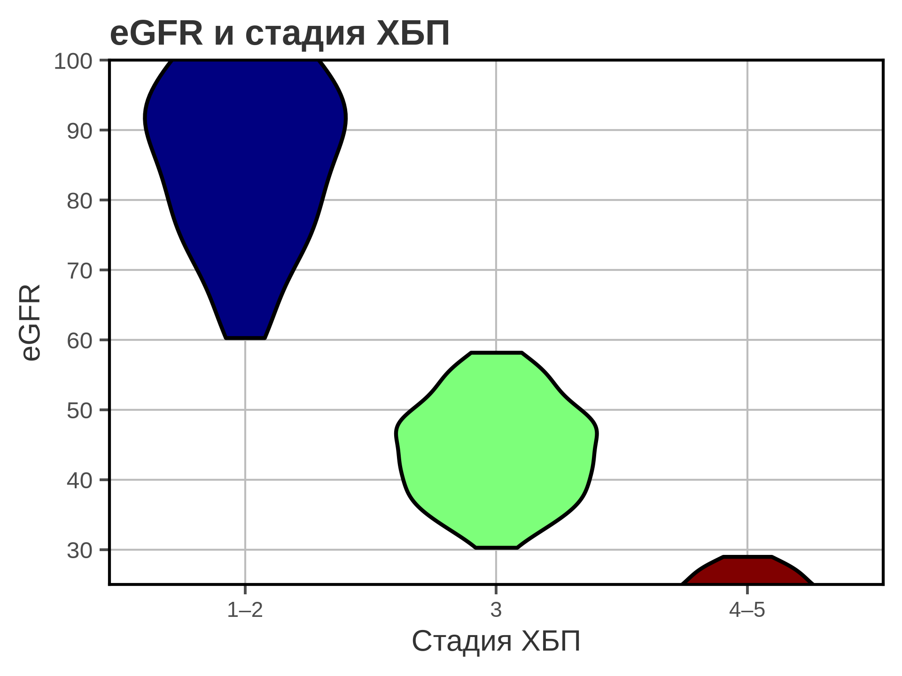
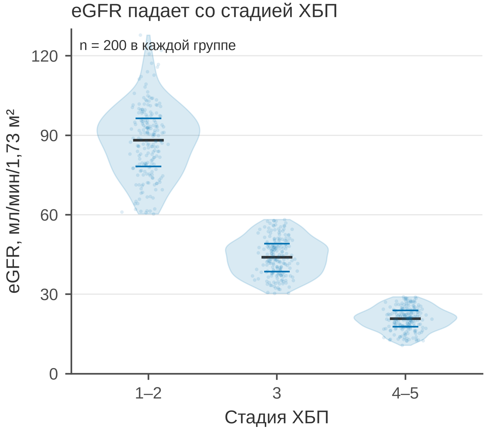
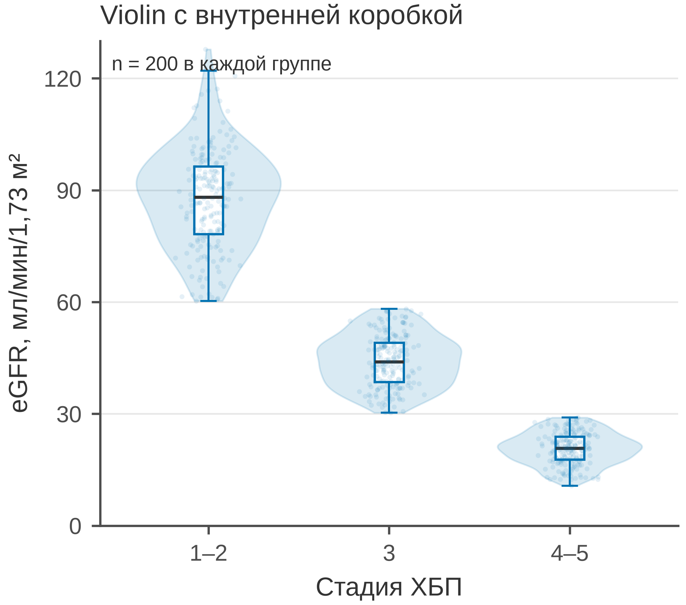

# 5.12 Violin: форма распределения

Violin plot — это зеркальная оценка плотности (KDE). Ширина скрипки
показывает, как часто встречаются значения; форма — модальность,
скошенность, хвосты. В отличие от boxplot, violin не прячет форму
за коробкой.

Но violin — это **оценка**, а не исходные данные. Ширина зависит от
bandwidth, хвосты могут выходить за реальный диапазон, а при малых *n*
контур становится фантазией. Поэтому внутри скрипки нужна сводка:
квартильные линии или коробка.

## 5.12.1 Сфера применения

Violin отвечает на вопрос: **как выглядит форма распределения
в каждой группе?**

Типичные случаи:

- сравнение 2–5 групп по непрерывной величине;
- поиск модальности/двугорбости;
- проверка формы перед выбором теста;
- замена boxplot, когда форма важна;
- презентация распределений в больших выборках.

Когда violin **не** нужен:

- *n* меньше ~20 — лучше точки/strip;
- нужны точные квантили — ECDF;
- групп много — small multiples;
- данные цензурированы — Kaplan–Meier;
- важна только медиана/IQR — boxplot.

## 5.12.2 Данные

Сценарий: 600 пациентов, три стадии ХБП (1–2, 3, 4–5). Показатель —
eGFR (мл/мин/1,73 м²), по 200 человек в группе.

| Колонка | Смысл | Единица |
|---|---|---|
| `patient_id` | идентификатор пациента | — |
| `ckd_stage` | стадия ХБП | — |
| `sex` | пол | — |
| `egfr_ml_min_1_73m2` | СКФ | мл/мин/1,73 м² |

Медианы: 88,2; 44,0; 20,8 мл/мин/1,73 м². Распределения сдвигаются
вниз, форма меняется.

Генератор: [`make_data.py`](scripts/make_data.py) → [`data/12_dataset.csv`](../../data/12_dataset.csv).

## 5.12.3 Плохой график



Код: [`bad_plot.py`](scripts/bad_plot.py).

Что с ним не так:

1. **Ось Y обрезана до 25–100.** Стадия 4–5 и верхний хвост
   стадии 1–2 скрыты; форма искажена.
2. **Радужные тела и толстые чёрные контуры.** Декор, CVD.
3. **Нет медианы, квартилей и точек.** Видна форма, но нет сводки
   и исходных наблюдений.
4. **Тяжёлая сетка, полная рамка.**
5. **Заголовок «eGFR и стадия ХБП».** Не сообщает направление.
6. **Нет единиц и *n*.**

## 5.12.4 Violin с квартильными линиями



Код: [`good_violin_quart.py`](scripts/good_violin_quart.py).

Что улучшено:

1. **Полный диапазон 0–130.** Все стадии и хвосты видны.
2. **Один цвет, без радуги.**
3. **Квартили и медиана — горизонтальными линиями.**
   Медиана толще, Q1/Q3 тоньше.
4. **Точки с jitter.** Видны наблюдения и размер групп.
5. **Единицы, *n* = 200, заголовок-вывод.**
6. **Лёгкая сетка по Y, 85 мм.**

## 5.12.5 Violin с внутренней коробкой



Код: [`good_violin_box.py`](scripts/good_violin_box.py).

Это версия «violin + прямоугольники»: внутри каждой скрипки —
мини-коробка с медианой, IQR и усами. Она полезна, когда нужно
одновременно показать форму (violin) и классическую сводку (box).

Что важно: коробка внутри должна быть узкой, иначе она закрывает
скрипку. Усы и выбросы можно не показывать, если точки уже нанесены;
но тогда это нужно указать в подписи.

## 5.12.6 Сопоставление

| Что было | Почему плохо | Что сделано |
|---|---|---|
| ось Y 25–100 | стадия 4–5 обрезана | 0–130 |
| радуга, толстые контуры | декор, CVD | один синий цвет |
| нет медиан | нет сводки | квартильные линии / коробка |
| нет точек | не видно наблюдений | jitter-точки |
| сетка по X и Y | шум | сетка только по Y |
| полная рамка | визуальный шум | только левая и нижняя оси |
| «eGFR и стадия ХБП» | нет сообщения | заголовок-вывод |
| нет единиц и n | невозможно прочитать | единицы, n = 200 |
| только violin | нет сводки | violin + quart / box |

## 5.12.7 Чек-лист violin

- [ ] Ось Y не обрезает хвосты.
- [ ] Указаны единицы и *n*.
- [ ] Внутри есть медиана/IQR (линии или коробка).
- [ ] Точки показаны, если *n* небольшое.
- [ ] Bandwidth/trim не скрывают структуру.
- [ ] Нет радуги и тяжёлых контуров.
- [ ] Для малых *n* выбран strip/dot.
- [ ] Для многих групп — small multiples.
- [ ] Форма не интерпретируется как «точная» плотность.
- [ ] Рисунок проверен в конечном размере 85 мм.

## 5.12.8 Как воспроизвести

```bash
uv sync
uv run python 05_charts/12_violin/scripts/make_data.py
uv run python 05_charts/12_violin/scripts/bad_plot.py
uv run python 05_charts/12_violin/scripts/good_violin_quart.py
uv run python 05_charts/12_violin/scripts/good_violin_box.py
```

Ключевые фрагменты:

```python
violins = ax.violinplot(data, positions=[1, 2, 3], widths=0.8,
                        showextrema=False, points=100)
for body in violins["bodies"]:
    body.set_facecolor(PRIMARY_BLUE)
    body.set_alpha(0.15)

# квартильные линии
q1, median, q3 = np.percentile(values, [25, 50, 75])
ax.hlines([q1, q3], position - 0.1, position + 0.1, color=PRIMARY_BLUE)
ax.hlines(median, position - 0.12, position + 0.12, color="#333333", linewidth=1.3)

# коробка внутри
ax.boxplot(data, positions=[1, 2, 3], widths=0.16, patch_artist=True,
           showfliers=False, boxprops={"facecolor": "white"})
```

## 5.12.9 Что дальше

Следующий график — **5.13 strip**: отдельные точки по группам без
коробки. У него будет свой генератор и свой `data/13_dataset.csv`.

## Источники

- Wilke C. O. *Fundamentals of Data Visualization*. 2019. —
  [clauswilke.com/dataviz](https://clauswilke.com/dataviz/)
- Hintze J. L., Nelson R. D. Violin Plots: A Box Plot-Density Trace
  Synergism // *The American Statistician*. 1998. —
  [doi:10.1080/00031305.1998.10480559](https://doi.org/10.1080/00031305.1998.10480559)
- Matplotlib: `violinplot` —
  [matplotlib.org](https://matplotlib.org/stable/api/_as_gen/matplotlib.axes.Axes.violinplot.html)
- Weissgerber T. L. et al. Beyond Bar and Line Graphs // *PLoS Biology*.
  2015. — [doi:10.1371/journal.pbio.1002128](https://doi.org/10.1371/journal.pbio.1002128)
