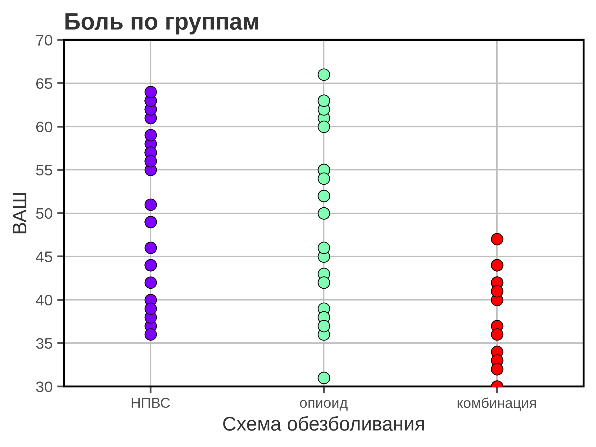
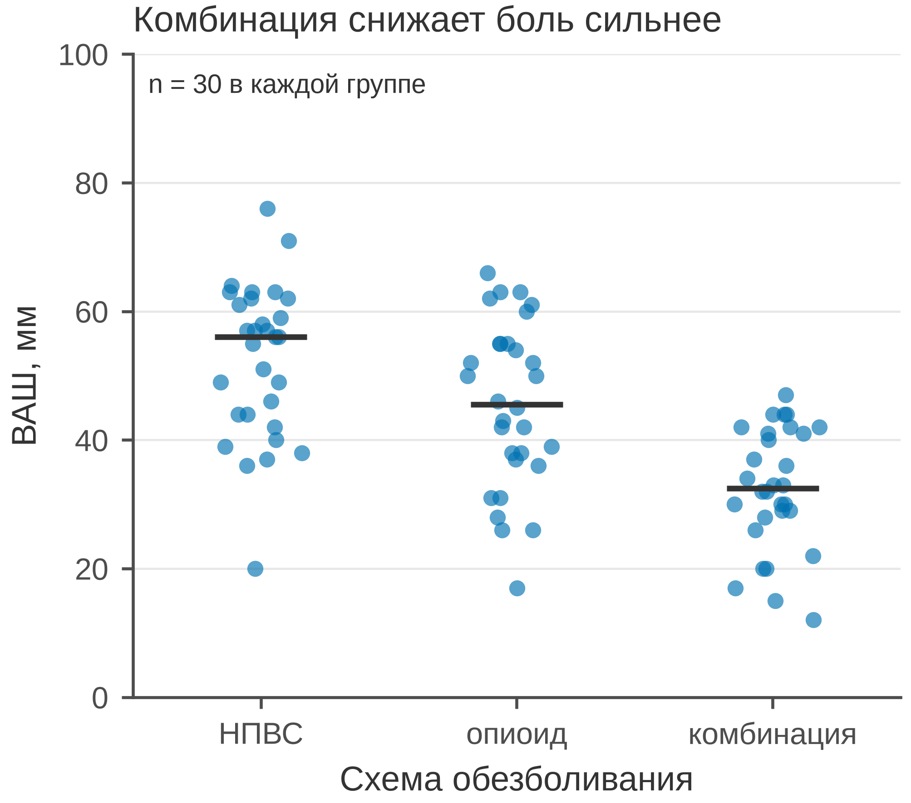

# 5.13 Strip: все точки по группам

Strip plot (jitter plot) показывает каждое наблюдение: точки
располагаются по группам, а небольшой случайный сдвиг по X не даёт им
слиться. Это самый честный способ сравнить небольшие выборки: видны
разброс, выбросы и форма, а не только медиана.

Jitter — не декор и не «шум». Он должен быть случайным, но
воспроизводимым (seed), и не настолько большим, чтобы точки уходили
в соседнюю группу.

## 5.13.1 Сфера применения

Strip отвечает на вопрос: **как выглядят все наблюдения в группах
и где медиана?**

Где это пригодится:

- небольшие выборки (10–50 на группу);
- сравнение 2–5 групп без коробки;
- показ выбросов и гетерогенности;
- замена bar/box, когда важны отдельные пациенты;
- проверка, не скрывает ли среднее бимодальность.

Когда strip **не** нужен:

- точек тысячи — overplotting, нужны hexbin/contour;
- нужны точные квантили — ECDF;
- важна только сводка — box/dot;
- группы сильно разного размера — точки могут перегрузить ось;
- jitter скрывает реальную структуру (например, дискретные значения).

## 5.13.2 Данные

Сценарий: 90 пациентов, три схемы обезболивания — НПВС, опиоид,
комбинация. Через 24 часа — боль по ВАШ (0–100 мм), по 30 человек
в группе.

| Колонка | Смысл | Единица |
|---|---|---|
| `patient_id` | идентификатор пациента | — |
| `analgesia` | схема обезболивания | — |
| `vas_mm` | боль по ВАШ | мм |

Медианы: НПВС — 56, опиоид — 45,5, комбинация — 32,5 мм.

Генератор: [`make_data.py`](scripts/make_data.py) → [`data/13_dataset.csv`](../../data/13_dataset.csv).

## 5.13.3 Плохой график



Код: [`bad_plot.py`](scripts/bad_plot.py).

Что не так:

1. **Нет jitter.** 30 точек в каждой группе стоят строго по одной
   вертикали и сливаются; видно не распределение, а плотность
   наложения.
2. **Радужные точки по группам.** Цвет дублирует ось X, CVD.
3. **Обрезанная ось Y (30–70).** Низкие и высокие значения скрыты.
4. **Крупные непрозрачные точки, тяжёлая сетка, полная рамка.**
5. **Заголовок «Боль по группам».** Не сообщает, какая схема лучше.
6. **Нет медиан, единиц и n.**

## 5.13.4 Правильный график



Код: [`good_plot.py`](scripts/good_plot.py).

Что изменилось:

1. **Jitter по X.** Все 30 точек видны отдельно; jitter
   воспроизводимый.
2. **Один цвет, alpha = 0,65.** Нет двойного кодирования.
3. **Полный диапазон 0–100 мм.**
4. **Медиана — горизонтальная линия** в каждой группе.
5. **n = 30, единицы, заголовок-вывод.**
6. **Лёгкая сетка только по Y, 85 мм.**

Strip особенно хорош, когда *n* небольшое: читатель видит каждого
пациента, а не только сводку. При больших *n* точки всё равно
сливаются — тогда нужны box/violin/hexbin.

## 5.13.5 Было и стало
| Что было | Почему плохо | Что сделано |
|---|---|---|
| нет jitter | точки сливаются | jitter 0,09 |
| радуга | CVD, двойное кодирование | один цвет |
| ось Y 30–70 | хвосты скрыты | 0–100 |
| крупные точки | шум | s=18, alpha=0,65 |
| нет медиан | нет сводки | горизонтальные медианы |
| сетка по X и Y | шум | сетка только по Y |
| полная рамка | визуальный шум | только левая и нижняя оси |
| «Боль по группам» | нет сообщения | заголовок-вывод |
| нет единиц и n | невозможно прочитать | «мм», n = 30 |

## 5.13.6 Чек-лист strip

- [ ] Jitter есть и он воспроизводимый.
- [ ] Jitter не переносит точки в чужую группу.
- [ ] Ось Y не обрезает хвосты.
- [ ] Указаны единицы и *n*.
- [ ] Медиана/среднее показаны, если нужна сводка.
- [ ] Цвет не дублирует ось X.
- [ ] Точек не слишком много; иначе box/hexbin.
- [ ] Дискретные значения не «размазаны» jitter’ом.
- [ ] Группы одинаково читаемы.
- [ ] Рисунок проверен в конечном размере 85 мм.

## 5.13.7 Как воспроизвести

```bash
uv sync
uv run python 05_charts/13_strip/scripts/make_data.py
uv run python 05_charts/13_strip/scripts/bad_plot.py
uv run python 05_charts/13_strip/scripts/good_plot.py
```

Вот как это выглядит в коде:

```python
for position, group in enumerate(GROUPS, start=1):
    values = df.loc[df["analgesia"] == group, "vas_mm"].to_numpy()
    jitter = rng.normal(0.0, 0.09, len(values))
    ax.scatter(position + jitter, values,
               s=18, color=PRIMARY_BLUE, alpha=0.65, linewidths=0)
    ax.hlines(np.median(values), position - 0.18, position + 0.18,
              color="#333333", linewidth=1.5)
```

`rng.normal(0, 0.09)` — компромисс: достаточно, чтобы развести точки,
но не настолько, чтобы смешать группы. Seed фиксируйте в подписи
или коде.

## 5.13.8 Что дальше

Следующий график — **5.14 dot + CI**: точка оценки и доверительный
интервал. У него будет свой генератор и свой `data/14_dataset.csv`.

## Источники

- Wilke C. O. *Fundamentals of Data Visualization*. 2019. —
  [clauswilke.com/dataviz](https://clauswilke.com/dataviz/)
- Weissgerber T. L. et al. Beyond Bar and Line Graphs // *PLoS Biology*.
  2015. — [doi:10.1371/journal.pbio.1002128](https://doi.org/10.1371/journal.pbio.1002128)
- Matplotlib: `scatter` —
  [matplotlib.org](https://matplotlib.org/stable/api/_as_gen/matplotlib.axes.Axes.scatter.html)
- Tufte E. R. *The Visual Display of Quantitative Information*. 1983. —
  [edwardtufte.com](https://www.edwardtufte.com/tufte/books_vdqi)