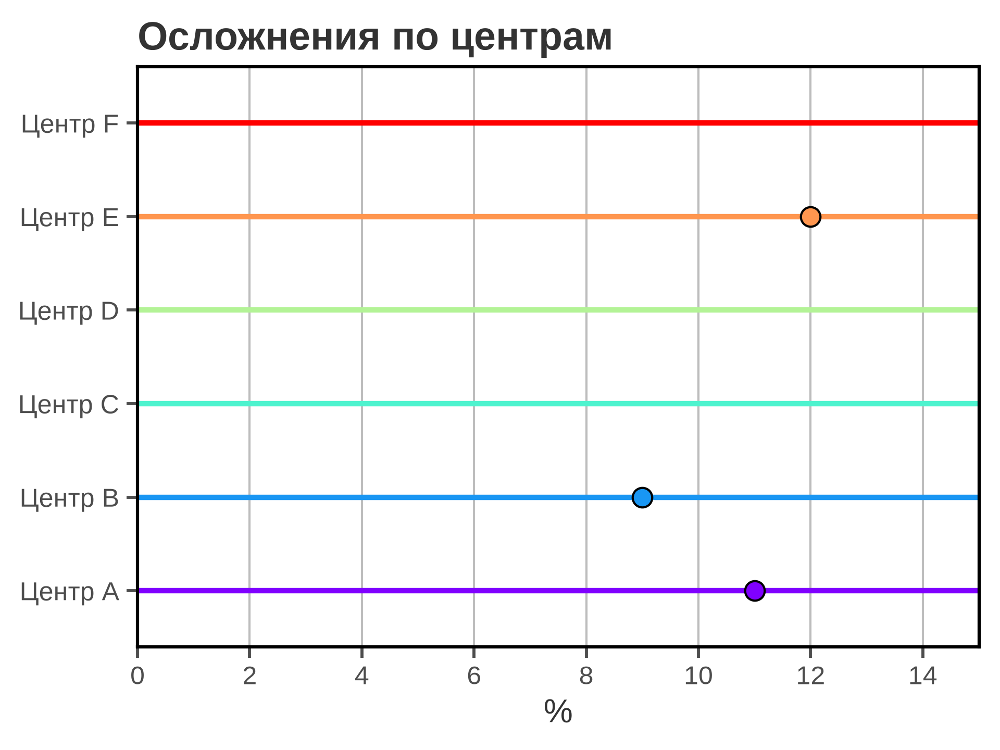
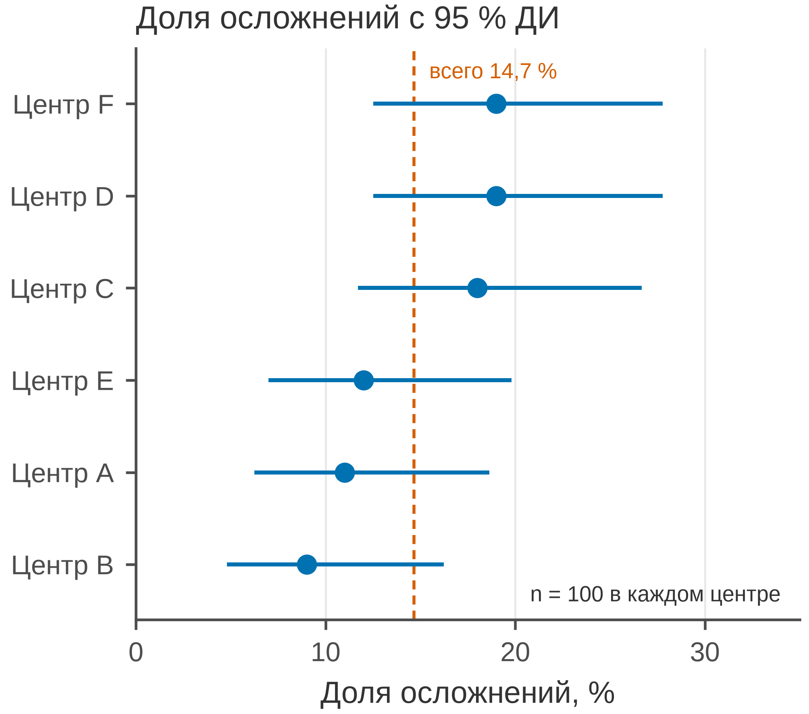

# 5.14 Dot + CI: оценка и неопределённость

Dot + CI — это точка оценки и доверительный интервал вокруг неё.
Такой график отвечает не только «сколько», но и «насколько точно».
Он честнее столбца с одной высотой: видно, что оценка — случайная
величина с неопределённостью.

Ключевое различие: **CI — это не SD**. Стандартное отклонение
описывает разброс наблюдений, доверительный интервал — точность
оценки. Для доли используют интервал Уилсона, для среднего —
t-интервал или бутстрэп.

## 5.14.1 Сфера применения

Dot + CI отвечает на вопрос: **какова оценка в каждой группе
и насколько она точна?**

Типичные случаи:

- доля осложнений/смертности по центрам;
- средние показатели по больницам с 95 % CI;
- результаты подгрупп перед forest plot (5.16);
- сравнение центров без ложного ранжирования;
- оценка эффекта с неопределённостью.

Когда dot + CI **не** нужен:

- нужны все наблюдения — strip/box;
- нужна одна сводка без сравнения — таблица;
- групп много и CI пересекаются — forest plot;
- оценка без интервала — описательная статистика;
- время до события — Kaplan–Meier.

## 5.14.2 Данные

Сценарий: 600 пациентов, шесть центров, по 100 человек. Исход —
осложнение (1/0). Для каждой доли — 95 % ДИ Уилсона.

| Колонка | Смысл | Единица |
|---|---|---|
| `patient_id` | идентификатор пациента | — |
| `center` | центр | — |
| `complication` | осложнение (1/0) | — |

Доли: 9–19 %; общая — 14,7 %. Интервалы широкие (≈ 5–28 %)
из-за *n* = 100 на центр.

Генератор: [`make_data.py`](scripts/make_data.py) → [`data/14_dataset.csv`](../../data/14_dataset.csv).

## 5.14.3 Плохой график



Код: [`bad_plot.py`](scripts/bad_plot.py).

Что с ним не так:

1. **Вместо 95 % ДИ — стандартное отклонение.** Усы выглядят
   как «интервалы», но это разброс бинарного исхода; их нельзя
   интерпретировать как точность оценки.
2. **Ось X обрезана до 0–15 %.** Центры с долей 18–19 % вообще
   не видны.
3. **Радужные точки и усы.** CVD, декор.
4. **Тяжёлая сетка, полная рамка.**
5. **Нет общей доли, n и единиц.**
6. **Заголовок «Осложнения по центрам».** Не сообщает,
   что показана неопределённость.

## 5.14.4 Правильный график



Код: [`good_plot.py`](scripts/good_plot.py).

Что улучшено:

1. **95 % ДИ Уилсона** для каждой доли — корректная
   неопределённость.
2. **Полный диапазон 0–35 %.** Все центры видны.
3. **Один цвет.** Точки и усы не конкурируют.
4. **Общая доля 14,7 %** — пунктирная линия и подпись.
5. **Сортировка по доле.** Легче читать, но CI показывают,
   что различия неочевидны.
6. **n = 100 в каждом центре, единицы, 85 мм.**

Пересекающиеся интервалы — важный сигнал: нельзя ранжировать
центры без формального сравнения. Dot + CI как раз показывает,
что разница между 9 % и 19 % при *n* = 100 может быть случайной.

## 5.14.5 Сопоставление

| Что было | Почему плохо | Что сделано |
|---|---|---|
| SD вместо CI | не та неопределённость | 95 % ДИ Уилсона |
| ось X 0–15 | центры 18–19 % скрыты | 0–35 |
| радуга | CVD, декор | один цвет |
| нет общей доли | нет ориентира | линия 14,7 % |
| нет сортировки | трудно читать | сортировка по доле |
| сетка по X и Y | шум | сетка только по X |
| полная рамка | визуальный шум | только левая и нижняя оси |
| «Осложнения по центрам» | нет сообщения | заголовок о 95 % ДИ |
| нет n | непонятна точность | n = 100 |

## 5.14.6 Чек-лист dot + CI

- [ ] Указано, что такое интервал: 95 % CI, а не SD/SE.
- [ ] Для долей — Уилсон/точный интервал, не нормальное приближение.
- [ ] Ось не обрезает интервалы.
- [ ] Указаны единицы и *n* по группам.
- [ ] Есть общая оценка/референс, если она нужна.
- [ ] Сортировка не выдаёт себя за статистический вывод.
- [ ] Пересечение CI не игнорируется.
- [ ] Цвет не дублирует ось.
- [ ] Сетка не конкурирует с усами.
- [ ] Рисунок проверен в конечном размере 85 мм.

## 5.14.7 Как воспроизвести

```bash
uv sync
uv run python 05_charts/14_dot_ci/scripts/make_data.py
uv run python 05_charts/14_dot_ci/scripts/bad_plot.py
uv run python 05_charts/14_dot_ci/scripts/good_plot.py
```

Ключевой фрагмент:

```python
def wilson_ci(successes, n, z=1.96):
    p = successes / n
    denominator = 1 + z**2 / n
    center = (p + z**2 / (2 * n)) / denominator
    half = z * np.sqrt(p * (1 - p) / n + z**2 / (4 * n**2)) / denominator
    return (center - half) * 100, (center + half) * 100

low, high = wilson_ci(successes, n)
ax.errorbar(p, y, xerr=[[p - low], [high - p]], fmt="o", color=PRIMARY_BLUE)
```

Для средних используйте t-интервал или бутстрэп; для долей
Уилсон устойчивее нормального приближения при малых *n* и крайних
долях.

## 5.14.8 Что дальше

Следующий график — **5.15 bar**: столбцы для сравнения величин
и их типичные ошибки. У него будет свой генератор и свой
`data/15_dataset.csv`.

## Источники

- Wilson E. B. Probable Inference, the Law of Succession, and Statistical
  Inference // *JASA*. 1927. —
  [doi:10.1080/01621459.1927.10502953](https://doi.org/10.1080/01621459.1927.10502953)
- Cumming G. *Understanding the New Statistics*. Routledge, 2012. —
  [routledge.com](https://www.routledge.com/Understanding-the-New-Statistics-Effect-Sizes-Confidence-Intervals-and-Meta-Analysis/Cumming/p/book/9780415879682)
- Wilke C. O. *Fundamentals of Data Visualization*. 2019. —
  [clauswilke.com/dataviz](https://clauswilke.com/dataviz/)
- Matplotlib: `errorbar` —
  [matplotlib.org](https://matplotlib.org/stable/api/_as_gen/matplotlib.axes.Axes.errorbar.html)
