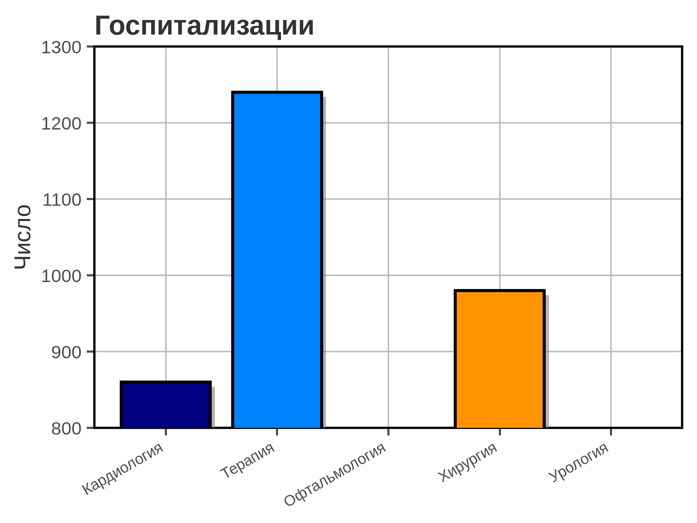
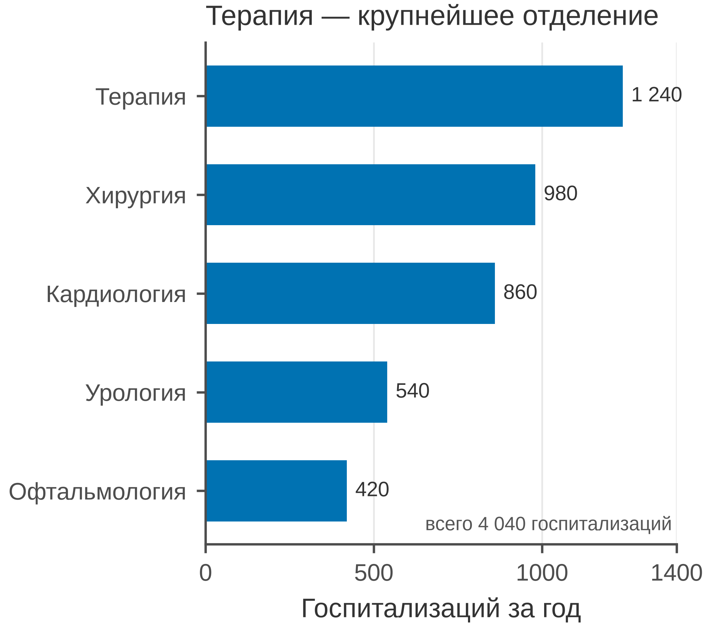

# 5.15 Bar: сравнение величин

Bar chart сравнивает **агрегированные величины** по категориям:
число госпитализаций, затраты, койко-дни, объём выборки. Это не график
распределения и не график тренда: для распределения — histogram/box,
для времени — line.

Главное: **нулевая база обязательна**. Длина столбца должна
быть пропорциональна величине; обрезанная ось превращает небольшую
разницу в «драму».

## 5.15.1 Сфера применения

Bar отвечает на вопрос: **какая категория больше и насколько?**

Где это пригодится:

- число пациентов/госпитализаций по отделениям;
- затраты или койко-дни по программам;
- объём выборки по центрам;
- сравнение немногих категорий (2–8);
- рейтинг, где важна абсолютная величина.

Когда bar **не** нужен:

- нужно распределение — histogram/box/violin;
- динамика во времени — line;
- много категорий — horizontal bar или dot;
- важна точность оценки — dot + CI;
- части целого — stacked bar 100 % (5.21), не pie (5.22).

## 5.15.2 Данные

Сценарий: пять отделений больницы, число госпитализаций за год.
Величины — счётчики, поэтому столбцы уместны.

| Колонка | Смысл | Единица |
|---|---|---|
| `department` | отделение | — |
| `admissions` | госпитализаций за год | число |

Терапия — 1 240, хирургия — 980, кардиология — 860, урология — 540,
офтальмология — 420. Всего 4 040.

Генератор: [`make_data.py`](scripts/make_data.py) → [`data/15_dataset.csv`](../../data/15_dataset.csv).

## 5.15.3 Плохой график



Код: [`bad_plot.py`](scripts/bad_plot.py).

Что не так:

1. **Ось Y обрезана до 800–1300.** Нулевая база скрыта; столбцы
   540 и 420 вообще не видны, а разница между 980 и 1 240
   преувеличена.
2. **Радужные столбцы, чёрные края и тени.** Декор, CVD.
3. **Отделения не отсортированы.** Глаз не может ранжировать.
4. **Тяжёлая сетка по обеим осям и полная рамка.**
5. **Заголовок «Госпитализации».** Не сообщает вывод.
6. **Нет значений на столбцах, единиц и n.**

## 5.15.4 Правильный график



Код: [`good_plot.py`](scripts/good_plot.py).

Что изменилось:

1. **Горизонтальные столбцы.** Длинные названия отделений
   читаются без поворота.
2. **Сортировка по величине.** Ранжирование очевидно.
3. **Нулевая база.** Ось X начинается с 0; длины пропорциональны.
4. **Значения подписаны** прямо у столбцов.
5. **Один цвет, без теней и 3D.**
6. **Единицы, общее число 4 040, заголовок-вывод, 85 мм.**

Bar — не «универсальный график». Если нужна форма распределения,
он её не покажет; если нужна динамика, он её скроет.

## 5.15.5 Было и стало
| Что было | Почему плохо | Что сделано |
|---|---|---|
| ось Y 800–1300 | нулевая база скрыта | 0–1400 |
| радуга, тени | декор | один цвет |
| без сортировки | трудно ранжировать | сортировка |
| вертикально | подписи наклонены | горизонтально |
| нет значений | нужно оценивать на глаз | подписи значений |
| сетка по X и Y | шум | сетка только по X |
| полная рамка | визуальный шум | только левая и нижняя оси |
| «Госпитализации» | нет вывода | заголовок-вывод |
| нет единиц и n | непонятно, что считать | «за год», всего 4 040 |

## 5.15.6 Чек-лист bar

- [ ] Ось начинается с нуля.
- [ ] Длина пропорциональна величине.
- [ ] Категории отсортированы, если нет смыслового порядка.
- [ ] Значения подписаны или легко читаются.
- [ ] Указаны единицы и период.
- [ ] Один цвет, без 3D/теней.
- [ ] Длинные подписи — горизонтально.
- [ ] Для распределения выбран histogram/box.
- [ ] Для тренда выбрана line.
- [ ] Рисунок проверен в конечном размере 85 мм.

## 5.15.7 Как воспроизвести

```bash
uv sync
uv run python 05_charts/15_bar/scripts/make_data.py
uv run python 05_charts/15_bar/scripts/bad_plot.py
uv run python 05_charts/15_bar/scripts/good_plot.py
```

Вот как это выглядит в коде:

```python
df = pd.read_csv(...).sort_values("admissions")
bars = ax.barh(df["department"], df["admissions"], color=PRIMARY_BLUE)
for bar in bars:
    value = int(bar.get_width())
    ax.text(value + 25, bar.get_y() + bar.get_height() / 2, f"{value:,}")
ax.set_xlim(0, 1400)
```

`barh` удобнее для длинных названий; сортировка и подписи значений
делают график самодостаточным.

## 5.15.8 Что дальше

Следующий график — **5.16 forest**: оценки эффектов и доверительные
интервалы для многих подгрупп. У него будет свой генератор и свой
`data/16_dataset.csv`.

## Источники

- Wilke C. O. *Fundamentals of Data Visualization*. 2019. —
  [clauswilke.com/dataviz](https://clauswilke.com/dataviz/)
- Tufte E. R. *The Visual Display of Quantitative Information*. 1983. —
  [edwardtufte.com](https://www.edwardtufte.com/tufte/books_vdqi)
- Matplotlib: `barh` —
  [matplotlib.org](https://matplotlib.org/stable/api/_as_gen/matplotlib.axes.Axes.barh.html)