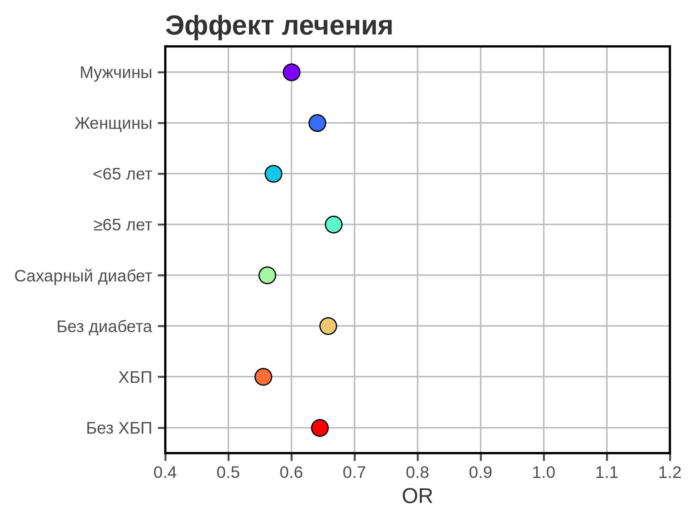
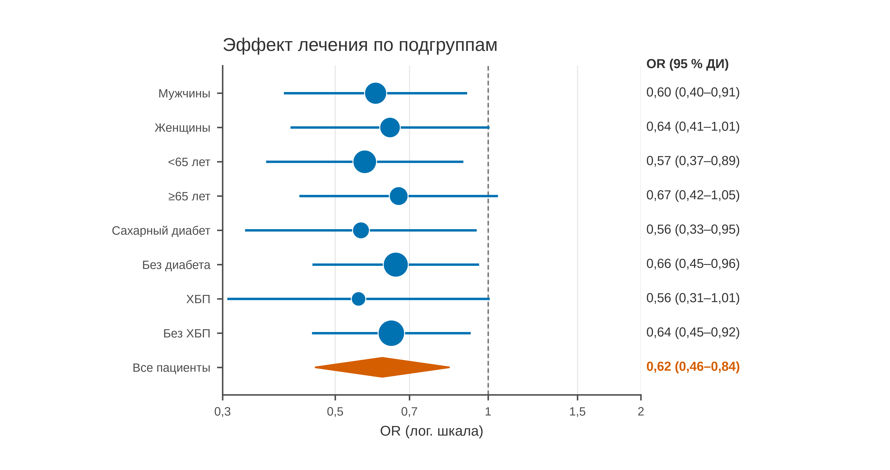

# 5.16 Forest: эффект по подгруппам

Forest plot — это ряд оценок эффекта с доверительными интервалами,
выстроенных по вертикали. Он показывает не только «где эффект»,
но и «насколько он точен» в каждой подгруппе.

Для отношений (OR, RR, HR) ось **обязательно логарифмическая**:
только тогда OR = 0,5 и OR = 2 симметричны относительно 1.
Линия «нет эффекта» — OR = 1 — обязательна.

## 5.16.1 Сфера применения

Forest отвечает на вопрос: **каков эффект в подгруппах и перекрывают
ли интервалы единицу?**

Типичные случаи:

- подгрупповой анализ RCT;
- мета-анализ нескольких исследований;
- OR/RR/HR по центрам и стратам;
- проверка гетерогенности эффекта;
- честное представление неопределённости.

Когда forest **не** нужен:

- одна оценка — dot + CI;
- нужны исходные распределения — box/strip;
- нет общего эффекта и осмысленной группировки;
- подгруппы выбраны post hoc без поправки;
- эффект выражен в абсолютных единицах без лог-шкалы.

## 5.16.2 Данные

Сценарий: RCT, 800 пациентов (400 лечение / 400 контроль), исход —
осложнение. Эффект — OR с 95 % CI Уолфа; восемь подгрупп и общая оценка.

| Колонка | Смысл | Единица |
|---|---|---|
| `subgroup` | подгруппа | — |
| `n_treatment` | n в группе лечения | — |
| `events_treatment` | события в лечении | — |
| `n_control` | n в контроле | — |
| `events_control` | события в контроле | — |

Общая OR — 0,62 (95 % ДИ 0,46–0,84). В подгруппах — 0,56–0,67;
у женщин, ≥65 лет и ХБП интервал пересекает 1.

Генератор: [`make_data.py`](scripts/make_data.py) → [`data/16_dataset.csv`](../../data/16_dataset.csv).

## 5.16.3 Плохой график



Код: [`bad_plot.py`](scripts/bad_plot.py).

Что с ним не так:

1. **Нет доверительных интервалов.** Точка без CI не показывает
   неопределённость; подгруппы выглядят точнее, чем есть.
2. **Линейная ось OR.** Расстояния между 0,5 и 0,7 и между
   1,0 и 1,2 не сопоставимы; лог-шкала обязательна.
3. **Нет линии OR = 1.** Непонятно, где «нет эффекта».
4. **Радужные точки, тяжёлая сетка, полная рамка.**
5. **Нет общей оценки и n.**
6. **Заголовок «Эффект лечения».** Не сообщает направление
   и неопределённость.

## 5.16.4 Правильный график



Код: [`good_plot.py`](scripts/good_plot.py).

Что улучшено:

1. **95 % ДИ для каждой подгруппы.**
2. **Логарифмическая ось 0,3–2,0.** OR симметричны
   относительно 1.
3. **Линия OR = 1** — референс «нет эффекта».
4. **Размер квадрата пропорционален n.** Видно, где оценка
   точнее.
5. **Ромб общей оценки** внизу; OR 0,62 (0,46–0,84).
6. **Справа — OR (95 % ДИ), слева — подгруппы.**
7. **Один цвет, лёгкая сетка, 170 мм.**

CI, пересекающие 1, — не «отсутствие эффекта», а недостаток
точности. Не ранжируйте подгруппы по p-value и не делайте
причинных выводов из подгруппового анализа.

## 5.16.5 Сопоставление

| Что было | Почему плохо | Что сделано |
|---|---|---|
| нет CI | не видна неопределённость | 95 % ДИ |
| линейная ось | OR искажены | лог-ось 0,3–2 |
| нет линии 1 | нет референса | пунктир OR = 1 |
| радуга | CVD, декор | один цвет |
| нет размера по n | не видна точность | размер квадрата |
| нет общей оценки | нет итога | ромб |
| нет таблицы справа | нужно считать в уме | OR (95 % ДИ) |
| «Эффект лечения» | нет сообщения | заголовок о подгруппах |
| нет n | непонятна точность | n в данных |

## 5.16.6 Чек-лист forest

- [ ] Для OR/RR/HR — логарифмическая ось.
- [ ] Есть линия «нет эффекта» (1).
- [ ] Показаны 95 % ДИ, а не только точки.
- [ ] Размер маркера отражает вес/n.
- [ ] Есть общая оценка (ромб/линия).
- [ ] Подгруппы не ранжированы по значимости.
- [ ] Указаны n и единицы эффекта.
- [ ] CI, пересекающие 1, не поданы как «нет эффекта».
- [ ] Подгрупповой анализ не подан как причинный.
- [ ] Рисунок проверен в конечном размере.

## 5.16.7 Как воспроизвести

```bash
uv sync
uv run python 05_charts/16_forest/scripts/make_data.py
uv run python 05_charts/16_forest/scripts/bad_plot.py
uv run python 05_charts/16_forest/scripts/good_plot.py
```

Ключевой фрагмент:

```python
odds = (a / b) / (c / d)
se = np.sqrt(1/a + 1/b + 1/c + 1/d)
low = np.exp(np.log(odds) - 1.96 * se)
high = np.exp(np.log(odds) + 1.96 * se)

ax.set_xscale("log")
ax.axvline(1, color="#777777", linestyle="--")
ax.hlines(y, low, high, color=PRIMARY_BLUE)
ax.scatter(odds, y, s=n_total / 3, color=PRIMARY_BLUE)
```

Для мета-анализа вместо OR Уолфа используйте модель
с фиксированным/случайным эффектом и вес исследований.

## 5.16.8 Что дальше

Следующий график — **5.17 slope**: изменение показателя между двумя
точками для многих групп. У него будет свой генератор и свой
`data/17_dataset.csv`.

## Источники

- Cumming G. *Understanding the New Statistics*. Routledge, 2012. —
  [routledge.com](https://www.routledge.com/Understanding-the-New-Statistics-Effect-Sizes-Confidence-Intervals-and-Meta-Analysis/Cumming/p/book/9780415879682)
- Cochrane Handbook, Chapter 10: Analysing data and undertaking
  meta-analyses — [training.cochrane.org](https://training.cochrane.org/handbook)
- Wilke C. O. *Fundamentals of Data Visualization*. 2019. —
  [clauswilke.com/dataviz](https://clauswilke.com/dataviz/)
- Matplotlib: `errorbar`/`hlines` —
  [matplotlib.org](https://matplotlib.org/stable/api/_as_gen/matplotlib.axes.Axes.hlines.html)
