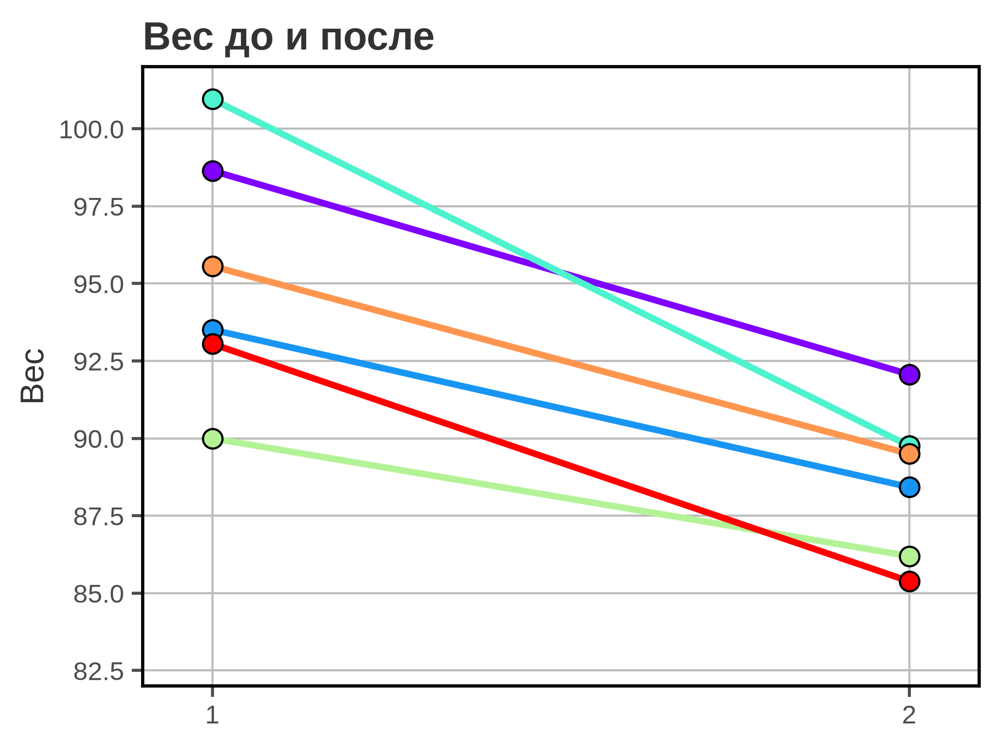
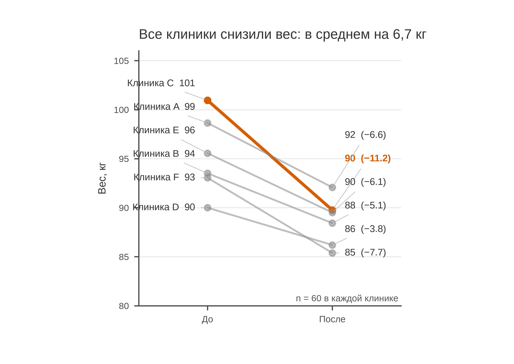

# 5.17 Slope: изменение между двумя точками

Slope plot соединяет две точки — «до» и «после» — для нескольких групп.
Наклон линии показывает направление и величину изменения, а набор
линий — гетерогенность эффекта.

Это график **парных агрегатов** (средних по группам), а не spaghetti
из сотен индивидуальных траекторий: при больших *n* линии сливаются.

## 5.17.1 Сфера применения

Slope отвечает на вопрос: **как изменился показатель в каждой группе
и насколько различается эффект?**

Типичные случаи:

- средние до/после программы по клиникам;
- парные измерения до/после лечения;
- изменение доли/риска по центрам;
- сравнение эффекта вмешательства в 2–8 группах;
- наглядная величина сдвига.

Когда slope **не** нужен:

- больше 8–10 групп — spaghetti/labels;
- нужны индивидуальные траектории — paired dot (5.18);
- нет парных измерений;
- нужно распределение — box/violin;
- динамика многих временных точек — line.

## 5.17.2 Данные

Сценарий: 360 пациентов, шесть клиник, по 60 человек. Вес до и через
12 недель программы снижения веса.

| Колонка | Смысл | Единица |
|---|---|---|
| `patient_id` | идентификатор пациента | — |
| `clinic` | клиника | — |
| `weight_before_kg` | вес до | кг |
| `weight_after_kg` | вес после | кг |

Среднее снижение — 6,7 кг. Клиника C — лидер: −11,2 кг; клиника D —
минимум: −3,8 кг. Все клиники снизили вес.

Генератор: [`make_data.py`](scripts/make_data.py) → [`data/17_dataset.csv`](../../data/17_dataset.csv).

## 5.17.3 Плохой график



Код: [`bad_plot.py`](scripts/bad_plot.py).

Что с ним не так:

1. **Шесть радужных линий без подписей.** Непонятно, где какая
   клиника; цвет не помогает.
2. **Ось Y обрезана до 82–102.** Нижние значения и размах скрыты.
3. **Нет подписей «до/после» и единиц.**
4. **Тяжёлая сетка, полная рамка.**
5. **Заголовок «Вес до и после».** Не сообщает вывод.
6. **Нет n и изменения в кг.**

## 5.17.4 Правильный график



Код: [`good_plot.py`](scripts/good_plot.py).

Что улучшено:

1. **Серые линии для всех, акцент на лидере.** Видно общий паттерн
   и лучший результат.
2. **Прямые подписи слева и справа** с лидер-линиями:
   клиника и вес до, вес после и изменение.
3. **Полный диапазон 80–106 кг.**
4. **Подписи «До/После», единицы, n = 60.**
5. **Заголовок-вывод:** все клиники снизили вес в среднем на 6,7 кг.
6. **120 мм** — хватает места для подписей.

Slope показывает **направление и величину** изменения, но не
статистическую значимость. Для вывода о различии эффектов нужны
парный тест/модель и доверительные интервалы.

## 5.17.5 Сопоставление

| Что было | Почему плохо | Что сделано |
|---|---|---|
| радуга без подписей | непонятно, где кто | серые + акцент + подписи |
| ось Y 82–102 | размах скрыт | 80–106 |
| нет «до/после» | непонятны точки | подписи осей |
| нет единиц | «вес» без кг | «Вес, кг» |
| сетка по X и Y | шум | сетка только по Y |
| полная рамка | визуальный шум | только левая и нижняя оси |
| «Вес до и после» | нет вывода | заголовок-вывод |
| нет n | непонятна точность | n = 60 |

## 5.17.6 Чек-лист slope

- [ ] Понятно, что слева «до», справа «после».
- [ ] Каждая линия подписана.
- [ ] Ось не обрезает диапазон.
- [ ] Указаны единицы и *n*.
- [ ] Линия не тонет в радуге.
- [ ] Акцент оправдан (лидер/аутлайер).
- [ ] Для многих групп — не spaghetti.
- [ ] Для индивидуальных пар — paired dot.
- [ ] Нет ложной причинности.
- [ ] Рисунок проверен в конечном размере.

## 5.17.7 Как воспроизвести

```bash
uv sync
uv run python 05_charts/17_slope/scripts/make_data.py
uv run python 05_charts/17_slope/scripts/bad_plot.py
uv run python 05_charts/17_slope/scripts/good_plot.py
```

Ключевой фрагмент:

```python
ax.plot([0, 1], [before, after], color="#8A8A8A", marker="o")
ax.annotate(f"{clinic}  {before:.0f}", xy=(0, before), xytext=(-0.1, label_y),
            ha="right", arrowprops={"arrowstyle": "-", "color": "#BBBBBB"})
ax.set_xticks([0, 1])
ax.set_xticklabels(["До", "После"])
```

Подписи можно развести по вертикали, сохраняя порядок; стрелки
свяжут подпись с точкой.

## 5.17.8 Что дальше

Следующий график — **5.18 paired dot**: индивидуальные парные
изменения. У него будет свой генератор и свой `data/18_dataset.csv`.

## Источники

- Wilke C. O. *Fundamentals of Data Visualization*. 2019. —
  [clauswilke.com/dataviz](https://clauswilke.com/dataviz/)
- Tufte E. R. *The Visual Display of Quantitative Information*. 1983. —
  [edwardtufte.com](https://www.edwardtufte.com/tufte/books_vdqi)
- Matplotlib: `annotate` —
  [matplotlib.org](https://matplotlib.org/stable/api/_as_gen/matplotlib.axes.Axes.annotate.html)
