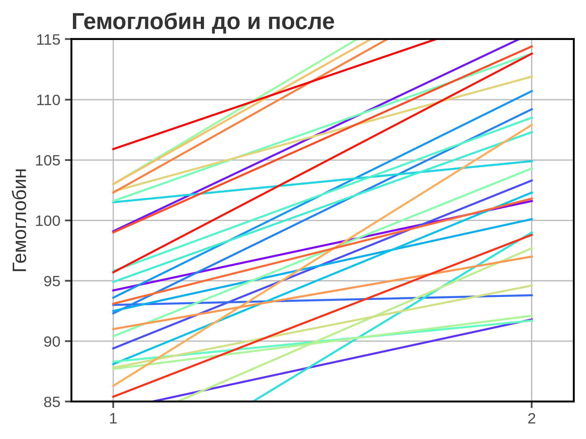
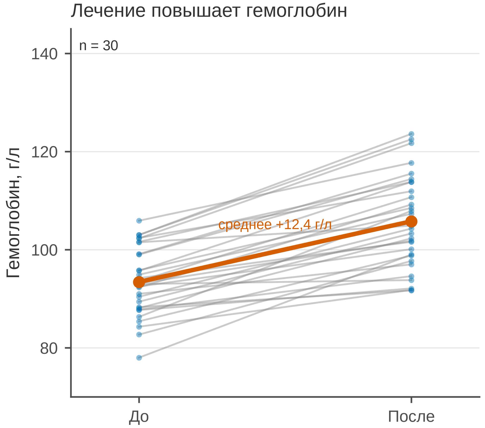

# 5.18 Paired dot: индивидуальные изменения

Paired dot — это линии, соединяющие два измерения одного и того же
пациента: «до» и «после». В отличие от slope plot средних, здесь
виден **каждый** пациент: у кого эффект большой, у кого маленький,
у кого его нет.

График хорош для 10–50 пар. При сотнях пар линии превращаются
в spaghetti; тогда нужны средние/CI или распределение разниц.

## 5.18.1 Сфера применения

Paired dot отвечает на вопрос: **как изменился показатель у каждого
пациента и каково среднее изменение?**

Где это пригодится:

- до/после лечения в одной группе;
- парные измерения биомаркера;
- индивидуальный ответ на вмешательство;
- проверка, не скрывает ли среднее разнородность;
- малые выборки, где важна каждая пара.

Когда paired dot **не** нужен:

- наблюдения непарные;
- пар слишком много (spaghetti);
- нужны только средние — slope/dot+CI;
- нужна динамика многих точек — line;
- нужно распределение — histogram/ECDF.

## 5.18.2 Данные

Сценарий: 30 пациентов, гемоглобин (г/л) до и через 8 недель лечения
анемии. Парные наблюдения.

| Колонка | Смысл | Единица |
|---|---|---|
| `patient_id` | идентификатор пациента | — |
| `hemoglobin_before` | гемоглобин до | г/л |
| `hemoglobin_after` | гемоглобин после | г/л |

Среднее до — 93,4 г/л; после — 105,8 г/л; средний прирост —
+12,4 ± 5,8 г/л. У всех 30 пациентов уровень вырос, но величина
прироста различается.

Генератор: [`make_data.py`](scripts/make_data.py) → [`data/18_dataset.csv`](../../data/18_dataset.csv).

## 5.18.3 Плохой график



Код: [`bad_plot.py`](scripts/bad_plot.py).

Что не так:

1. **30 радужных линий.** Непонятно, где отдельный пациент;
   цвет не помогает.
2. **Нет точек и средних.** Видны только линии, нет сводки.
3. **Ось Y обрезана до 85–115.** Высокие значения после лечения
   скрыты.
4. **Тяжёлая сетка, полная рамка.**
5. **Заголовок «Гемоглобин до и после».** Не сообщает вывод.
6. **Нет единиц, n и среднего изменения.**

## 5.18.4 Правильный график



Код: [`good_plot.py`](scripts/good_plot.py).

Что изменилось:

1. **Серые линии для отдельных пациентов.** Видна каждая пара,
   но линии не конкурируют.
2. **Точки на обоих концах.** Видны исходные значения и выбросы.
3. **Среднее до/после — цветная толстая линия.**
   Подписано «среднее +12,4 г/л».
4. **Полный диапазон 70–145 г/л.**
5. **«До/После», единицы, n = 30.**
6. **Заголовок-вывод, 85 мм.**

Paired dot показывает индивидуальную изменчивость, но не
статистическую значимость. Для вывода нужен парный тест
(Уилкоксон/парный t) и CI среднего изменения.

## 5.18.5 Было и стало
| Что было | Почему плохо | Что сделано |
|---|---|---|
| радужные линии | непонятно, где кто | серые линии |
| нет точек | не видно значений | точки на концах |
| нет средних | нет сводки | цветная средняя линия |
| ось Y 85–115 | высокие значения скрыты | 70–145 |
| нет единиц | «гемоглобин» без г/л | «г/л» |
| сетка по X и Y | шум | сетка только по Y |
| полная рамка | визуальный шум | только левая и нижняя оси |
| «Гемоглобин до и после» | нет вывода | заголовок-вывод |
| нет n | непонятна точность | n = 30 |

## 5.18.6 Чек-лист paired dot

- [ ] Пары действительно парные.
- [ ] Видны отдельные линии и точки.
- [ ] Среднее/медиана изменения показаны.
- [ ] Ось не обрезает диапазон.
- [ ] Указаны единицы и *n*.
- [ ] Линии не радужные без смысла.
- [ ] При больших *n* — не spaghetti.
- [ ] Есть парный тест/CI для вывода.
- [ ] Выбросы не скрыты.
- [ ] Рисунок проверен в конечном размере 85 мм.

## 5.18.7 Как воспроизвести

```bash
uv sync
uv run python 05_charts/18_paired_dot/scripts/make_data.py
uv run python 05_charts/18_paired_dot/scripts/bad_plot.py
uv run python 05_charts/18_paired_dot/scripts/good_plot.py
```

Вот как это выглядит в коде:

```python
for b, a in zip(before, after, strict=True):
    ax.plot([0, 1], [b, a], color="#8A8A8A", alpha=0.45, linewidth=0.9)
    ax.scatter([0, 1], [b, a], s=8, color=PRIMARY_BLUE, alpha=0.45)

ax.plot([0, 1], [before.mean(), after.mean()],
        color=ACCENT_VERMILLION, linewidth=2.2, marker="o")
```

Для формального вывода используйте `scipy.stats.wilcoxon` или
`ttest_rel` и CI среднего изменения.

## 5.18.8 Что дальше

Следующий график — **5.19 Bland–Altman**: согласие двух методов
измерения. У него будет свой генератор и свой `data/19_dataset.csv`.

## Источники

- Bland J. M., Altman D. G. Statistical Methods for Assessing Agreement
  between Two Methods of Clinical Measurement // *The Lancet*. 1986. —
  [doi:10.1016/S0140-6736(86)90837-8](https://doi.org/10.1016/S0140-6736(86)90837-8)
- Wilke C. O. *Fundamentals of Data Visualization*. 2019. —
  [clauswilke.com/dataviz](https://clauswilke.com/dataviz/)
- Matplotlib: `plot`/`scatter` —
  [matplotlib.org](https://matplotlib.org/stable/api/_as_gen/matplotlib.axes.Axes.plot.html)