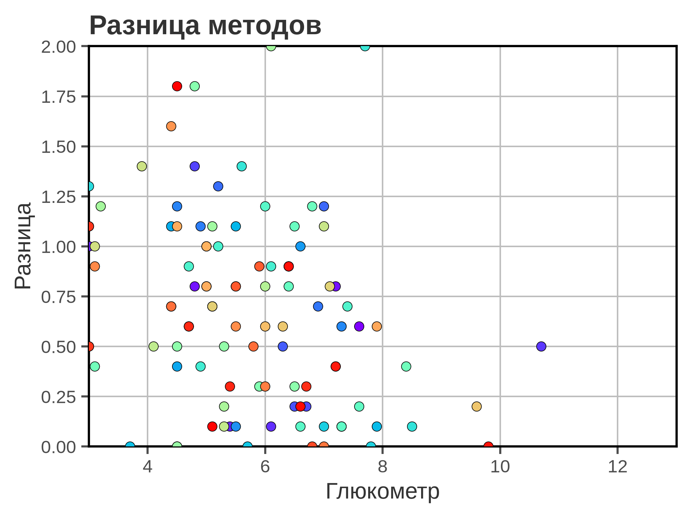
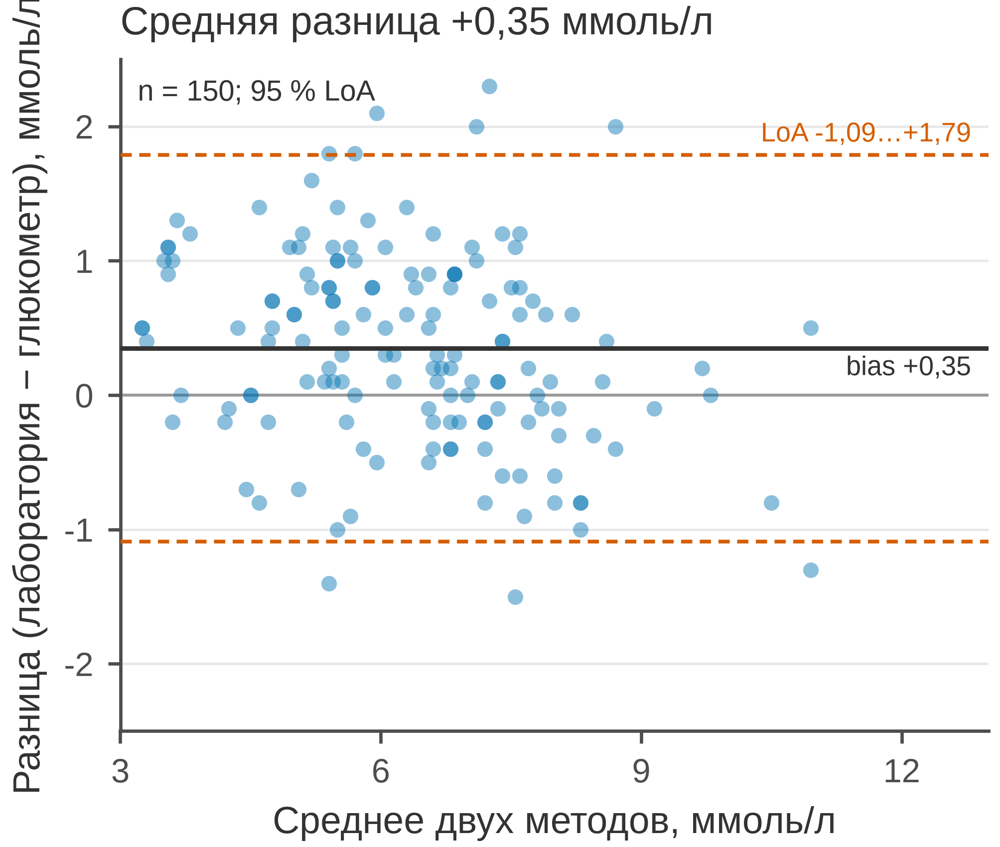

# 5.19 Bland–Altman: согласие методов

Bland–Altman отвечает на вопрос: **насколько два метода измерения
согласуются?** По X — среднее двух методов, по Y — разница между ними.
Горизонтальная линия — средняя разница (bias), пунктиры — пределы
согласия (limits of agreement, LoA = bias ± 1,96 SD).

Это не корреляция. Два метода могут коррелировать почти идеально
и при этом систематически расходиться; BA показывает именно согласие.

## 5.19.1 Сфера применения

BA отвечает на вопрос: **где проходит средняя разница и в каких
пределах лежат 95 % расхождений?**

Где это пригодится:

- новый анализатор против референсного;
- глюкометр против лаборатории;
- два способа измерения АД;
- согласие шкал/опросников;
- проверка, можно ли заменить метод.

Когда BA **не** нужен:

- сравниваются не методы, а группы;
- нужна корреляция/ассоциация — scatter (5.05);
- нужны только средние — dot + CI (5.14);
- разница зависит от масштаба — нужна лог-трансформация;
- нет парных измерений.

## 5.19.2 Данные

Сценарий: 150 пациентов, глюкоза измерена лабораторным анализатором
и глюкометром. Разница = лаборатория − глюкометр.

| Колонка | Смысл | Единица |
|---|---|---|
| `patient_id` | идентификатор пациента | — |
| `lab_glucose` | лабораторный анализ | ммоль/л |
| `meter_glucose` | глюкометр | ммоль/л |

Bias = +0,35 ммоль/л; 95 % LoA = −1,09…+1,79 ммоль/л. Глюкометр
систематически занижает, но расхождения укладываются в широкие
пределы.

Генератор: [`make_data.py`](scripts/make_data.py) → [`data/19_dataset.csv`](../../data/19_dataset.csv).

## 5.19.3 Плохой график



Код: [`bad_plot.py`](scripts/bad_plot.py).

Что не так:

1. **По X — один метод, а не среднее двух.** Это не BA; разница
   может коррелировать с масштабом.
2. **Нет bias и LoA.** Непонятно, где средняя разница и границы
   согласия.
3. **Ось Y обрезана до 0–2.** Отрицательные разницы скрыты;
   картина согласия искажена.
4. **Радужные точки, тяжёлая сетка, полная рамка.**
5. **Заголовок «Разница методов».** Не сообщает вывод.
6. **Нет единиц и n.**

## 5.19.4 Правильный график



Код: [`good_plot.py`](scripts/good_plot.py).

Что изменилось:

1. **По X — среднее двух методов.**
2. **Bias +0,35 и 95 % LoA −1,09…+1,79** — линии и подписи.
3. **Полный диапазон разниц −2,5…+2,5.**
4. **Один цвет, полупрозрачные точки.**
5. **Единицы, n = 150, заголовок-вывод.**
6. **Лёгкая сетка по Y, 85 мм.**

Bias — систематическое расхождение; LoA — случайное. Если LoA шире
клинически допустимого, методы нельзя считать взаимозаменяемыми,
даже если bias мал.

## 5.19.5 Было и стало
| Что было | Почему плохо | Что сделано |
|---|---|---|
| по X один метод | это не BA | среднее двух методов |
| нет bias/LoA | нет согласия | линии и подписи |
| ось Y 0–2 | отрицательные скрыты | −2,5…+2,5 |
| радуга | CVD, декор | один цвет |
| сетка по X и Y | шум | сетка только по Y |
| полная рамка | визуальный шум | только левая и нижняя оси |
| «Разница методов» | нет вывода | заголовок с bias |
| нет единиц и n | невозможно прочитать | единицы, n = 150 |

## 5.19.6 Чек-лист Bland–Altman

- [ ] По X — среднее двух методов.
- [ ] По Y — разница (указано, какой метод из какого вычитается).
- [ ] Показаны bias и 95 % LoA.
- [ ] Ось Y не обрезает разницы.
- [ ] Указаны единицы и *n*.
- [ ] Проверена пропорциональная bias (наклон).
- [ ] LoA сопоставлены с клинически допустимыми.
- [ ] Нет корреляции вместо согласия.
- [ ] Выбросы видны.
- [ ] Рисунок проверен в конечном размере 85 мм.

## 5.19.7 Как воспроизвести

```bash
uv sync
uv run python 05_charts/19_bland_altman/scripts/make_data.py
uv run python 05_charts/19_bland_altman/scripts/bad_plot.py
uv run python 05_charts/19_bland_altman/scripts/good_plot.py
```

Вот как это выглядит в коде:

```python
mean = (lab + meter) / 2
diff = lab - meter
bias = diff.mean()
loa = 1.96 * diff.std(ddof=1)

ax.scatter(mean, diff, s=14, alpha=0.45)
ax.axhline(bias, color="#333333")
ax.axhline(bias - loa, color=ACCENT_VERMILLION, linestyle="--")
ax.axhline(bias + loa, color=ACCENT_VERMILLION, linestyle="--")
```

Если разброс разницы растёт с уровнем, постройте BA для логарифмов
или добавьте регрессию разницы на среднее.

## 5.19.8 Что дальше

Следующий график — **5.20 stacked bar**: состав целого по категориям.
У него будет свой генератор и свой `data/20_dataset.csv`.

## Источники

- Bland J. M., Altman D. G. Statistical Methods for Assessing Agreement
  between Two Methods of Clinical Measurement // *The Lancet*. 1986. —
  [doi:10.1016/S0140-6736(86)90837-8](https://doi.org/10.1016/S0140-6736(86)90837-8)
- Giavarina D. Understanding Bland Altman Analysis // *Biochemia Medica*.
  2015. — [doi:10.11613/BM.2015.015](https://doi.org/10.11613/BM.2015.015)
- Wilke C. O. *Fundamentals of Data Visualization*. 2019. —
  [clauswilke.com/dataviz](https://clauswilke.com/dataviz/)