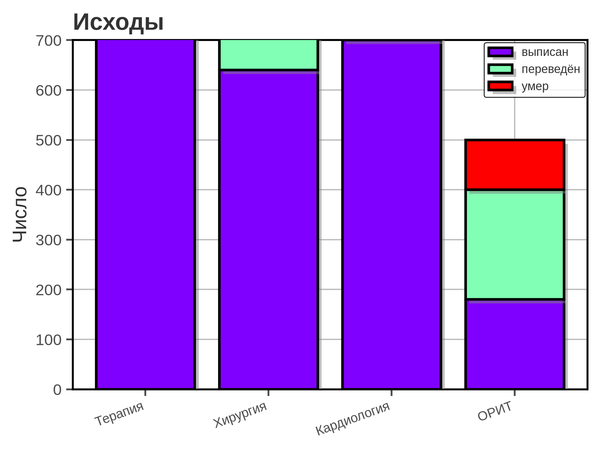
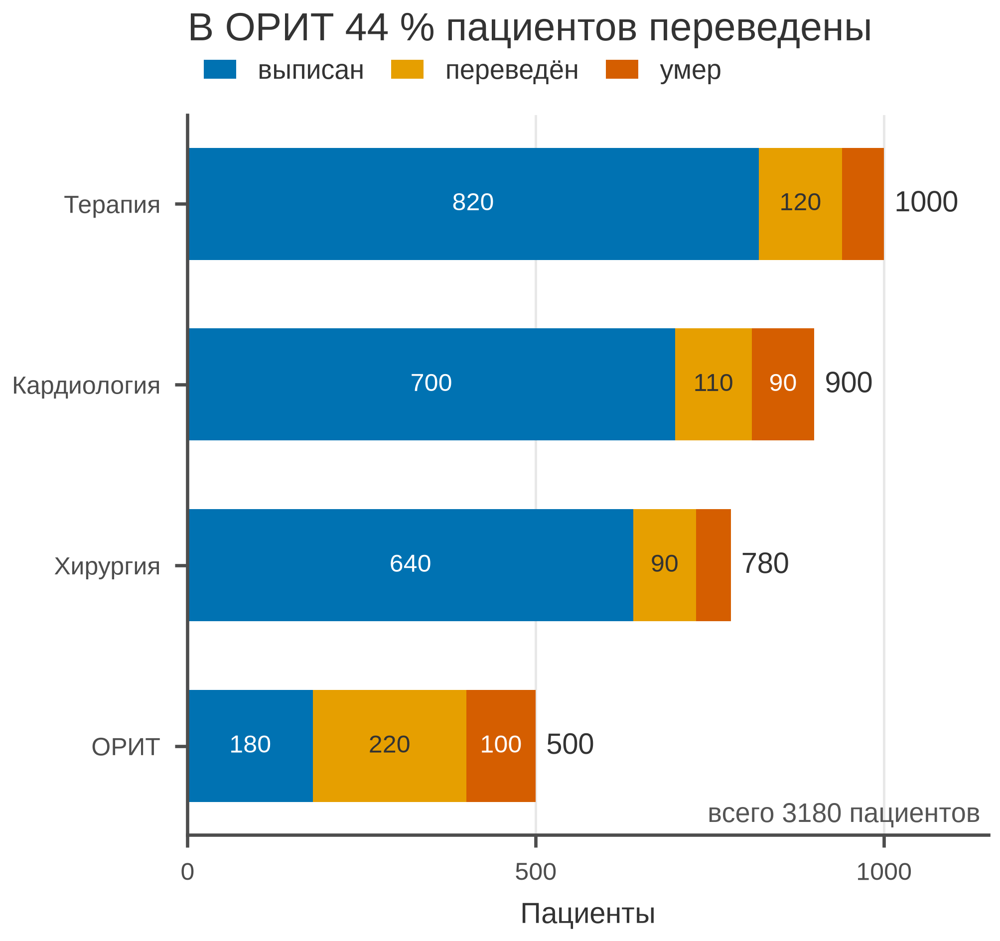

# 5.20 Stacked bar: состав целого

Stacked bar показывает не только общий объём, но и вклад категорий.
Он отвечает на вопрос: **из чего состоит целое и как состав меняется
между группами?**

Главное ограничение: сравнивать сегменты, которые начинаются не от
нуля, трудно. Поэтому stacked bar хорош для **2–4 категорий**, а для
точного сравнения долей лучше 100 % stacked bar (5.21) или dot.

## 5.20.1 Сфера применения

Stacked bar отвечает на вопрос: **каков общий объём и из каких частей
он состоит?**

Где это пригодится:

- исходы госпитализации (выписан/переведён/умер);
- структура затрат по программам;
- возрастные группы в когорте;
- степени тяжести по отделениям;
- состав выборки по центрам.

Когда stacked bar **не** нужен:

- нужно сравнить отдельные сегменты — grouped bar/dot;
- частей много (5+) — 100 % stacked или таблица;
- важна динамика — line;
- части не складываются в целое;
- нулевая база недоступна.

## 5.20.2 Данные

Сценарий: четыре отделения, три исхода — выписан, переведён, умер.

| Колонка | Смысл | Единица |
|---|---|---|
| `department` | отделение | — |
| `outcome` | исход | — |
| `patients` | число пациентов | человек |

Всего 3 180 пациентов. В ОРИТ переведены 44 % — больше, чем в других
отделениях.

Генератор: [`make_data.py`](scripts/make_data.py) → [`data/20_dataset.csv`](../../data/20_dataset.csv).

## 5.20.3 Плохой график



Код: [`bad_plot.py`](scripts/bad_plot.py).

Что не так:

1. **Ось Y обрезана до 700.** Столбцы Терапии и Кардиологии
   обрезаны; общий объём не виден.
2. **Радужные сегменты, чёрные края, тени, «3D».**
3. **Нет подписей значений и общего числа.**
4. **Тяжёлая сетка, полная рамка.**
5. **Заголовок «Исходы».** Не сообщает вывод.
6. **Нет единиц и n.**

## 5.20.4 Правильный график



Код: [`good_plot.py`](scripts/good_plot.py).

Что изменилось:

1. **Горизонтально и отсортировано по общему числу.**
2. **Нулевая база и полный масштаб 0–1150.**
3. **Палитра Okabe–Ito** — различима при CVD.
4. **Значения внутри сегментов, итоги справа.**
5. **Легенда сверху, единицы, всего 3 180.**
6. **Заголовок-вывод:** в ОРИТ 44 % переведены.

Stacked bar показывает состав, но не заменяет сравнение долей:
для этого используйте 100 % stacked bar или dot + CI.

## 5.20.5 Было и стало
| Что было | Почему плохо | Что сделано |
|---|---|---|
| ось Y 0–700 | столбцы обрезаны | 0–1150 |
| радуга, тени | декор, CVD | Okabe–Ito |
| без сортировки | трудно читать | сортировка по итогу |
| нет значений | оценка на глаз | подписи сегментов |
| нет итогов | не виден объём | итоги справа |
| сетка по X и Y | шум | сетка только по X |
| полная рамка | визуальный шум | только левая и нижняя оси |
| «Исходы» | нет вывода | заголовок-вывод |
| нет n | непонятен масштаб | всего 3 180 |

## 5.20.6 Чек-лист stacked bar

- [ ] Нулевая база.
- [ ] Частей 2–4, иначе 100 % stacked/таблица.
- [ ] Палитра различима при CVD.
- [ ] Значения/итоги подписаны.
- [ ] Указаны единицы и общее *n*.
- [ ] Порядок сегментов одинаков во всех столбцах.
- [ ] Сортировка по итогу или смыслу.
- [ ] Нет 3D и теней.
- [ ] Для сравнения долей — 100 % stacked/dot.
- [ ] Рисунок проверен в конечном размере 85 мм.

## 5.20.7 Как воспроизвести

```bash
uv sync
uv run python 05_charts/20_stacked_bar/scripts/make_data.py
uv run python 05_charts/20_stacked_bar/scripts/bad_plot.py
uv run python 05_charts/20_stacked_bar/scripts/good_plot.py
```

Вот как это выглядит в коде:

```python
left = np.zeros(len(pivot))
for outcome, color in zip(OUTCOMES, COLORS, strict=True):
    ax.barh(pivot.index, pivot[outcome], left=left,
            color=color, label=outcome)
    left += pivot[outcome].to_numpy()
```

Сегменты должны идти в одном порядке; иначе сравнение столбцов
становится ловушкой.

## 5.20.8 Что дальше

Следующий график — **5.21 bar 100 %**: нормированный состав.
У него будет свой генератор и свой `data/21_dataset.csv`.

## Источники

- Wilke C. O. *Fundamentals of Data Visualization*. 2019. —
  [clauswilke.com/dataviz](https://clauswilke.com/dataviz/)
- Tufte E. R. *The Visual Display of Quantitative Information*. 1983. —
  [edwardtufte.com](https://www.edwardtufte.com/tufte/books_vdqi)
- Matplotlib: `barh` —
  [matplotlib.org](https://matplotlib.org/stable/api/_as_gen/matplotlib.axes.Axes.barh.html)