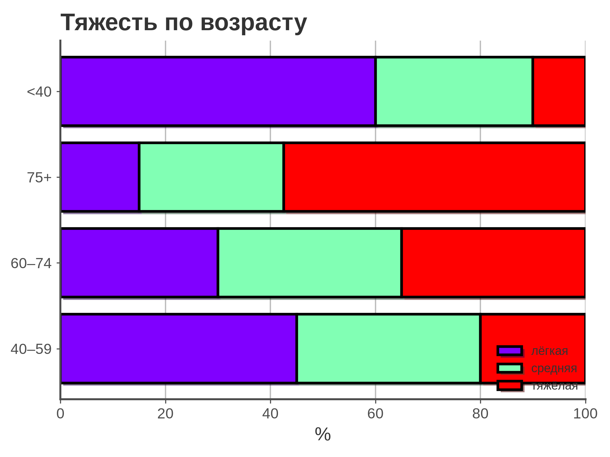
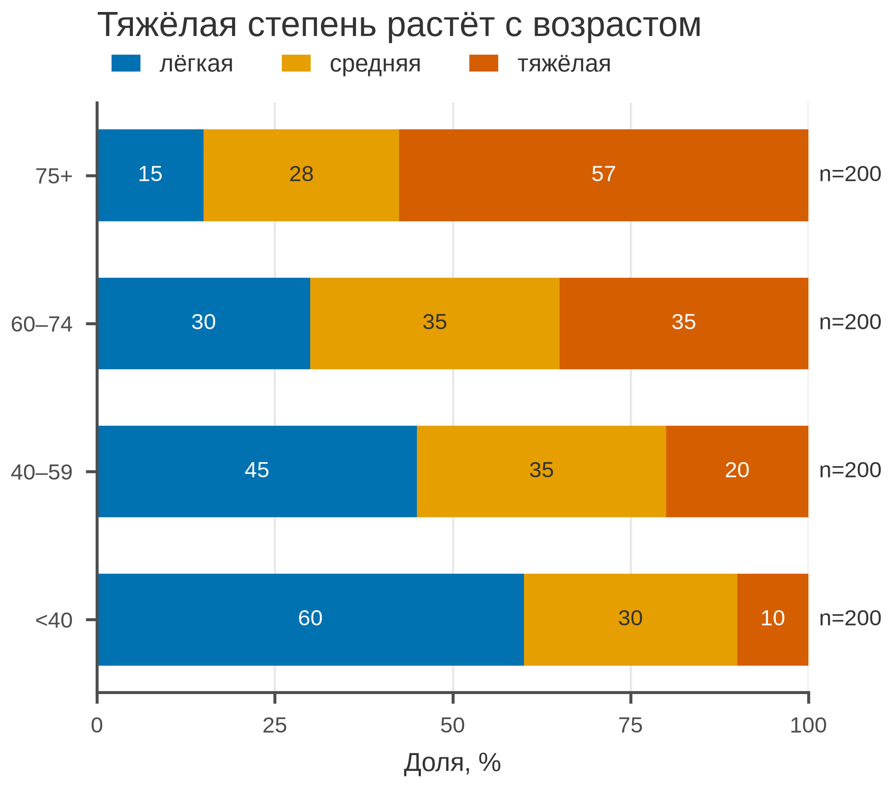

# 5.21 Bar 100 %: нормированный состав

100 % stacked bar показывает **доли**, а не абсолютные числа: каждый
столбец нормирован к 100 %. Он хорош, когда нужно сравнить состав
групп разного размера, но скрывает общий объём — поэтому *n* нужно
указывать рядом.

## 5.21.1 Сфера применения

- сравнение структуры по группам разного размера;
- доли исходов, степеней тяжести, возрастных групп;
- 2–4 категории;
- когда абсолютные итоги не важны.

Не подходит, если нужны абсолютные объёмы, частей больше 5 или
разница долей мала.

## 5.21.2 Данные

4 возрастные группы × 3 степени тяжести, по 200 пациентов.

| Колонка | Смысл |
|---|---|
| `age_group` | возрастная группа |
| `severity` | лёгкая/средняя/тяжёлая |
| `patients` | число пациентов |

Доля тяжёлой степени: 10 % (<40), 20 % (40–59), 35 % (60–74),
57 % (75+).

Генератор: [`make_data.py`](scripts/make_data.py) → [`data/21_dataset.csv`](../../data/21_dataset.csv).

## 5.21.3 Плохой график



Код: [`bad_plot.py`](scripts/bad_plot.py).

Ошибки: радужные сегменты, тени, нет процентов внутри, нет *n*,
тяжёлая сетка, заголовок «Тяжесть по возрасту» без вывода.

## 5.21.4 Правильный график



Код: [`good_plot.py`](scripts/good_plot.py).

Улучшения: горизонтально, порядок возрастов, палитра Okabe–Ito,
проценты внутри сегментов, *n* = 200 справа, заголовок-вывод,
85 мм.

## 5.21.5 Было и стало
| Было | Стало |
|---|---|
| радуга, тени | Okabe–Ito |
| нет процентов | подписи долей |
| нет n | n = 200 |
| нет вывода | «Тяжёлая степень растёт с возрастом» |

## 5.21.6 Чек-лист

- [ ] Столбцы нормированы к 100 %.
- [ ] Указаны доли и *n*.
- [ ] 2–4 сегмента.
- [ ] Порядок сегментов одинаков.
- [ ] Палитра CVD-безопасна.
- [ ] Нет 3D/теней.
- [ ] Заголовок-вывод.
- [ ] Проверено в 85 мм.

## 5.21.7 Как воспроизвести

```bash
uv sync
uv run python 05_charts/21_bar_100/scripts/make_data.py
uv run python 05_charts/21_bar_100/scripts/bad_plot.py
uv run python 05_charts/21_bar_100/scripts/good_plot.py
```

```python
share = pivot.div(pivot.sum(axis=1), axis=0) * 100
ax.barh(share.index, share["тяжёлая"], left=..., color="#D55E00")
```

## 5.21.8 Что дальше

5.22 Pie: части целого и почему pie редко бывает лучшим выбором.

## Источники

- Wilke C. O. *Fundamentals of Data Visualization*. 2019. —
  [clauswilke.com/dataviz](https://clauswilke.com/dataviz/)
- Matplotlib: `barh` —
  [matplotlib.org](https://matplotlib.org/stable/api/_as_gen/matplotlib.axes.Axes.barh.html)