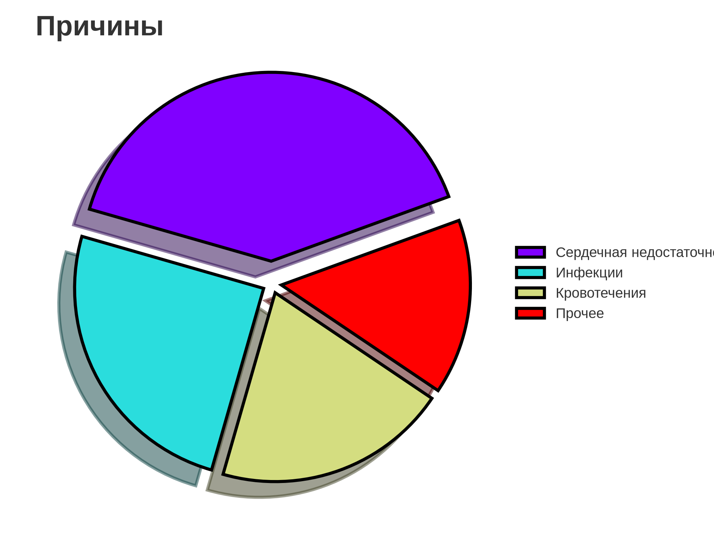
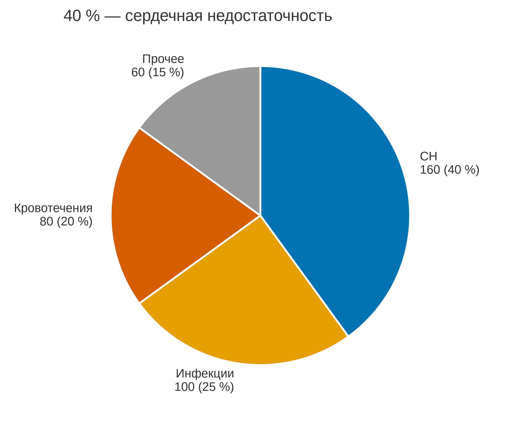

# 5.22 Pie: части целого

Pie показывает доли целого. Он уместен только для **3–4 частей**,
когда нужно подчеркнуть «примерно половина/четверть», а не сравнивать
близкие значения. Для точного сравнения лучше bar/dot.

## 5.22.1 Сфера применения

- 3–4 части целого;
- одна аудитория, один вывод;
- доли, которые легко узнать (50 %, 25 %);
- презентация, а не анализ.

Не подходит: много частей, близкие доли, отрицательные значения,
несколько кругов, точное сравнение.

## 5.22.2 Данные

400 повторных госпитализаций, 4 причины.

| Причина | n | Доля |
|---|---|---|
| Сердечная недостаточность | 160 | 40 % |
| Инфекции | 100 | 25 % |
| Кровотечения | 80 | 20 % |
| Прочее | 60 | 15 % |

Генератор: [`make_data.py`](scripts/make_data.py) → [`data/22_dataset.csv`](../../data/22_dataset.csv).

## 5.22.3 Плохой график



Код: [`bad_plot.py`](scripts/bad_plot.py).

Ошибки: 3D-тени и explode искажают площадь, радуга, легенда вместо
подписей, нет процентов, заголовок «Причины».

## 5.22.4 Правильный график



Код: [`good_plot.py`](scripts/good_plot.py).

Улучшения: 4 доли, старт на 12 часах, подписи «причина, n (% )»,
белые границы, без 3D, заголовок-вывод, 95 мм.

## 5.22.5 Было и стало
| Было | Стало |
|---|---|
| 3D, explode | плоские доли |
| радуга | палитра Okabe–Ito |
| легенда | прямые подписи |
| нет % | n и % |
| «Причины» | «40 % — сердечная недостаточность» |

## 5.22.6 Чек-лист

- [ ] 3–4 доли, сумма 100 %.
- [ ] Подписи с n и %.
- [ ] Нет 3D, explode, теней.
- [ ] Палитра различима.
- [ ] Старт на 12 часах, по часовой.
- [ ] Для сравнения предложен bar.
- [ ] Заголовок-вывод.
- [ ] Проверено в 95 мм.

## 5.22.7 Как воспроизвести

```bash
uv sync
uv run python 05_charts/22_pie/scripts/make_data.py
uv run python 05_charts/22_pie/scripts/bad_plot.py
uv run python 05_charts/22_pie/scripts/good_plot.py
```

```python
ax.pie(values, labels=labels, colors=COLORS, startangle=90,
       counterclock=False, wedgeprops={"edgecolor": "white"})
```

## 5.22.8 Что дальше

5.23 Treemap: иерархический состав.

## Источники

- Wilke C. O. *Fundamentals of Data Visualization*. 2019. —
  [clauswilke.com/dataviz](https://clauswilke.com/dataviz/)
- Tufte E. R. *The Visual Display of Quantitative Information*. 1983. —
  [edwardtufte.com](https://www.edwardtufte.com/tufte/books_vdqi)