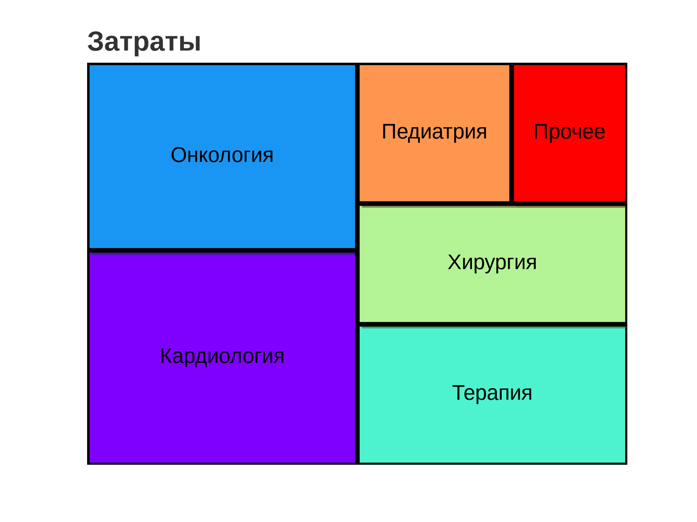
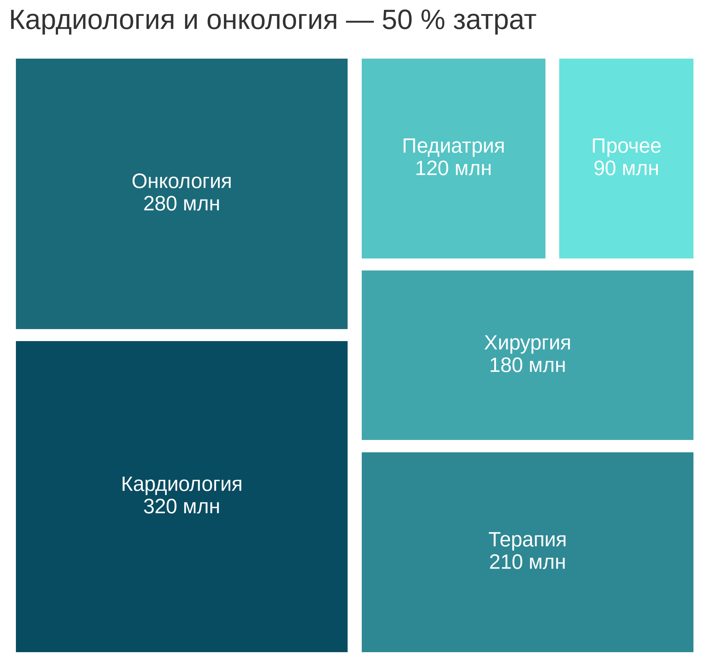

# 5.23 Treemap: иерархический состав

Treemap кодирует величину **площадью** прямоугольников. Он хорош для
иерархического состава (программы → подпрограммы), но плохо подходит
для точного сравнения: человек слабо оценивает площади.

## 5.23.1 Сфера применения

- 5–20 категорий, составляющих целое;
- иерархия (программа → направление);
- акцент на крупнейших вкладчиках;
- презентация структуры затрат.

Не подходит: мало категорий (bar), точное сравнение, отрицательные
значения, динамика.

## 5.23.2 Данные

Затраты по шести программам, всего 1 200 млн руб.

| Программа | Млн руб. |
|---|---|
| Кардиология | 320 |
| Онкология | 280 |
| Терапия | 210 |
| Хирургия | 180 |
| Педиатрия | 120 |
| Прочее | 90 |

Кардиология и онкология — 50 % затрат.

Генератор: [`make_data.py`](scripts/make_data.py) → [`data/23_dataset.csv`](../../data/23_dataset.csv).

## 5.23.3 Плохой график



Код: [`bad_plot.py`](scripts/bad_plot.py).

Ошибки: радуга, толстые чёрные границы, тени, только названия без
значений, нет процентов и итога.

## 5.23.4 Правильный график



Код: [`good_plot.py`](scripts/good_plot.py).

Улучшения: сортировка, последовательная палитра, подписи «программа
+ млн руб.», без границ и теней, заголовок-вывод, 85 мм.

## 5.23.5 Сопоставление

| Было | Стало |
|---|---|
| радуга | последовательная палитра |
| толстые границы | без границ |
| тени | плоско |
| нет значений | подписи с млн |
| нет вывода | «50 % затрат» |

## 5.23.6 Чек-лист

- [ ] Площадь пропорциональна величине.
- [ ] 5–20 категорий.
- [ ] Подписи с значениями.
- [ ] Последовательная палитра.
- [ ] Нет 3D/теней.
- [ ] Крупнейшие видны.
- [ ] Заголовок-вывод.
- [ ] Проверено в 85 мм.

## 5.23.7 Как воспроизвести

```bash
uv sync
uv run python 05_charts/23_treemap/scripts/make_data.py
uv run python 05_charts/23_treemap/scripts/bad_plot.py
uv run python 05_charts/23_treemap/scripts/good_plot.py
```

```python
squarify.plot(sizes=df["cost_mln_rub"], label=labels,
              color=COLORS, ax=ax, pad=True)
```

## 5.23.8 Что дальше

5.24 Heatmap: матрица значений.

## Источники

- Wilke C. O. *Fundamentals of Data Visualization*. 2019. —
  [clauswilke.com/dataviz](https://clauswilke.com/dataviz/)
- Squarify —
  [github.com/laserson/squarify](https://github.com/laserson/squarify)
