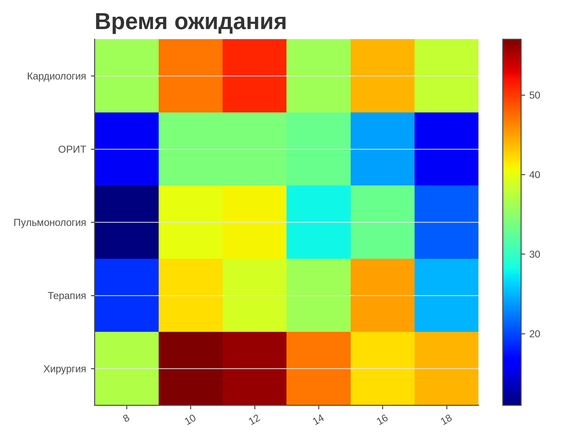
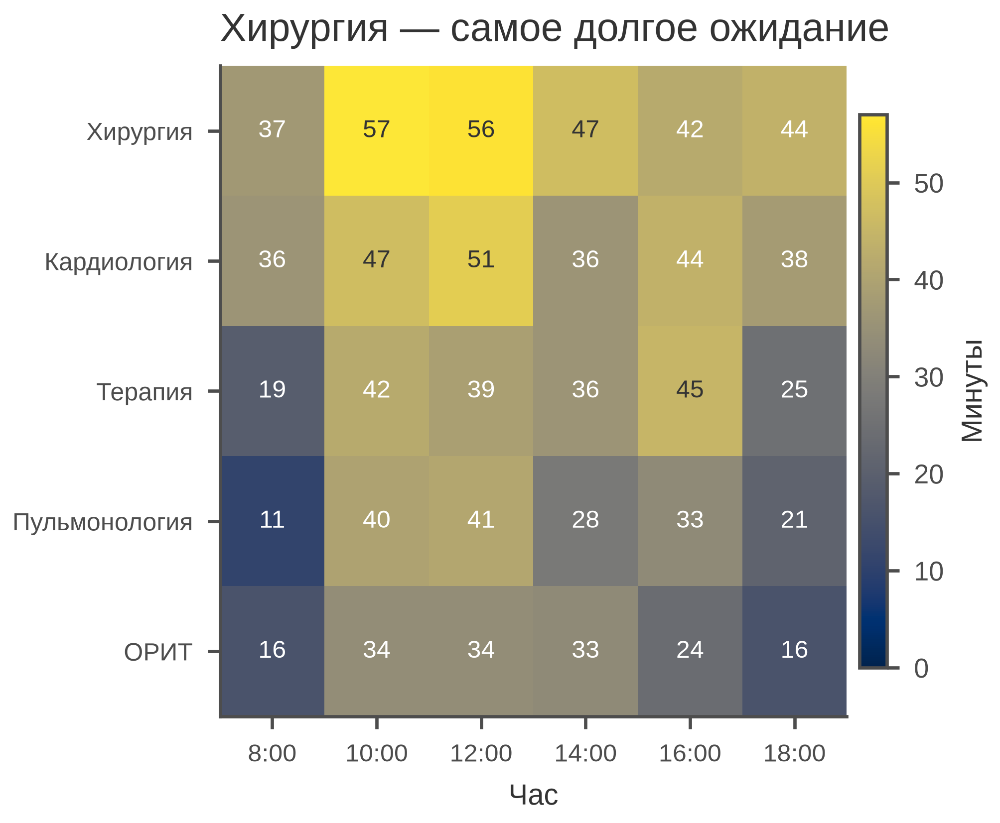

# 5.24 Heatmap: матрица значений

Heatmap кодирует значение цветом в сетке «строка × столбец». Он хорош
для матриц 5×5–50×50, но требует **упорядочивания**, **подписей** и
**colorbar**: иначе цвет не читается.

## 5.24.1 Сфера применения

- время ожидания по отделениям и часам;
- показатели по центрам и месяцам;
- матрица различий/ошибок;
- тепловая карта загрузки.

Не подходит: мало значений (bar), точное сравнение (таблица),
непрерывные двумерные данные (hexbin/contour).

## 5.24.2 Данные

5 отделений × 6 часов, среднее время ожидания (мин).

| Колонка | Смысл | Единица |
|---|---|---|
| `department` | отделение | — |
| `hour` | час | ч |
| `wait_min` | ожидание | мин |

Хирургия — самое долгое ожидание; пик — 10–12 часов.

Генератор: [`make_data.py`](scripts/make_data.py) → [`data/24_dataset.csv`](../../data/24_dataset.csv).

## 5.24.3 Плохой график



Код: [`bad_plot.py`](scripts/bad_plot.py).

Ошибки: `jet`, нет чисел в ячейках, нет единиц у colorbar, строки не
упорядочены, заголовок «Время ожидания» без вывода.

## 5.24.4 Правильный график



Код: [`good_plot.py`](scripts/good_plot.py).

Улучшения: `cividis`, значения в ячейках, colorbar «Минуты», строки
отсортированы по среднему, подписи часов, заголовок-вывод, 85 мм.

## 5.24.5 Чек-лист

- [ ] Строки/столбцы упорядочены осмысленно.
- [ ] Значения подписаны или есть colorbar с единицами.
- [ ] Палитра последовательная/дивергентная по смыслу.
- [ ] Нет `jet`.
- [ ] Указаны единицы и *n*.
- [ ] Ячейки не искажены (aspect auto/equal осознанно).
- [ ] Заголовок-вывод.
- [ ] Проверено в 85 мм.

## 5.24.6 Как воспроизвести

```bash
uv sync
uv run python 05_charts/24_heatmap/scripts/make_data.py
uv run python 05_charts/24_heatmap/scripts/bad_plot.py
uv run python 05_charts/24_heatmap/scripts/good_plot.py
```

## 5.24.7 Что дальше

5.25 Clustermap: heatmap с кластеризацией.

## Источники

- Wilke C. O. *Fundamentals of Data Visualization*. 2019. —
  [clauswilke.com/dataviz](https://clauswilke.com/dataviz/)
- Matplotlib: `imshow` —
  [matplotlib.org](https://matplotlib.org/stable/api/_as_gen/matplotlib.axes.Axes.imshow.html)
