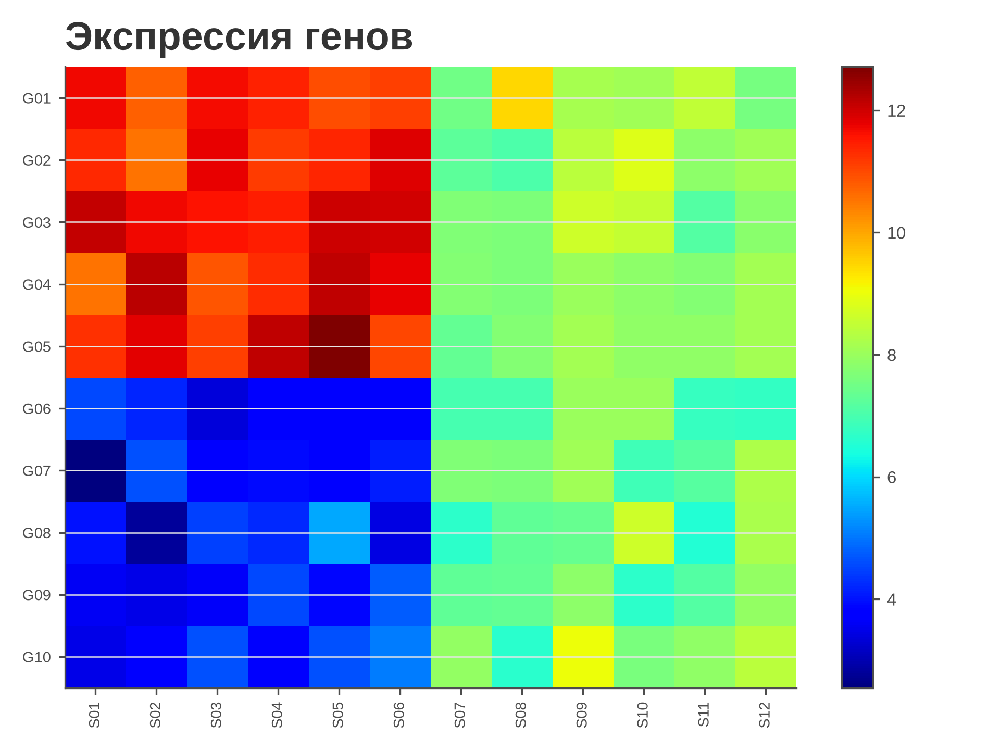
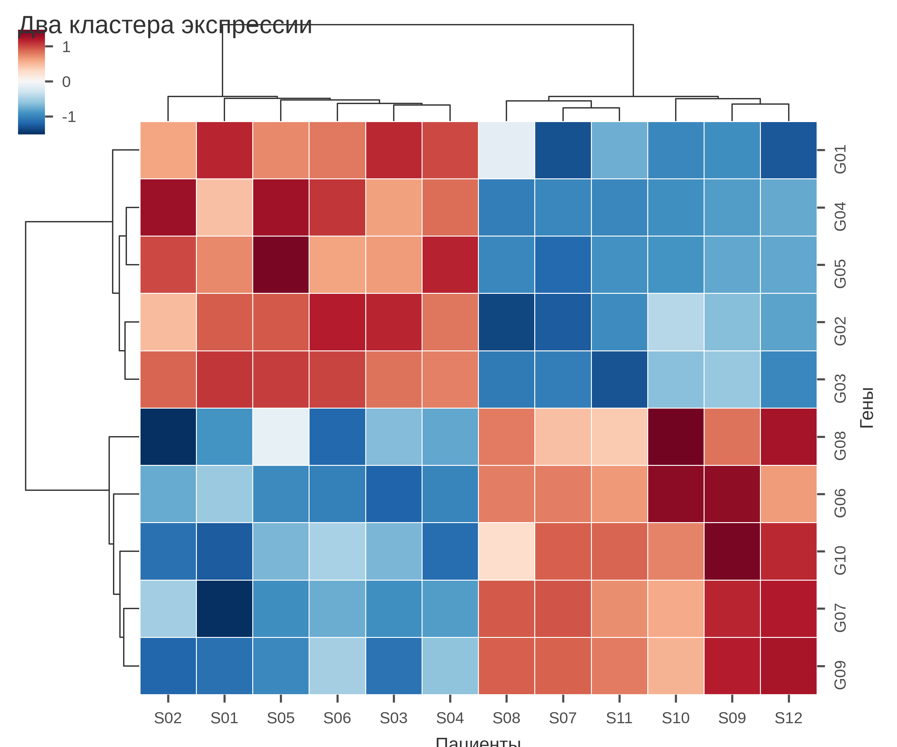

# 5.25 Clustermap: heatmap с кластеризацией

Clustermap — это heatmap, у которого строки и столбцы переставлены
иерархической кластеризацией. Он показывает блоки/кластеры, но
**не доказывает** их существование: дендрограмма — результат
выбранной метрики и linkage.

## 5.25.1 Сфера применения

- экспрессия генов;
- биомаркеры по пациентам;
- матрицы расстояний;
- поиск блоков в больших матрицах.

Не подходит: малые матрицы, точное сравнение, данные без смысла
кластеризации.

## 5.25.2 Данные

10 генов × 12 пациентов, экспрессия. Два кластера: G01–G05 выше
у S01–S06, G06–G10 — у S07–S12.

Генератор: [`make_data.py`](scripts/make_data.py) → [`data/25_dataset.csv`](../../data/25_dataset.csv).

## 5.25.3 Плохой график



Код: [`bad_plot.py`](scripts/bad_plot.py).

Ошибки: нет кластеризации, нет z-score, `jet`, нет дендрограмм,
цвет не отражает отклонение от среднего.

## 5.25.4 Правильный график



Код: [`good_plot.py`](scripts/good_plot.py).

Улучшения: z-score по генам, `RdBu_r` с центром 0, дендрограммы,
подписи, заголовок, 120 мм. Цвет — отклонение от среднего гена.

## 5.25.5 Чек-лист

- [ ] Понятно, что кластеризация — метод, а не истина.
- [ ] Указаны метрика/linkage или значение по умолчанию.
- [ ] z-score/нормировка осознанны.
- [ ] Палитра diverging с центром 0.
- [ ] Дендрограммы и подписи читаются.
- [ ] Нет `jet`.
- [ ] Указаны n и единицы.
- [ ] Проверено в 120 мм.

## 5.25.6 Как воспроизвести

```bash
uv sync
uv run python 05_charts/25_clustermap/scripts/make_data.py
uv run python 05_charts/25_clustermap/scripts/bad_plot.py
uv run python 05_charts/25_clustermap/scripts/good_plot.py
```

## 5.25.7 Что дальше

5.26 Corr matrix: корреляции.

## Источники

- Wilke C. O. *Fundamentals of Data Visualization*. 2019. —
  [clauswilke.com/dataviz](https://clauswilke.com/dataviz/)
- Seaborn: `clustermap` —
  [seaborn.pydata.org](https://seaborn.pydata.org/generated/seaborn.clustermap.html)
