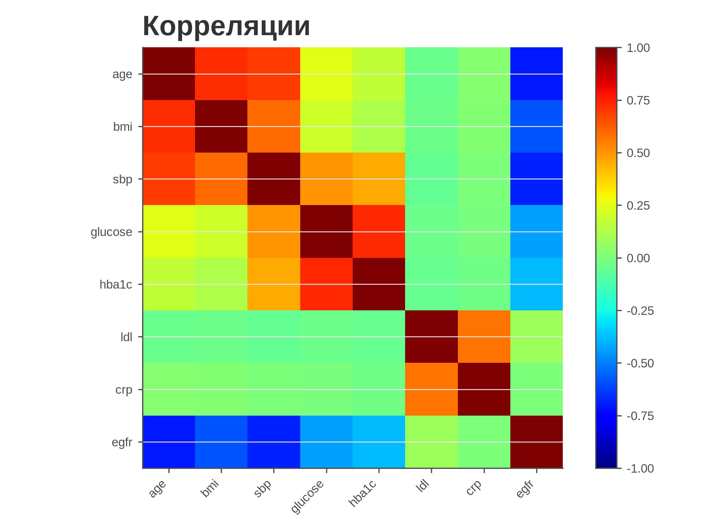
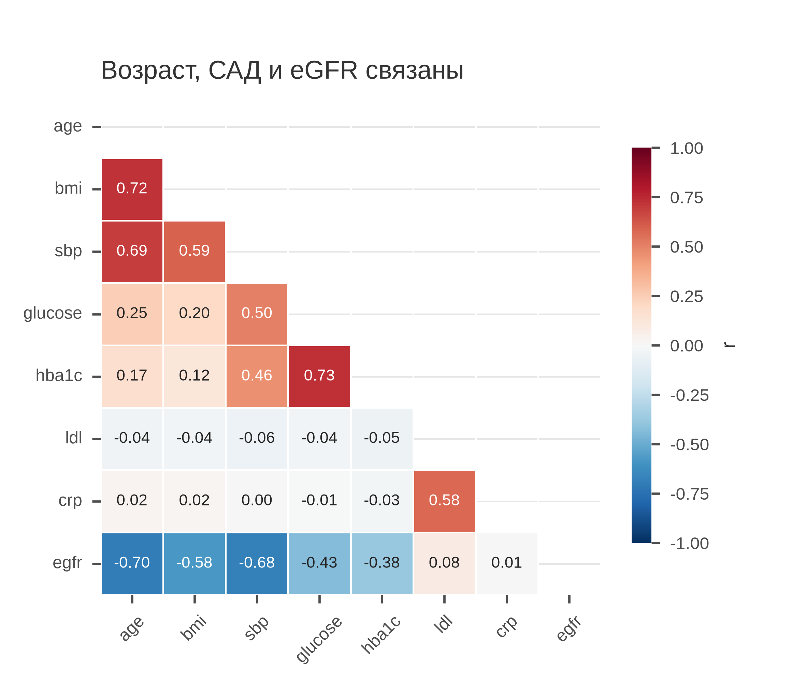

# 5.26 Corr matrix: корреляционная матрица

Корреляционная матрица показывает парные связи многих переменных.
Она полезна как **обзор**, но легко перегружается: верхний треугольник
дублирует нижний, а цвет без коэффициентов и шкалы −1…1 обманчив.

## 5.26.1 Сфера применения

- обзор корреляций 5–15 биомаркеров;
- проверка мультиколлинеарности;
- выбор переменных для модели;
- поиск блоков связанных признаков.

Не подходит: причинность, малые выборки, нелинейные связи,
много переменных (>20).

## 5.26.2 Данные

500 пациентов, 8 показателей: возраст, BMI, САД, глюкоза, HbA1c,
ЛПНП, СРБ, eGFR. Корреляции — Пирсона.

Генератор: [`make_data.py`](scripts/make_data.py) → [`data/26_dataset.csv`](../../data/26_dataset.csv).

## 5.26.3 Плохой график



Код: [`bad_plot.py`](scripts/bad_plot.py).

Ошибки: полная матрица с дублированием, `jet`, нет коэффициентов,
нет шкалы −1…1, заголовок «Корреляции».

## 5.26.4 Правильный график



Код: [`good_plot.py`](scripts/good_plot.py).

Улучшения: нижний треугольник, `RdBu_r` с центром 0 и границами
−1…1, коэффициенты в ячейках, цветbar «r», заголовок-вывод, 100 мм.

## 5.26.5 Чек-лист

- [ ] Показан только нижний/верхний треугольник.
- [ ] Шкала −1…1 и центр 0.
- [ ] Коэффициенты подписаны.
- [ ] Указан метод (Пирсон/Спирмен).
- [ ] Указаны n и единицы.
- [ ] Нет `jet`.
- [ ] Не интерпретируется как причинность.
- [ ] Проверено в 100 мм.

## 5.26.6 Как воспроизвести

```bash
uv sync
uv run python 05_charts/26_corr_matrix/scripts/make_data.py
uv run python 05_charts/26_corr_matrix/scripts/bad_plot.py
uv run python 05_charts/26_corr_matrix/scripts/good_plot.py
```

## 5.26.7 Что дальше

5.27 Kaplan–Meier: выживаемость.

## Источники

- Wilke C. O. *Fundamentals of Data Visualization*. 2019. —
  [clauswilke.com/dataviz](https://clauswilke.com/dataviz/)
- Seaborn: `heatmap` —
  [seaborn.pydata.org](https://seaborn.pydata.org/generated/seaborn.heatmap.html)