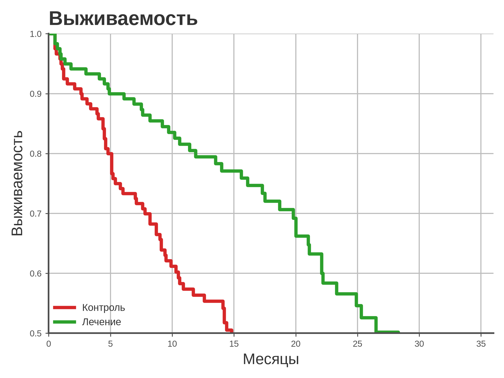
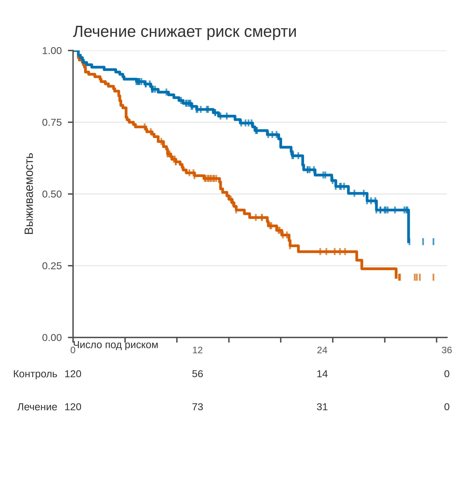

# 5.27 Kaplan–Meier: выживаемость

Кривая Каплана–Мейера показывает долю пациентов без события во времени
с учётом **цензурирования**. Это не доля выживших к фиксированному сроку:
кривая пересчитывается в каждом событии, а цензурированные пациенты
выходят из риска, не считаясь событиями.

## 5.27.1 Сфера применения

- время до смерти/рецидива/госпитализации;
- сравнение групп с цензурированием;
- оценка выживаемости к 12/24/36 месяцам;
- проверка пропорциональности рисков (лог-ранг).

Не подходит: нет цензурирования (ECDF), конкурирующие риски
(5.28), сравнение средних без времени.

## 5.27.2 Данные

240 пациентов, две группы по 120, наблюдение до 36 месяцев;
событие — смерть, остальные цензурированы.

| Колонка | Смысл |
|---|---|
| `group` | контроль/лечение |
| `time_months` | время наблюдения |
| `event` | 1 смерть, 0 цензурирование |

Генератор: [`make_data.py`](scripts/make_data.py) → [`data/27_dataset.csv`](../../data/27_dataset.csv).

## 5.27.3 Плохой график



Код: [`bad_plot.py`](scripts/bad_plot.py).

Ошибки: ось 0,5–1,0 скрывает половину кривых; нет меток
цензурирования, числа под риском, CI; радуга, тяжёлая сетка.

## 5.27.4 Правильный график



Код: [`good_plot.py`](scripts/good_plot.py).

Улучшения: полный диапазон 0–1, две группы, метки цензурирования,
таблица «число под риском» на 0/12/24/36, единицы, 95 мм.

## 5.27.5 Чек-лист

- [ ] Указано событие и цензурирование.
- [ ] Ось Y 0–1.
- [ ] Метки цензурирования.
- [ ] Число под риском по времени.
- [ ] Указаны n и единицы времени.
- [ ] Нет радуги/тяжёлой сетки.
- [ ] Лог-ранг/HR — если есть сравнение.
- [ ] Проверено в 95 мм.

## 5.27.6 Как воспроизвести

```bash
uv sync
uv run python 05_charts/27_kaplan_meier/scripts/make_data.py
uv run python 05_charts/27_kaplan_meier/scripts/bad_plot.py
uv run python 05_charts/27_kaplan_meier/scripts/good_plot.py
```

## 5.27.7 Что дальше

5.28 Cumulative incidence: конкурирующие риски.

## Источники

- Kaplan E. L., Meier P. Nonparametric Estimation from Incomplete
  Observations // *JASA*. 1958. —
  [doi:10.1080/01621459.1958.10501452](https://doi.org/10.1080/01621459.1958.10501452)
- Wilke C. O. *Fundamentals of Data Visualization*. 2019. —
  [clauswilke.com/dataviz](https://clauswilke.com/dataviz/)