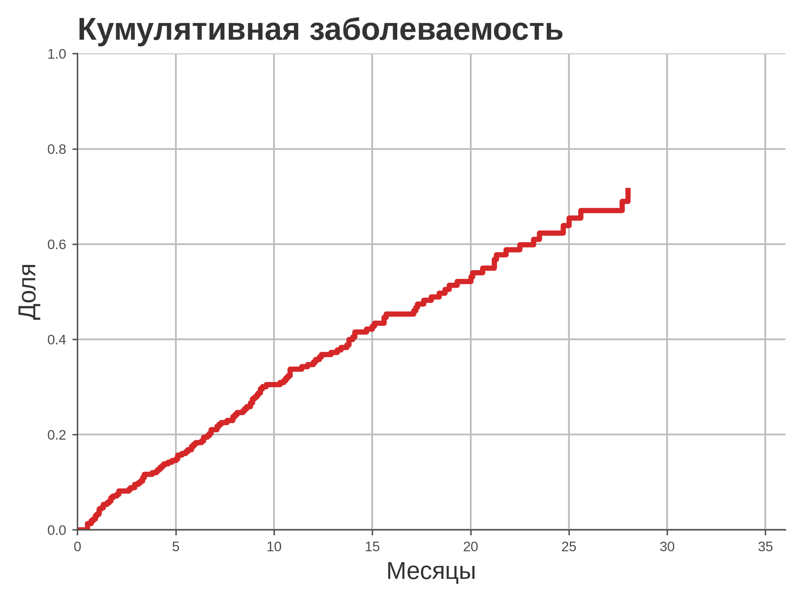
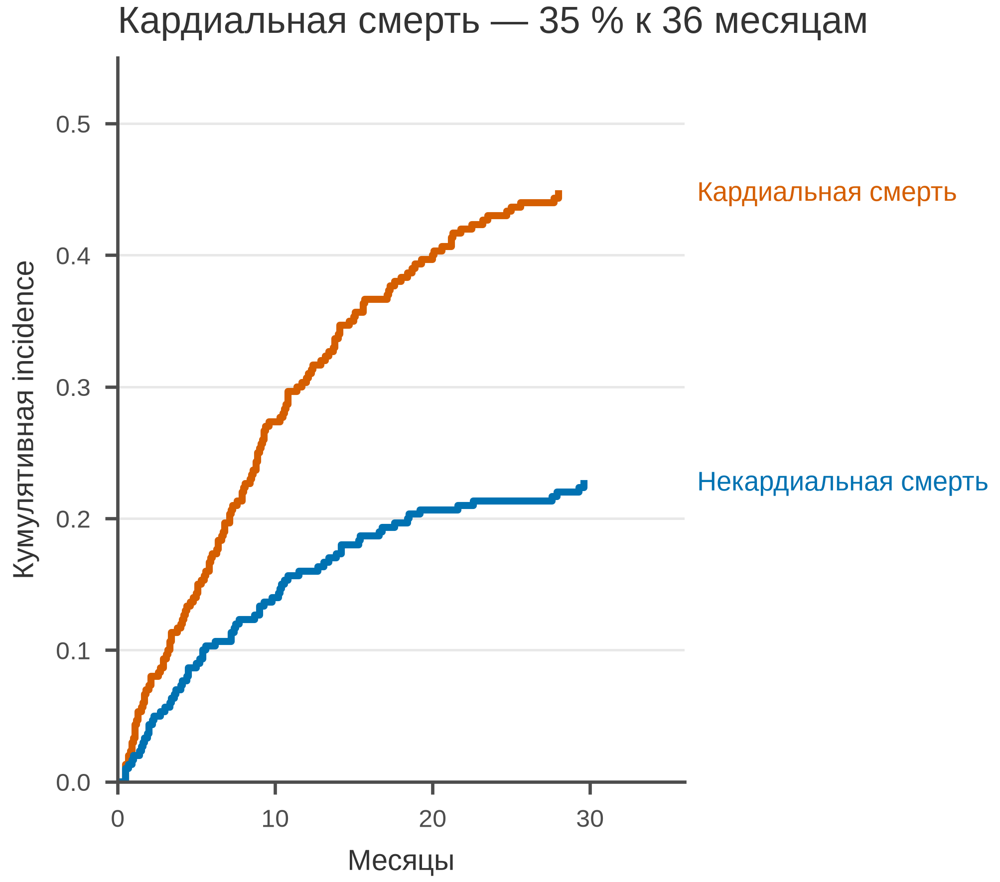

# 5.28 Cumulative incidence: конкурирующие риски

При конкурирующих рисках событие одного типа мешает событию другого.
Обычная 1 − KM завышает риск, если считать конкурирующее событие
цензурированием. Правильная оценка — кумулятивная заболеваемость
(Aalen–Johansen): суммируются cause-specific hazards с учётом общей
выживаемости.

## 5.28.1 Данные

300 пациентов, 36 месяцев; статус: 0 — цензурирован, 1 — кардиальная
смерть, 2 — некардиальная смерть.

Генератор: [`make_data.py`](scripts/make_data.py) → [`data/28_dataset.csv`](../../data/28_dataset.csv).

## 5.28.2 Плохой график



Код: [`bad_plot.py`](scripts/bad_plot.py).

Ошибки: конкурирующая смерть считается цензурированием; риск завышен;
нет второй кривой, n и единиц.

## 5.28.3 Правильный график



Код: [`good_plot.py`](scripts/good_plot.py).

Улучшения: две cause-specific CIF, общая выживаемость в знаменателе,
полный диапазон, прямые подписи, 85 мм.

## 5.28.4 Чек-лист

- [ ] Конкурирующие события не считаются цензурированием.
- [ ] Показаны все конкурирующие исходы.
- [ ] Ось 0–разумный максимум.
- [ ] Указаны n, время, единицы.
- [ ] Прямые подписи кривых.
- [ ] Нет 1 − KM как «заболеваемости».
- [ ] Проверено в 85 мм.

## 5.28.5 Как воспроизвести

```bash
uv sync
uv run python 05_charts/28_cumulative_incidence/scripts/make_data.py
uv run python 05_charts/28_cumulative_incidence/scripts/bad_plot.py
uv run python 05_charts/28_cumulative_incidence/scripts/good_plot.py
```

## 5.28.6 Что дальше

5.29 ROC-кривая.

## Источники

- Fine J. P., Gray R. J. A Proportional Hazards Model for the
  Subdistribution of a Competing Risk // *JASA*. 1999. —
  [doi:10.1080/01621459.1999.10474144](https://doi.org/10.1080/01621459.1999.10474144)
- Wilke C. O. *Fundamentals of Data Visualization*. 2019. —
  [clauswilke.com/dataviz](https://clauswilke.com/dataviz/)