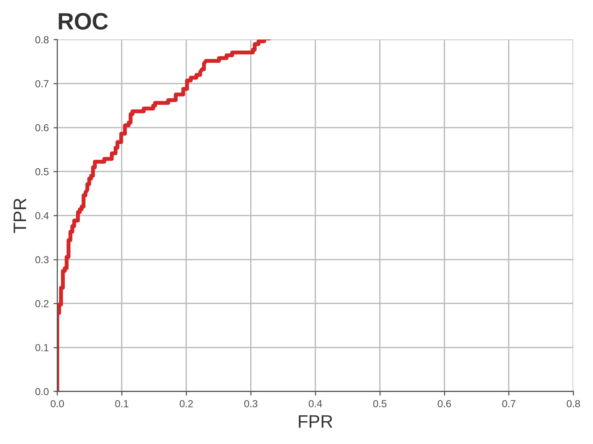
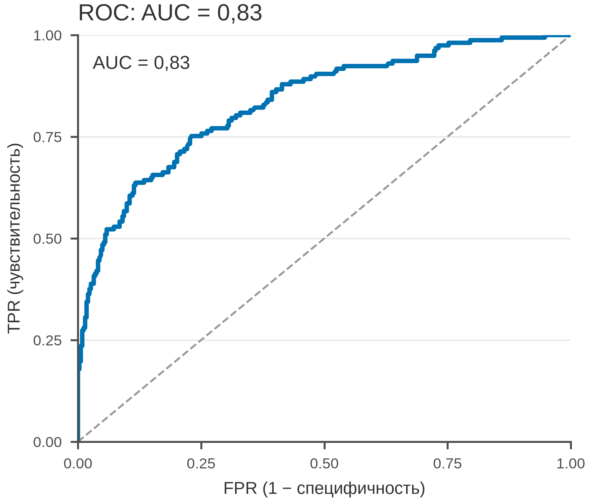

# 5.29 ROC: чувствительность и специфичность

ROC показывает компромисс TPR/FPR при всех порогах; AUC — площадь.
AUC 0,5 — случайность, 1 — идеал. ROC полезна для баланса классов,
но при редком исходе PR информативнее (5.30).

## 5.29.1 Данные

500 пациентов, score и бинарный исход; prevalence 31 %.

Генератор: [`make_data.py`](scripts/make_data.py) → [`data/29_dataset.csv`](../../data/29_dataset.csv).

## 5.29.2 Плохой график



Код: [`bad_plot.py`](scripts/bad_plot.py). Ошибки: обрезаны оси, нет
диагонали, AUC/n, тяжёлая сетка.

## 5.29.3 Правильный график



Код: [`good_plot.py`](scripts/good_plot.py). Диагональ, AUC 0,84,
оси 0–1, единицы, 85 мм.

## 5.29.4 Чек-лист

- [ ] Оси 0–1.
- [ ] Диагональ случайного классификатора.
- [ ] AUC и n.
- [ ] Указан порог/цель.
- [ ] Для редкого исхода — PR.

## 5.29.5 Как воспроизвести

```bash
uv sync
uv run python 05_charts/29_roc/scripts/make_data.py
uv run python 05_charts/29_roc/scripts/bad_plot.py
uv run python 05_charts/29_roc/scripts/good_plot.py
```

## 5.29.6 Что дальше

5.30 Precision–recall.

## Источники

- Fawcett T. An Introduction to ROC Analysis // *Pattern Recognition
  Letters*. 2006. — [doi:10.1016/j.patrec.2005.10.010](https://doi.org/10.1016/j.patrec.2005.10.010)