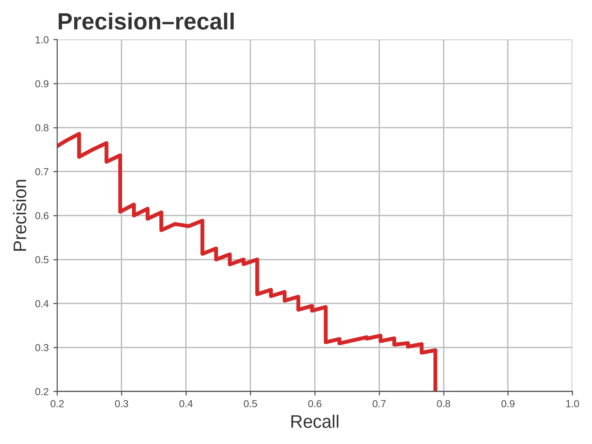
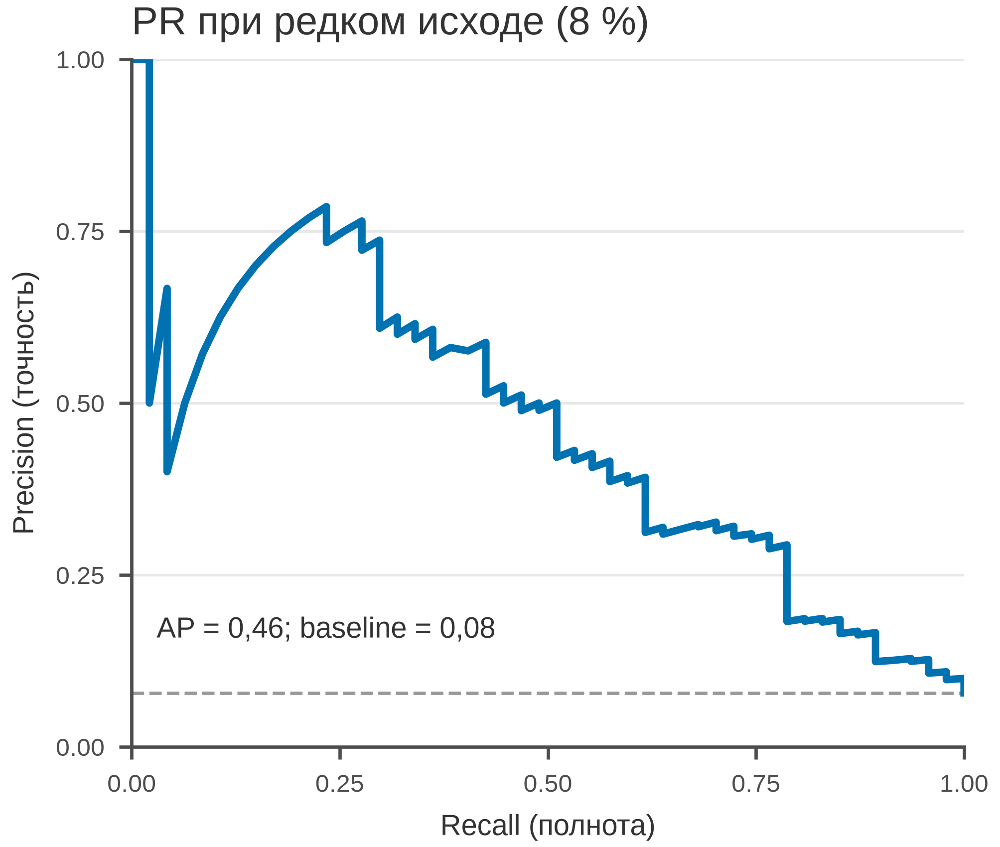

# 5.30 Precision–recall: редкий исход

При редком исходе ROC выглядит оптимистично: большое число TN маскирует
ложные срабатывания. PR-кривая показывает precision (сколько
предсказанных событий истинны) и recall (какую долю событий поймали).

## 5.30.1 Данные

600 пациентов, prevalence 8 %; score и событие.

Генератор: [`make_data.py`](scripts/make_data.py) → [`data/30_dataset.csv`](../../data/30_dataset.csv).

## 5.30.2 Плохой график



Код: [`bad_plot.py`](scripts/bad_plot.py). Ошибки: оси 0,2–1, нет
baseline prevalence, AP, n.

## 5.30.3 Правильный график



Код: [`good_plot.py`](scripts/good_plot.py). Baseline, AP 0,46,
оси 0–1, 85 мм.

## 5.30.4 Чек-лист

- [ ] Указана prevalence/baseline.
- [ ] Оси 0–1.
- [ ] AP или AUC-PR.
- [ ] n и событие.
- [ ] Для редкого исхода PR, не только ROC.

## 5.30.5 Как воспроизвести

```bash
uv sync
uv run python 05_charts/30_precision_recall/scripts/make_data.py
uv run python 05_charts/30_precision_recall/scripts/bad_plot.py
uv run python 05_charts/30_precision_recall/scripts/good_plot.py
```

## 5.30.6 Что дальше

5.31 Calibration.

## Источники

- Saito T., Rehmsmeier M. The Precision-Recall Plot Is More Informative
  than the ROC Plot // *PLoS ONE*. 2015. —
  [doi:10.1371/journal.pone.0118432](https://doi.org/10.1371/journal.pone.0118432)
