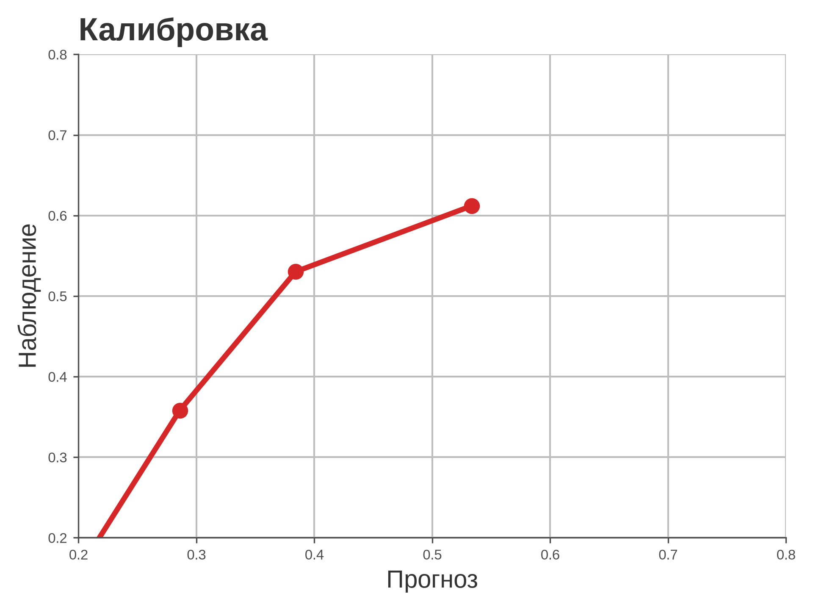
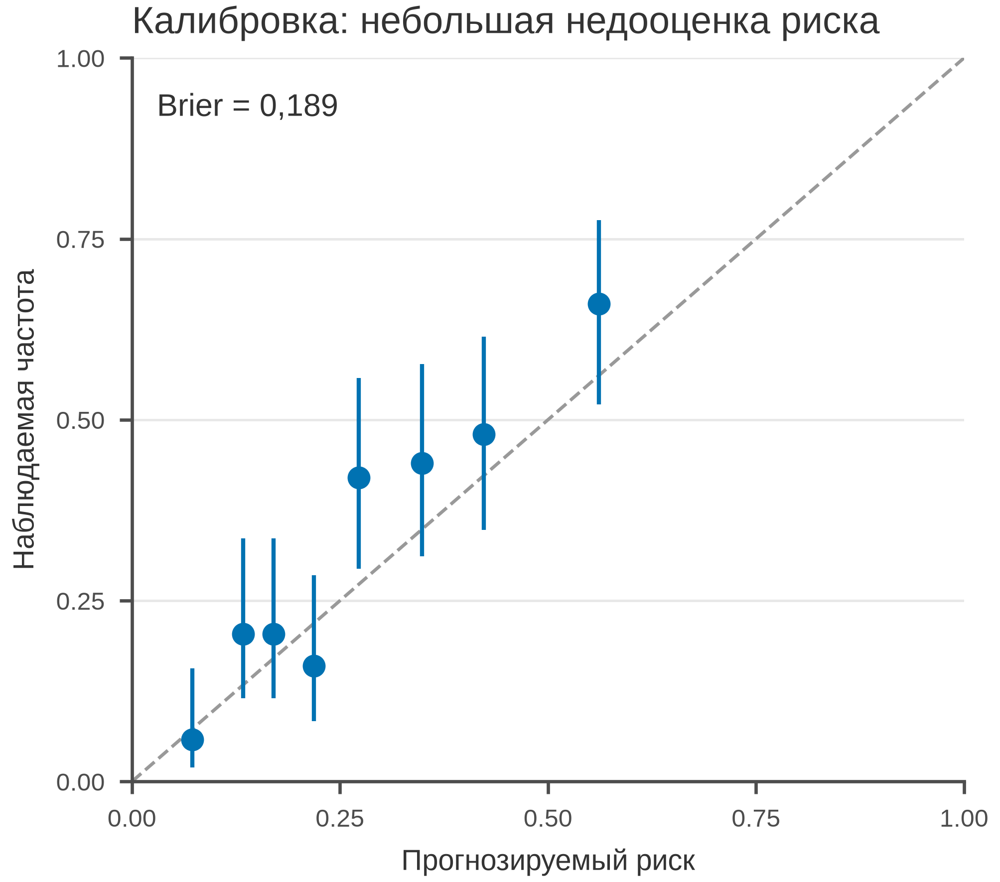

# 5.31 Calibration: соответствие прогноза и реальности

Калибровка отвечает: если модель говорит «риск 30 %», действительно ли
у 30 % наступает событие? ROC/AUC этого не показывают. Идеальная
калибровка — диагональ.

## 5.31.1 Данные

400 пациентов, прогнозируемый риск и бинарный исход; 8 бинов.

Генератор: [`make_data.py`](scripts/make_data.py) → [`data/31_dataset.csv`](../../data/31_dataset.csv).

## 5.31.2 Плохой график



Код: [`bad_plot.py`](scripts/bad_plot.py). Ошибки: оси 0,2–0,8, нет
диагонали, CI, Brier и n.

## 5.31.3 Правильный график



Код: [`good_plot.py`](scripts/good_plot.py). Диагональ, 8 бинов,
Wilson CI, Brier 0,19, 85 мм.

## 5.31.4 Чек-лист

- [ ] Диагональ идеальной калибровки.
- [ ] Бины и n.
- [ ] CI/uncertainty.
- [ ] Brier или calibration slope.
- [ ] Оси 0–1.
- [ ] Не путать с ROC/AUC.

## 5.31.5 Как воспроизвести

```bash
uv sync
uv run python 05_charts/31_calibration/scripts/make_data.py
uv run python 05_charts/31_calibration/scripts/bad_plot.py
uv run python 05_charts/31_calibration/scripts/good_plot.py
```

## 5.31.6 Что дальше

5.32 Caterpillar plot.

## Источники

- Van Calster B. et al. Calibration: the Achilles Heel of Predictive
  Analytics // *BMC Medicine*. 2019. —
  [doi:10.1186/s12916-019-1466-7](https://doi.org/10.1186/s12916-019-1466-7)
