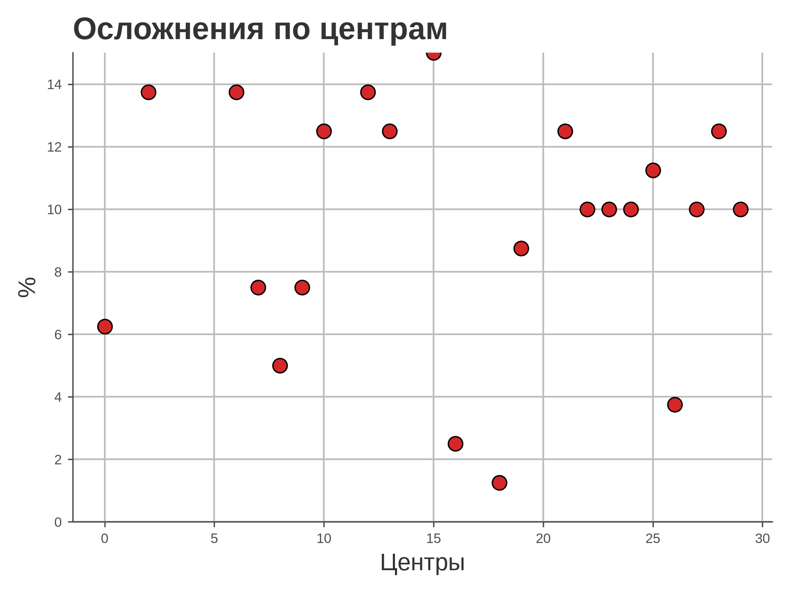
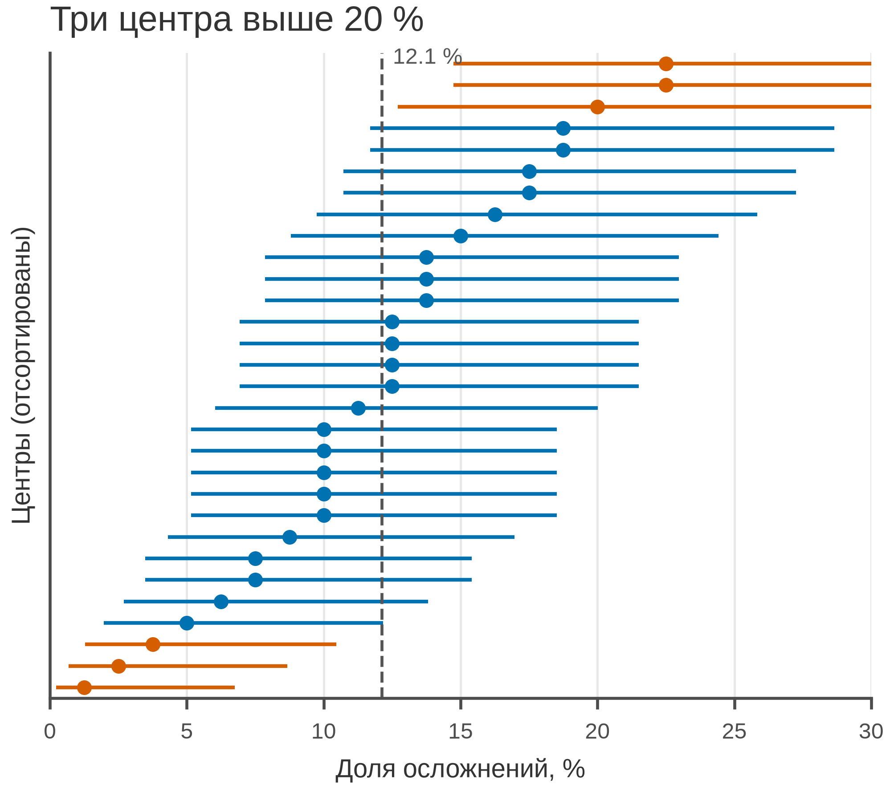

# 5.32 Caterpillar: упорядоченные оценки

Caterpillar plot — это точки оценок с доверительными интервалами,
отсортированные по величине. Он показывает и ранг, и точность:
нельзя сравнивать центры только по точке, если интервалы перекрываются.

## 5.32.1 Данные

30 центров, по 80 пациентов, осложнения. 95 % ДИ Уилсона.

Генератор: [`make_data.py`](scripts/make_data.py) → [`data/32_dataset.csv`](../../data/32_dataset.csv).

## 5.32.2 Плохой график



Код: [`bad_plot.py`](scripts/bad_plot.py). Ошибки: нет сортировки,
CI, общей линии, n; обрезанная ось.

## 5.32.3 Правильный график



Код: [`good_plot.py`](scripts/good_plot.py). Сортировка, 95 % CI,
общая линия, крайние центры акцентированы, 85 мм.

## 5.32.4 Чек-лист

- [ ] Сортировка по оценке.
- [ ] 95 % CI для каждой оценки.
- [ ] Общая/референсная линия.
- [ ] Указаны n и единицы.
- [ ] Пересечение CI не игнорируется.
- [ ] Крайние центры выделены осознанно.
- [ ] Проверено в 85 мм.

## 5.32.5 Как воспроизвести

```bash
uv sync
uv run python 05_charts/32_caterpillar/scripts/make_data.py
uv run python 05_charts/32_caterpillar/scripts/bad_plot.py
uv run python 05_charts/32_caterpillar/scripts/good_plot.py
```

## 5.32.6 Что дальше

5.33 Funnel plot.

## Источники

- Spiegelhalter D. J. Funnel Plots for Comparing Institutional Performance //
  *Statistics in Medicine*. 2005. —
  [doi:10.1002/sim.1970](https://doi.org/10.1002/sim.1970)