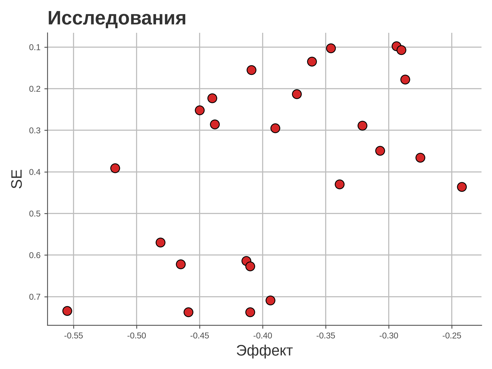
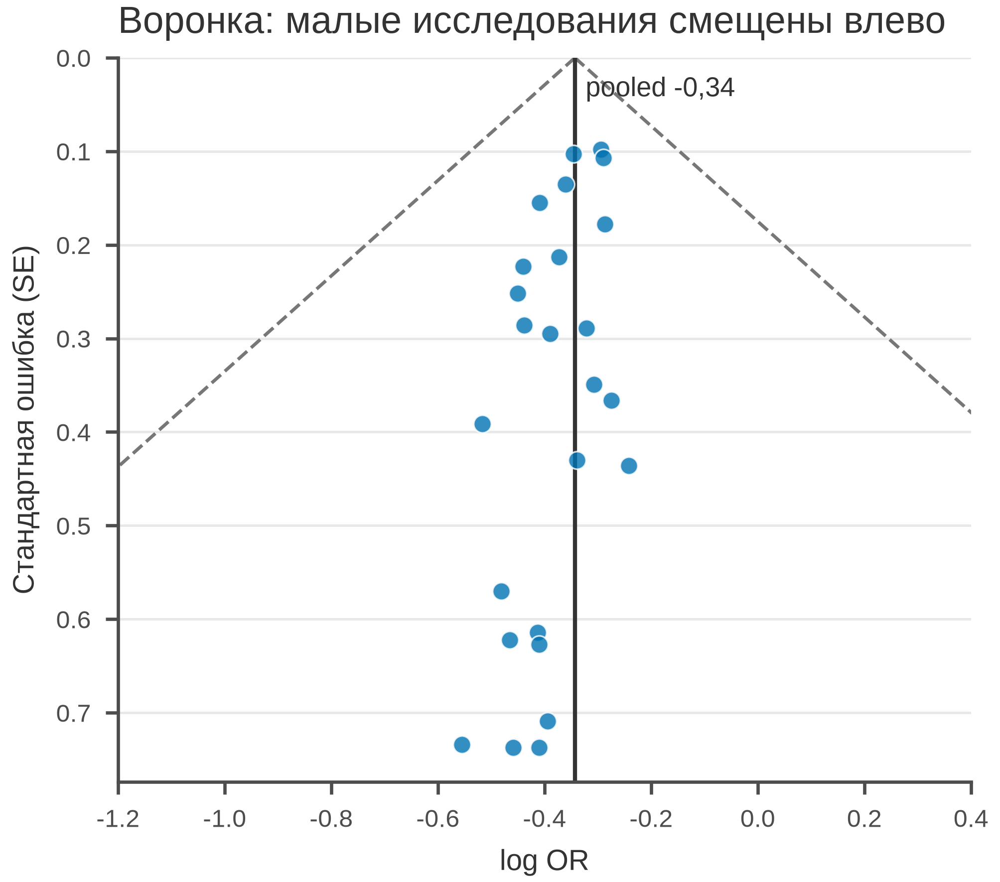

# 5.33 Funnel: асимметрия и малые исследования

Funnel plot показывает эффект против точности (SE). Воронка — 95 %
область вокруг pooled-эффекта. Асимметрия (малые исследования
«выпадают» из воронки) — сигнал publication bias / small-study effects.

## 5.33.1 Данные

25 исследований, log OR и SE.

Генератор: [`make_data.py`](scripts/make_data.py) → [`data/33_dataset.csv`](../../data/33_dataset.csv).

## 5.33.2 Плохой график



Код: [`bad_plot.py`](scripts/bad_plot.py). Ошибки: нет 95 % воронки,
pooled-линии, осей эффекта/SE, n.

## 5.33.3 Правильный график



Код: [`good_plot.py`](scripts/good_plot.py). Pooled, 95 % воронка,
SE по Y, точки, заголовок об асимметрии, 85 мм.

## 5.33.4 Чек-лист

- [ ] Эффект по X, SE/точность по Y (SE вниз).
- [ ] Pooled-эффект.
- [ ] 95 % воронка.
- [ ] Указаны k (число исследований).
- [ ] Асимметрия не подана как доказательство bias.
- [ ] Проверено в 85 мм.

## 5.33.5 Как воспроизвести

```bash
uv sync
uv run python 05_charts/33_funnel/scripts/make_data.py
uv run python 05_charts/33_funnel/scripts/bad_plot.py
uv run python 05_charts/33_funnel/scripts/good_plot.py
```

## 5.33.6 Итог раздела 5

Все 33 графика разобраны: данные → плохой пример → разбор →
правильный пример. Каждый — со своим генератором, датасетом,
SVG/PNG и Typst-дубликатом.

## Источники

- Egger M. et al. Bias in Meta-Analysis Detected by a Simple, Graphical
  Test // *BMJ*. 1997. —
  [doi:10.1136/bmj.315.7109.629](https://doi.org/10.1136/bmj.315.7109.629)
- Sterne J. A. C. et al. Recommendations for Examining and Interpreting
  Funnel Plot Asymmetry // *BMJ*. 2011. —
  [doi:10.1136/bmj.d4002](https://doi.org/10.1136/bmj.d4002)