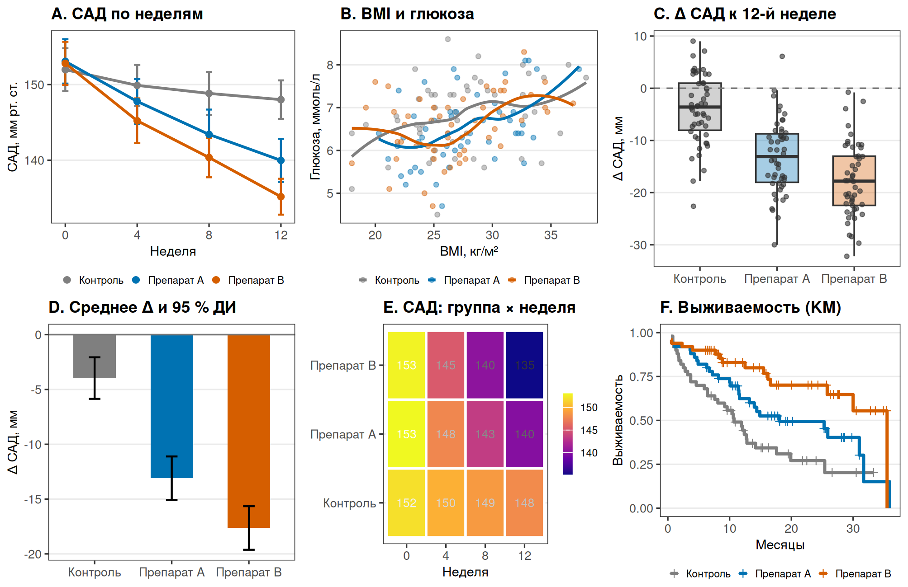
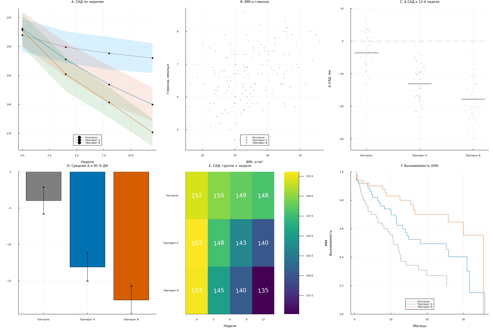
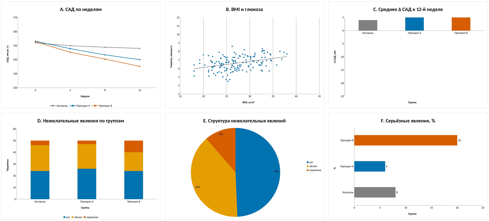

# 9. Приложения

R, Julia и электронные таблицы — краткий обзор и шесть графиков
в каждой среде.

Основная методичка построена на Python, но научная графика не начинается
и не заканчивается им. В приложениях — краткий обзор трёх сред, которые
часто оказываются под рукой: R, Julia и электронные таблицы. Чтобы
сравнение было честным, все три примера используют **один и тот же
учебный набор** `data/09_appendix_dataset.csv`: 150 пациентов, три
группы, САД на 0/4/8/12-й неделе, возраст, BMI, глюкоза, время до
события и категория нежелательного явления.

Это не учебники по R, Julia и Excel. Скорее — «карта входа»: какие
шесть графиков там делаются естественно, где начинаются ограничения и
что стоит автоматизировать, а что оставить руками.

## A. Системы моделирования и анализа

| Среда | Сильная сторона | Ключевые пакеты | Ограничения |
|---|---|---|---|
| **R** | статистика, bioconductor, ggplot2, отчётные пакеты | ggplot2, dplyr, tidyr, survival, gridExtra, rmarkdown | синтаксис непривычен после Python; скорость на больших данных ниже |
| **Julia** | скорость, типы, диффуры, большие массивы | Plots, DataFrames, CSV, DifferentialEquations, Makie | экосистема меньше; предкомпиляция и версии требуют дисциплины |
| **Excel / LibreOffice** | быстрый взгляд, таблицы, ручная правка, отчёты | встроенные диаграммы, сводные таблицы, условное форматирование | воспроизводимость, сложные статистические графики, контроль версий |
| **Python** | автоматизация, ML, интеграция | matplotlib, seaborn, plotnine, pandas, statsmodels | требует кода и настройки окружения |

**R** хорош там, где статистика уже живёт в R: модели, тесты,
выживаемость, мета-анализ. `ggplot2` задаёт грамматику слоёв и
облегчает faceting; `survival` и `gridExtra` закрывают KM и сборку
панелей. Слабое место — воспроизводимость проектов: версии пакетов
нужно фиксировать (`renv`), а не «у меня работает».

**Julia** выигрывает, когда важна скорость или математическая модель:
дифференциальные уравнения, оптимизация, большие массивы. `Plots`
даёт быстрый старт, `Makie` — более тонкий контроль. Плата — время
на предкомпиляцию и более молодой набор пакетов; проект лучше держать
в отдельном `Project.toml`/`Manifest.toml`.

**Excel/LibreOffice** незаменим для черновика, быстрой проверки и
разговора с коллегами, которые не пишут код. Но как только нужны
доверительные интервалы, KM, box plot с точками или единый стиль,
таблица начинает проигрывать скрипту. Хорошая стратегия — считать в
R/Julia/Python, а в Excel смотреть и обсуждать.

## B. Шесть графиков в R

Скрипт: [`09_appendices/r/six_plots.R`](r/six_plots.R). Пакеты:
`ggplot2`, `gridExtra`, `survival`. Запуск:

```bash
Rscript 09_appendices/r/six_plots.R
```



Что показано:

1. **Линия** — среднее САД по неделям с 95 % CI; группы различаются цветом.
2. **Scatter + LOESS** — BMI и глюкоза; точки полупрозрачны, шум не скрыт.
3. **Box + jitter** — индивидуальное изменение к 12-й неделе; видно разброс и выбросы.
4. **Столбцы с 95 % CI** — среднее изменение по группам, нулевая линия.
5. **Heatmap** — среднее САД по группе и неделе, значения в ячейках.
6. **Kaplan–Meier** — выживаемость с метками цензурирования, без «1 − KM».

Ключевой фрагмент:

```r
agg <- aggregate(sbp_mm_hg ~ group + week, df,
                 function(x) c(mean = mean(x), sd = sd(x), n = length(x)))
agg <- do.call(data.frame, agg); agg$ci <- 1.96 * agg$sd / sqrt(agg$n)

ggplot(agg, aes(week, mean, color = group)) +
  geom_errorbar(aes(ymin = mean - ci, ymax = mean + ci), width = 0.35) +
  geom_line() + geom_point() +
  scale_color_manual(values = c("#7F7F7F", "#0072B2", "#D55E00")) +
  labs(x = "Неделя", y = "САД, мм рт. ст.")
```

Сильные места R здесь — `geom_ribbon`/`geom_errorbar`, `facet_wrap`,
`survival::survfit` и `gridExtra` для панелей. Слабые — необходимость
помнить про факторы, порядок уровней и `stringsAsFactors`; в R 4.x
последнее уже не так болезненно.

## C. Шесть графиков в Julia

Скрипт: [`09_appendices/julia/six_plots.jl`](julia/six_plots.jl).
Проект: [`09_appendices/julia_env/`](julia_env/). Запуск:

```bash
JULIA_DEPOT_PATH="$PWD/.julia:$HOME/.julia" \
julia --project=09_appendices/julia_env 09_appendices/julia/six_plots.jl
```



Что показано:

1. **Линия + ribbon** — среднее САД и 95 % CI; `ribbon` рисует полосу.
2. **Scatter** — BMI и глюкоза, цвет по группе; без ложного сглаживания.
3. **Точки + медиана** — индивидуальные изменения и медиана группы.
4. **Столбцы с ошибками** — среднее изменение и 95 % CI.
5. **Heatmap** — среднее САД, значения подписаны.
6. **Kaplan–Meier** — шаговая выживаемость по группам.

Ключевой фрагмент:

```julia
using Plots, DataFrames, CSV, Statistics
df = CSV.read("data/09_appendix_dataset.csv", DataFrame)
agg = combine(groupby(df, [:group, :week]),
              :sbp_mm_hg => mean => :mean,
              :sbp_mm_hg => std => :sd,
              :sbp_mm_hg => length => :n)
agg.ci = 1.96 .* agg.sd ./ sqrt.(agg.n)

plot(agg.week, agg.mean, group = agg.group, ribbon = agg.ci,
     marker = :circle, linecolor = [:gray, :blue, :orange])
```

Julia требует больше дисциплины к окружению: отдельный проект,
`Manifest.toml`, предкомпиляция. Зато `Plots`/`Makie` хорошо ложатся
на большие массивы и математические модели; для интерактивных
отчётов чаще берут Makie или связку с Python.

## D. Шесть графиков в Excel / LibreOffice

Книга: [`09_appendices/excel/make_workbook.py`](excel/make_workbook.py)
собирает `.xlsx` с шестью листами-графиками; данные лежат на скрытых
листах. Запуск:

```bash
uv run python 09_appendices/excel/make_workbook.py
```



Что показано:

1. **Линия** — среднее САД по неделям, три серии, ось 120–170.
2. **Scatter** — BMI и глюкоза, линейный тренд, без соединительных линий.
3. **Столбцы** — среднее изменение САД по группам, нулевая линия.
4. **Stacked columns** — нежелательные явления по группам.
5. **Pie** — структура явлений, 3 доли, проценты.
6. **Bar** — доля серьёзных явлений по группам, значения подписаны.

В Excel это делается через **Вставка → Диаграмма**:

| График | Тип Excel | Настройки |
|---|---|---|
| Линия | Line | без 3D, маркеры, ось Y 120–170 |
| Scatter | XY (Scatter) | только маркеры, линейный тренд |
| Столбцы | Column | нулевая линия, ось Y −25…5 |
| Stacked | Stacked Column | 100 % перекрытие, 3 серии |
| Pie | Pie | 3 доли, проценты, без 3D |
| Bar | Bar | горизонтально, значения, ось 0–30 |

Excel силён в простых формах и быстрой правке. Но у него нет
нормального box plot с точками, KM и heatmap «из коробки»; для
них нужны надстройки, Python/R или ручная сборка. Плюс версии
файла и «ручные» правки плохо проверяются в ревью — поэтому
книгу лучше генерировать скриптом, а не править мышью.

## E. Что выбрать

- **R** — если статистика, модели и отчёт уже в R; ggplot2 + survival.
- **Julia** — если важны скорость, типы и математическая модель.
- **Excel** — если нужен быстрый черновик, таблица или разговор с
  коллегами; для финальных журнальных рисунков — редко.
- **Python** — если нужен единый пайплайн «данные → рисунки → PDF»
  и автоматическая проверка, как в этой методичке.

Хорошая практика — не выбирать «одну среду навсегда», а разделять:
расчёт в R/Julia/Python, просмотр в Excel, финальная вёрстка в
Typst/LaTeX/Illustrator. Тогда сильные стороны каждой среды работают
на результат, а не спорят друг с другом.

## F. Перенос графика между средами

При переносе одного и того же рисунка из R в Julia, из Julia в Excel
или из любой среды в журнал проверяйте не «похожесть картинки», а
инварианты:

| Что проверить | Почему это важно |
|---|---|
| Уровни групп и порядок | R и Julia по-разному сортируют факторы; порядок меняет легенду и цвета |
| Неделя как число | В Excel дата/текст легко превращается в категорию |
| Пропуски | `NA`, `missing` и пустая ячейка — разные вещи |
| Определение CI | 95 % CI среднего, Уилсона или бутстрэп — не взаимозаменяемы |
| Шрифт и кириллица | Проверяйте встраивание и наличие глифов в PDF |
| Размер в мм | 85/170 мм, а не «по ширине окна» |
| Цвет и печать | CVD, серый, белый фон, 3:1 для линий |
| Версии и seed | Без фиксации версий и seed рисунок не воспроизводится |

Практический минимум: сохраните исходные данные, скрипт, версии
пакетов и финальный PDF/SVG. Excel-файл без скрипта — это не
воспроизводимый артефакт, а иллюстрация.

## Источники

- R Core Team. *R: A Language and Environment for Statistical Computing*. —
  [r-project.org](https://www.r-project.org/)
- Wickham H. *ggplot2: Elegant Graphics for Data Analysis*. 3rd ed., Springer, 2024. —
  [ggplot2.tidyverse.org](https://ggplot2.tidyverse.org/)
- Therneau T. *A Package for Survival Analysis in R*. —
  [cran.r-project.org](https://cran.r-project.org/package=survival)
- Julia Language. *Documentation*. — [docs.julialang.org](https://docs.julialang.org/)
- Plots.jl. *Documentation*. — [docs.juliaplots.org](https://docs.juliaplots.org/)
- Microsoft. *Create a chart from start to finish*. —
  [support.microsoft.com](https://support.microsoft.com/en-us/office/create-a-chart-from-start-to-finish-0baf399e-dd61-4e18-8a73-b3fd5d5680c2)
- LibreOffice. *Charts*. — [help.libreoffice.org](https://help.libreoffice.org/latest/en-US/text/shared/guide/chart_insert.html)
